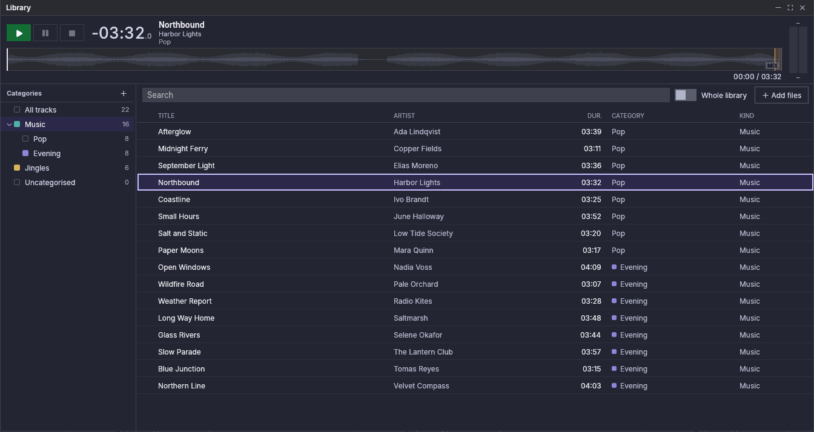

# Biblioteca

La biblioteca és el conjunt de pistes que Fauste Player coneix: cada fitxer que
has afegit a una llista, a un cartutx o a la mateixa biblioteca és una pista,
amb les seves etiquetes, marcadors i ajustos de sonoritat. La finestra de la
biblioteca les llista, les agrupa en *categories*, les troba per text i les
envia a les llistes i a la cartutxera. A l'escriptori i a una tauleta és una
finestra; un mòbil mostra la biblioteca a la pestanya **Biblioteca** (vegeu
[En un mòbil](#on-a-phone)).

## Obrir la finestra {#opening-the-window}

Fes clic al mosaic **Biblioteca** de la barra superior. Està il·luminat mentre
la finestra és oberta; fes-hi clic de nou, o al botó de tancar de la finestra,
per tancar-la. La finestra flota sobre els reproductors i la cartutxera i no
els bloqueja: res del que hi ha dins atura l'àudio ni les dreceres de la
finestra principal.

Mou-la per la barra de títol i canvia'n la mida des de les vores i les
cantonades. La barra de títol té tres botons: **Minimitza** (només queda la
barra de títol, on era la finestra, o a la part superior de l'àrea principal
quan la finestra està maximitzada; fes-hi clic de nou per desplegar-la),
**Maximitza** (la finestra omple l'àrea principal; **Restaura** la torna com
estava) i **Tanca**. Una finestra que no hi cabria, després que la finestra
principal s'encongeixi o es mogui a una pantalla més petita, es torna a posar
dins de l'àrea principal.

La posició i la mida de la finestra, l'estat de minimitzada o maximitzada,
l'amplada de l'arbre, les columnes, l'ordre i la categoria seleccionada es
desen amb la sessió i tornen a l'inici següent. També es desa si la finestra
és oberta, però per això no sona res per si sol. El text del camp de cerca no
es desa.

## Categories {#categories}

L'arbre de l'esquerra agrupa les pistes. A dalt, **Totes les pistes**; després
les teves categories, que poden contenir subcategories; al final, **Sense
categoria**, les pistes que no pertanyen a cap categoria. Cada element mostra
el seu color i un recompte: una categoria compta les seves pistes i les de les
seves subcategories. Una pista pertany com a màxim a una categoria.

- **Fes clic** en un element per llistar-ne les pistes a la taula. Una
  categoria també llista les pistes de les seves subcategories.
- La **fletxa** abans d'una categoria obre o tanca les seves subcategories.
  Es desa quines són obertes.
- **Nova categoria** (＋ sobre l'arbre) demana un nom, un color i un *tipus*.
  Una categoria nova pren el color i el tipus de la categoria on es crea; el
  tipus és el que una pista pren quan s'uneix a la categoria, i canviar-lo
  després deixa com estan les pistes que ja hi són. Un nom no pot estar buit
  ni repetir el d'una germana; les categories només es poden niar fins a un
  límit.
- **Clic dret** en una categoria (o pulsació llarga en una pantalla tàctil)
  per a **Nova subcategoria…**, **Canvia el nom…**, **Color**, **Tipus** i
  **Elimina…**. A l'escriptori el menú també té **Vigila una carpeta…**
  (**Canvia la carpeta vigilada…** i **Deixa de vigilar la carpeta** quan ja
  en vigila una) i **Treu les pistes que falten…**; vegeu [Carpetes
  vigilades](#watched-folders) i [Treure pistes](#removing-tracks).
- **Arrossega** una categoria per moure-la: sobre una altra categoria per
  niar-la-hi, o a l'espai entre dues categories per col·locar-la allà. Una
  categoria no pot anar dins d'ella mateixa. En una pantalla tàctil l'arbre
  només accepta toccs i es desplaça amb un dit; no s'hi pot arrossegar una
  categoria.

**Elimina…** diu què se'n va amb la categoria: les seves subcategories i totes
les pistes que contenen es treuen de la biblioteca. Els fitxers no s'esborren
mai. Si alguna d'aquestes pistes s'utilitza, una segona pregunta diu quantes
entrades de llistes i quants cartutxos les fan servir: **Treu igualment** treu
les entrades de les seves llistes i buida els cartutxos. No es treu res mentre
alguna estigui en antena; un avís diu què sona.

El mateix arbre és a **Configuració → Biblioteca**, per crear, canviar el nom,
canviar el color, canviar el tipus, moure i eliminar categories sense obrir la
finestra (no té *Totes les pistes*, *Sense categoria* ni selecció).

## Carpetes vigilades {#watched-folders}

A l'escriptori una categoria pot vigilar una carpeta. Fes-hi clic dret i
tria **Vigila una carpeta…**, i després la carpeta. La categoria mostra una
marca ⟳ abans del seu recompte; passa-hi el cursor per llegir la carpeta.

- Tots els fitxers d'àudio de la carpeta i de les seves subcarpetes s'uneixen
  a la categoria. Les subcarpetes no creen subcategories.
- Una pista que ja és en una altra categoria hi continua. Una pista que no és
  en cap categoria s'uneix a aquesta. Establir, canviar o deixar de vigilar
  una carpeta mai no mou cap pista: les pistes d'una carpeta que ja no es
  vigila es queden a la seva categoria.
- Mentre l'aplicació s'executa, la carpeta se segueix: un fitxer nou
  s'uneix quan ha estat quiet un moment (`library.watch_debounce_ms`, 1
  segon per defecte, de manera que un fitxer que encara es copia no es llegeix
  a mitges). La carpeta també s'escaneja cada cop que l'aplicació s'inicia,
  per detectar què ha canviat mentre estava tancada.
- Un fitxer que desapareix de la carpeta (esborrat, mogut o reanomenat) deixa
  la seva pista a la biblioteca, marcada com a absent, amb els seus
  marcadors. Si el fitxer torna, la pista torna a ser normal per si sola. Un
  fitxer reanomenat s'uneix com una pista nova amb el seu nom nou.
- Les carpetes vigilades es poden niar. Un fitxer sota dues d'elles va a la
  categoria de la més interna; deixar de vigilar-ne una deixa l'altra
  seguida. La mateixa carpeta no la poden vigilar dues categories:
  l'aplicació diu quina categoria ja la té.
- Res del que fa una carpeta vigilada carrega ni reprodueix una pista.

Si la carpeta no es pot seguir, la marca ⟳ canvia de color i el seu consell
diu per què: *No es troba la carpeta vigilada: …. Es torna a buscar.* (per
exemple una unitat que no és muntada), *No es pot llegir la carpeta vigilada:
…. Es torna a provar.*, o *Els canvis a … no se segueixen; es revisa a l'inici
i es torna a provar.* (el sistema ha refusat vigilar-la). Una carpeta desada
com un camí que no és complet (editat a mà) no es vigila en absolut, i la marca
ho diu.

Cada 30 segons (`tuning.missing_recheck_ms`) l'aplicació comprova que cada
carpeta vigilada continua allà, de manera que també s'informa d'una unitat
desconnectada mentre s'executa. Una carpeta amb problemes es torna a provar a
aquest ritme i s'escaneja tan bon punt torna. Una carpeta que no hi és, que no
es pot llegir, o que és buida mentre la biblioteca encara té pistes seves (una
unitat o un recurs compartit que no és muntat sovint sembla una carpeta buida)
compta com a no trobada. Llavors la vigilància no marca com a absent cap de
les seves pistes i no en treu cap, també quan la carpeta és dins d'una altra
carpeta vigilada.

Si buides una carpeta vigilada a propòsit, l'avís continua fins que hi tornin
fitxers o deixis de vigilar-la, i les seves pistes es queden a la biblioteca
sense marcar-se com a absents. Per netejar-les, selecciona-les a la taula i
tria **Treu de la biblioteca…**, o tria **Tornar a analitzar** en elles:
l'anàlisi marca com a absents les pistes el fitxer de les quals ha
desaparegut, i després **Treu les pistes que falten…** les treu (si la carpeta
encara es vigila, el seu avís s'esborra a la comprovació següent).

Una excepció a la regla anterior: una pista que no s'ha analitzat mai es marca
igualment com a absent quan l'anàlisi no en troba el fitxer, sigui on sigui.

Una subcarpeta que no es pot llegir s'omet i el registre ho diu; els enllaços
a carpetes (enllaços simbòlics a carpetes) no se segueixen.

Els fitxers nous van a l'anàlisi darrere de tot el que un reproductor o un
cartutx necessiti, de manera que una carpeta amb milers de fitxers triga una
estona; el progrés de l'anàlisi ho mostra.

El mateix menú i la mateixa marca són a **Configuració → Biblioteca**. No són a
Android, que no vigila carpetes: allà una categoria pot prendre els seus
fitxers d'una carpeta del dispositiu que tornes a llegir quan tries (vegeu
[Android → Biblioteca](android.md#library)).

## La taula de pistes {#the-track-table}

La taula llista les pistes de l'element seleccionat, amb les mateixes columnes
que les taules de les llistes (les triades a **Configuració → Llistes →
Columnes de la taula**, sense la posició `#`) seguides de **Categoria** i
**Tipus**. Una cel·la estreta a l'esquerra assenyala una pista el fitxer de la
qual és absent o no es pot llegir. Una pista que espera la seva anàlisi
s'assenyala a la dreta de la seva cel·la **Títol** (de manera que només quan
la columna Títol es mostra).

- Arrossega el separador d'una capçalera per canviar l'amplada d'una columna;
  fes clic en una capçalera per ordenar-hi i de nou per invertir l'ordre.
  S'en desen les amplades i l'ordre.
- **Clic** selecciona una fila, **Ctrl** (**Cmd** a macOS) **clic** n'afegeix o
  en treu una, **Maj clic** selecciona les files entre l'últim clic i aquest.
  La selecció només conserva files que són llistades: una fila que surt de la
  taula, per una cerca, una altra categoria o una eliminació, surt de la
  selecció. Cada acció s'aplica a les files seleccionades en l'ordre de la
  taula.
- **Afegeix fitxers** (sobre la taula) tria fitxers d'àudio i els afegeix a la
  biblioteca, a la categoria seleccionada (sense categoria quan hi ha
  seleccionat *Totes les pistes* o *Sense categoria*).

En una pantalla tàctil les files només accepten toccs i es desplacen amb un
dit; una pulsació llarga obre el menú, i les pistes s'envien amb els menús
(més avall), no arrossegant-les.

## Cerca {#search}

El camp sobre la taula troba pistes per text. Mira al títol, artista, àlbum,
artista de l'àlbum, compositor, gènere, comentari i nom del fitxer, ignorant
majúscules i accents, i una pista es llista quan conté totes les paraules que
has escrit (en qualsevol ordre i en qualsevol d'aquests camps). Cerca a
l'element seleccionat; activa **Tota la biblioteca** per cercar totes les
pistes sigui quina sigui la selecció. L'abast es desa; el text no. Esborra el
camp per tornar a veure tot l'element.

## El menú de la fila {#the-row-menu}

Fes clic dret en una fila. Si la fila no és seleccionada, es converteix en la
selecció; altrament el menú actua sobre totes les files seleccionades. La
primera línia mostra el títol de la pista quan el menú és per a una pista, i
quantes pistes hi ha seleccionades quan és per a diverses.

| Element | Acció |
|---|---|
| Afegeix a ▸ | Una llista: les pistes s'afegeixen al seu final |
| Afegeix a un cartutx ▸ | Un cartutx de la pàgina que mostra la cartutxera: les pistes omplen el cartutx triat i els propers cartutxos buits de la pàgina, en l'ordre de la graella. Les pistes que no hi caben es deixen fora i un avís les compta |
| Mou a la categoria ▸ | Una categoria, o Sense categoria |
| Tipus ▸ | Música, Jingle, Efecte, Anunci o Veu |
| Editar les etiquetes… | L'editor d'etiquetes (una pista) |
| Sonoritat… | La finestra de sonoritat (una pista) |
| Tornar a analitzar | Analitza de nou les pistes |
| Tornar als marcadors automàtics | Descarta els marcadors manuals |
| Mostra la ubicació del fitxer | Obre la carpeta del fitxer (una pista) |
| Treu de la biblioteca… | Treu les pistes de la biblioteca, després de preguntar (més avall) |

## Preescolta {#pre-listening}

La barra sota la barra de títol preescolta la pista seleccionada a la sortida
**Biblioteca** pròpia de la biblioteca (triada a [Configuració → Sortides
d'àudio](settings.md#audio-outputs)), per exemple uns auriculars. Un mòbil
preescolta des de la seva llista de pistes (vegeu [En un
mòbil](#on-a-phone)).

La barra mostra:

- **Preescolta**, **Posa en pausa la preescolta** i **Atura la preescolta**;
- el temps restant de la pista en gran, el seu títol, artista i categoria;
- un petit mesurador a la dreta. Només llegeix aquesta preescolta, mai el
  mesurador d'un reproductor ni el de la cartutxera; fes-hi clic per
  reiniciar-ne el màxim;
- la forma d'ona de tot el fitxer, amb els seus marcadors, i una línia
  `transcorregut / total` a sota.

Preescolta inicia la pista seleccionada des del seu cue-in i la reprodueix
fins al final del fitxer. Preescolta en una preescolta en pausa la reprèn, i
Preescolta en una que sona no fa res: Atura la preescolta i després
Preescolta torna a començar des del cue-in. La normalització de la sonoritat
s'aplica com al CUE d'un reproductor.

La forma d'ona funciona com a la finestra CUE d'un reproductor: fes-hi clic
per saltar (un clic o deixar anar el ratolí salta; arrossegar no), amplia-la i
desplaça-la amb la roda, i edita els marcadors i obre **Sonoritat…** des del
seu menú (vegeu [Editar els
marcadors](markers-and-mixing.md#editing-markers)). Mentre la preescolta és
aturada, un clic estableix on començarà la propera Preescolta.

**La preescolta segueix la selecció.** Amb diverses files seleccionades, usa
l'última en què has fet clic.

- Mentre sona, seleccionar una altra fila canvia a aquella pista des del seu
  cue-in i continua sonant, sense preguntar.
- Mentre és en pausa, la pista nova es carrega en pausa.
- Mentre és aturada, continua aturada i la barra mostra la pista nova.
- No seleccionar res (cap fila seleccionada, o la fila seleccionada filtrada)
  deixa una preescolta en marxa com està.
- Seleccionar una pista que no es pot reproduir (el seu fitxer és absent o
  il·legible) atura la preescolta, i la barra diu que el fitxer no es pot
  reproduir.

**Què l'atura.** Atura la preescolta; treure la seva pista de la biblioteca;
tancar la finestra (minimitzar-la no). Mai no sona després d'un reinici.

**Sense sortida Biblioteca** (a l'escriptori; Android reprodueix per la
sortida predeterminada, vegeu [Android → Biblioteca](android.md#library))
Preescolta és atenuat (passa-hi el cursor per veure'n el motiu) i una línia al
costat diu que la preescolta necessita una sortida CUE de la biblioteca, amb un
enllaç que obre Configuració → Sortides d'àudio a la fila **Biblioteca**. La
barra continua mostrant la pista, la seva forma d'ona i els seus marcadors.

**En una sortida d'antena.** La sortida Biblioteca pot ser una sortida
d'antena (el mateix dispositiu i els mateixos canals que el Main d'un
reproductor o de la cartutxera). Llavors funciona com el CUE dels reproductors
i de la cartutxera (vegeu [CUE (preescolta)](players.md#cue-pre-listen)):
mentre hi sona alguna cosa, Preescolta pregunta primer (**Preescoltar
igualment** o **Cancel·lar**), i una preescolta que no has confirmat s'atura
quan alguna cosa comença en aquesta sortida.

## Arrossegar a llistes i cartutxos {#dragging-to-playlists-and-carts}

Arrossega les files seleccionades (o la fila des de la qual comences a
arrossegar, quan no és seleccionada) amb el ratolí:

- sobre la **pestanya d'una llista** d'un reproductor: les pistes van al final
  d'aquesta llista;
- sobre una **taula d'una llista**: les pistes van on mostra la línia violeta;
- sobre un **cartutx**: el cartutx rep la primera pista (un cartutx conté un
  sol fitxer), substituint el seu fitxer quan és aturat. Un cartutx que sona o
  és en CUE refusa el que s'hi deixa anar, perquè un fitxer nou l'aturaria a
  l'antena.

## Treure pistes {#removing-tracks}

**Treu de la biblioteca…** primer pregunta: els fitxers no s'esborren. Quan
alguna de les pistes s'utilitza, una segona pregunta compta les entrades de
llistes i els cartutxos que les perden. Una pista que és en antena (sonant en
un reproductor o a la cartutxera) no es pot treure: no es treu res i un avís
diu què sona.

**Treu les pistes que falten…** (al menú de la categoria, en qualsevol
categoria) treu les pistes d'aquella categoria i de les seves subcategories
el fitxer de les quals és absent i que cap entrada de llista ni cartutx fa
servir. Primer pregunta, amb el seu nombre; no es toca cap fitxer. Les pistes
en ús es conserven, i una categoria que no en té ho diu en un avís. Fes-lo
servir per netejar després que fitxers hagin sortit d'una carpeta vigilada:
l'aplicació no els treu mai per si sola.

## Des d'una llista {#from-a-playlist}

A l'escriptori, el menú de pista d'una fila de llista té **Mostra a la
biblioteca** i **Mou a la categoria ▸**, després de **Sonoritat…**. *Mostra a
la biblioteca* obre la finestra a la categoria de la pista i en selecciona la
fila; *Mou a la categoria* arxiva la pista sense obrir la finestra. Per a una
pista que no és a la biblioteca, *Mostra a la biblioteca* es mostra
desactivat i *Mou a la categoria* no es mostra.

## En un mòbil {#on-a-phone}

Un mòbil no té finestra de biblioteca: la seva pestanya **Biblioteca** s'obre
amb les categories (*Totes les pistes*, les teves categories, *Sense
categoria* i **Música del dispositiu**), i un toc en una llista les pistes
amb una cerca i **Tota la biblioteca**. Marca pistes per afegir-les a una
llista, mantén premuda una fila per obrir-ne el menú, preescolta una pista amb
el seu 🎧, i afegeix la música del dispositiu a una categoria amb el **＋** de
la seva llista. A Android, sense sortida Biblioteca, la preescolta sona per la
sortida predeterminada. Vegeu [Android → Biblioteca](android.md#library).
