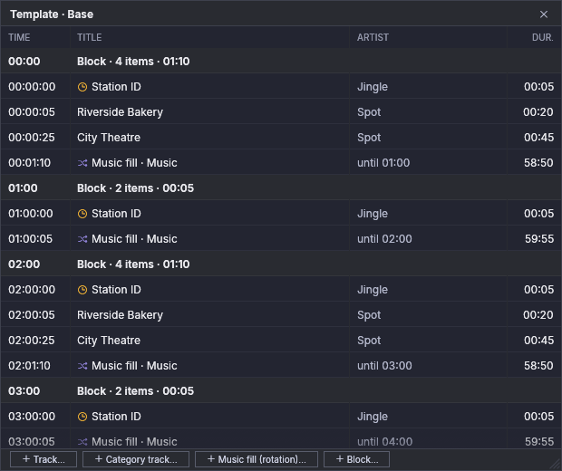

# Automatisierung

Die Automatisierung hält den Sender auf Sendung, wenn niemand im Studio ist.
Diese Version hat den **Musikfüller**, einen Player, der die Musik nach
Regeln, die du festlegst, selbst auswählt und nie aus Mangel an einer Liste
stehen bleibt, und die Spalte **Sendeplan**, die die zeitgesteuerten Blöcke
des Tages ausführt, gebaut aus Vorlagen in den Einstellungen.
Die Player, die du schon benutzt (P1 … Pn), bleiben unberührt: Sie gehören
weiterhin dir für Sendungen, die du vorbereitest und live spielst.

## Die Spalte Sendeplan {#the-log-column}

Die Spalte **Sendeplan** spielt die **Blöcke** des Tages: Gruppen von
Elementen mit einer Startzeit (eine Stundenkennung, Spots, eine Sendung).
Blende sie über die Kachel **Sendeplan** in der oberen Leiste ein, so wie du
einen Player einblendest.

Ihre Liste sieht aus wie eine Playlist, nach Blöcken gruppiert. Jeder Block
beginnt mit einer Kopfzeile: seine Startzeit, wie viele Elemente er hat und
wie lange sie dauern, „für diesen Tag geändert“, wenn du ihn heute geändert
hast, und in Bernstein, um wie viel er in den nächsten Block hineinläuft.
Dann kommen seine Elemente, mit der **Zeit**, zu der jedes beginnen soll. Die
Liste zeigt heute, den letzten Block von gestern und den ersten von morgen.
Das Element on Air und das nächste sind wie bei einem Player markiert;
Elemente, die schon gelaufen sind, sind abgeblendet, und ein Element, das
nicht lief (**verpasst**), ist durchgestrichen. Eine Uhr kennzeichnet ein
Element mit **fester Startzeit**, das nur zu seiner Zeit spielt. Ein
**Kategorie-Titel** zeigt den für ihn gewählten Track, sobald er der nächste
ist (oder in seinem Block nach dem nächsten kommt), mit der Kategorie
dahinter: Das ist der Track, der spielt. Hat die Kategorie keinen Track, der
spielen kann (keiner ist ihr zugeordnet, oder ihre Dateien fehlen), sagt es
die Zeile in Bernstein, und das Element wird verpasst. Ein Element, dessen
Datei sich kurz vor dem Spielen als unlesbar erweist, wird übersprungen und
ebenfalls als verpasst markiert. Tracks ordnest du einer Kategorie in der
Bibliothek zu. Die Zeile des **Musikfüllers** sagt, bis wann er spielt, und
erscheint als on Air, solange der Musikfüller für den Sendeplan spielt. Ein
nächstes Element, dessen Zeit vorbei ist, zeigt seine Zeit in Bernstein.
Ziehe die Linie zwischen zwei Spaltenköpfen, um die Spaltenbreiten zu ändern,
wie bei einer Playlist; die Vorlagen- und Tagesfenster verwenden dieselben
Breiten.

### Den heutigen Sendeplan ändern {#changing-todays-log}

Du änderst den Sendeplan wie eine Playlist, und die Änderung gilt nur für
diesen Tag: Die Vorlage bleibt, wie sie ist.

- Die Buttons unten in der Spalte: **+ Titel…** öffnet die Bibliothek, um
  Tracks in die Liste zu ziehen; **+ Kategorie-Titel…** und
  **+ Musikfüller (Rotation)…** fragen, welche, und fügen sie direkt unter der
  gewählten Zeile ein (klicke eine Zeile an, um sie zu wählen; wähle einen
  Blockkopf, um am Anfang dieses Blocks einzufügen), oder, wenn nichts gewählt
  ist oder unter einer Zeile, die sich nicht mehr ändern lässt, am Ende des
  kommenden Blocks; **+ Block…** fragt nach einer Zeit, die erste freie ist
  schon eingetragen. Ist die Spalte für alle zu schmal, liegen die, die nicht
  passen, hinter **⋯**.
- Ziehe Tracks aus der Bibliothek oder Audiodateien aus deinem Dateimanager
  auf eine Zeile, um sie davor einzufügen (oder dahinter, auf der unteren
  Hälfte der Zeile, wie bei einer Playlist: So kommen sie ans Ende eines
  Blocks), und ziehe Zeilen innerhalb desselben Tages, um sie zu verschieben.
  Die Zeile, die du hinzufügst, ist gewählt und in den sichtbaren Bereich
  gerollt, sodass die nächste darunter kommt.
- Rechtsklicke eine Zeile für **Feste Startzeit** und **Aus dem heutigen
  Sendeplan entfernen**. Klicke (oder rechtsklicke) einen Blockkopf, um am
  Ende dieses Blocks einen **Titel…**, einen **Kategorie-Titel…** oder einen
  **Musikfüller (Rotation)…** hinzuzufügen, oder für **Zeit ändern…**,
  **Block entfernen** und, bei einem geänderten Block, **Zurück zur Vorlage**.
- Während du über einen Blockkopf ziehst, zeigt die Linie darunter, dass das
  Ablegen am Anfang dieses Blocks landet; um Zeilen ans Ende des Blocks
  darüber zu legen, lege sie auf der unteren Hälfte seiner letzten Zeile ab.
- Was schon gespielt hat, das Element on Air und vergangene Tage lassen sich
  nicht ändern. Eine Änderung am Block on Air wirkt nach dem Element on Air.

Die Spalte Sendeplan hat den Kopf und die Buttons eines Players, und sie
funktionieren wie bei einem Player:

- **Abspielen** spielt das als nächstes markierte Element und führt die
  Automatisierung aus: Jeder Block spielt dann zu seiner Zeit, und der
  Musikfüller spielt zwischen den Blöcken. Wurde das nächste Element von der
  Uhr gewählt und beginnt sein Block später, spielt bis dahin die Musik.
  Nichts läuft von selbst: Nach jedem Start der Anwendung ist die
  Automatisierung gestoppt, bis du Abspielen drückst.
- **Pause**, **Stopp** und **Ausblenden** wirken auf das, was für den
  Sendeplan on Air ist (sein Element oder zwischen Blöcken den Titel des
  Musikfüllers), und stoppen die Automatisierung. Abspielen nach Pause macht
  dort weiter, wo es war; während der Pause bewegt sich das nächste Element
  nicht, und nach dem Fortsetzen behält der nächste Block seine Zeit.
  Abspielen nach einem Stopp während der Musik spielt wieder Musik, und der
  nächste Block beginnt zu seiner Zeit.
- **Stopp danach** lässt zu Ende laufen, was on Air ist, und dann stoppt die
  Automatisierung. Läuft die Musik und kommt zuerst die Zeit eines Blocks,
  beginnt der Block pünktlich, und die Automatisierung stoppt nach seinem
  ersten Element.
- **Vorheriger Track** tut im Sendeplan nichts.
- **SINGLE** macht den Sendeplan manuell: Abspielen spielt das nächste
  Element und stoppt danach; kein Block beginnt von selbst.

Während der Musikfüller zwischen Blöcken spielt, zeigt der Kopf des
Sendeplans **Musikfüller · *Rotation*** (die Rotation, die er spielt), und
seine Buttons funktionieren weiter; der Titel, sein Pegelmesser und seine
Wellenform sind nur in der Spalte Musikfüller zu sehen.

Stoppt die Automatisierung nach einem Element, bleibt das nächste auf dem
Element unter dem, das gespielt hat, und Abspielen spielt es, egal wie spät
es ist: Du entscheidest. Stoppt sie während der Musik, spielt Abspielen bis
zum nächsten Block wieder Musik, sofern du kein anderes nächstes Element
gewählt hast. Um zu ändern, was als Nächstes spielt, doppelklicke ein Element
oder rechtsklicke es und wähle **Als Nächstes spielen**. **Zurück zur Uhr**
im selben Menü setzt als nächstes Element, was die Uhrzeit sagt.

## Vorlagen und Tage {#templates-and-days}

Der Sendeplan spielt jeden Tag nach einer **Vorlage**: einem Tag aus Blöcken.
Eine neue Installation hat eine, „Basis“, für jeden Tag. Vorlagen entstehen
in Einstellungen → **Automatisierung** unter **Vorlagen und Tage** (nicht
unter Android); die Spalte Sendeplan ändert nur heute, wie oben.

- **Vorlagen.** Wähle eine und drücke **Bearbeiten…** (oder doppelklicke
  sie), um sie zu öffnen; **Neue Vorlage**, **Duplizieren** und **Löschen**
  stehen daneben, ihr Name darunter.
- **Wochenplan.** Welche Vorlage jeder Wochentag verwendet.
- **Tage.** Wähle ein Datum im Kalender (Daten mit Änderungen sind
  bernsteinfarben). Ein Datum kann eine andere Vorlage als die seines
  Wochentags verwenden (ein Feiertag an einem Donnerstag kann die des
  Wochenendes nehmen). **Tag bearbeiten…** öffnet dieses Datum, um seine
  Blöcke nur für dieses Datum zu ändern; vergangene Daten lassen sich nicht
  ändern.

Eine Vorlage oder ein Datum öffnet sich in einem eigenen Fenster, das die
Einstellungen schließt. Es ist dieselbe Liste wie die Spalte Sendeplan, und
du änderst sie genauso: die Buttons unten (Titel…, Kategorie-Titel…,
Musikfüller (Rotation)…, Block…, die unter der gewählten Zeile einfügen),
Tracks, die du aus der Bibliothek (oder Dateien, die du aus deinem
Dateimanager) auf eine Zeile ziehst, Zeilen, die du zum Verschieben ziehst,
das Rechtsklickmenü der Zeilen und das Menü der Blockköpfe. Es spielt nie
und kann neben der Bibliothek offen bleiben. Das Fenster von heute zeigt, was
gespielt hat und was spielt, wie der Sendeplan; das Fenster eines Tages
schließt sich um Mitternacht, wenn sich dieser Tag nicht mehr ändern lässt.

Ein **Kategorie-Titel** in einer Vorlage spielt einen Track dieser Kategorie,
jedes Mal einen anderen. Das Element **Musikfüller** wählt die Rotation, die
der Musikfüller nach dem Block spielt (die Standardrotation, wenn der Block
keine hat). Sind die Elemente eines Blocks länger als die Zeit bis zum
nächsten Block, sagt sein Kopf in Bernstein, um wie viel; du kannst es
trotzdem so lassen.

Eine Änderung an einem Datum ist an ihrem Block mit „für diesen Tag
geändert“ markiert, und **Zurück zur Vorlage** im Menü des Blockkopfs macht
sie rückgängig. Spätere Änderungen an der Vorlage erreichen weiterhin die
Blöcke, die du an diesem Datum nicht geändert hast. Eine Änderung an einer
Vorlage, während einer ihrer Blöcke on Air ist, lässt diesen Block für heute,
wie er ist (er zeigt „für diesen Tag geändert“); die Änderung erreicht ihn ab
dem nächsten Tag.

## Der Musikfüller {#the-music-fill}

Der Musikfüller ist die Spalte **Musikfüller**. Sie ist ausgeblendet, bis du
sie einblendest: Klicke links in der oberen Leiste auf die Kachel
**Musikfüller**. Sie sitzt links von P1.

Sie sieht aus und funktioniert wie ein Player: die große Uhr, die Wellenform,
die Transport-Buttons, der Fader und die Track-Liste. Der Unterschied ist die
Liste:

- sie **füllt sich selbst** aus einer **Rotation** (unten), immer etwa eine
  halbe Stunde im Voraus (*Vorlauf*, in Einstellungen → Automatisierung);
- sie **kürzt sich selbst**: Sie behält die letzten 50 Tracks, die sie
  gespielt hat, und entfernt ältere, damit sie wochenlang laufen kann;
- vor einem Block des Sendeplans kann sie **Titel, die sie selbst gewählt hat,
  austauschen** gegen andere, deren Länge zur verbleibenden Zeit passt (siehe
  unten); die Titel, die du hinzugefügt hast, werden nie angetastet;
- du kannst sie weiterhin **von Hand ändern**: Tracks aus der Bibliothek
  ziehen, Zeilen umordnen, einen unerwünschten Titel entfernen. Eine Zeile, die
  du hinzufügst, ist mit einer Hand markiert und wird nie ersetzt; eine Zeile,
  die du entfernst, zählt nicht als gespielt.

Ihre Ausgänge werden in Einstellungen → Audioausgänge in der Zeile
**Musikfüller** festgelegt, wie bei jedem Player. Sie hat keine Nummer, keine
Tastenkürzel und keine MIDI-Belegungen, und die Fernsteuerung sieht sie nicht.

Drücke **Abspielen**, um sie zu starten, und **Stopp danach**, um den Titel
on Air zu Ende laufen zu lassen und zu stoppen. Wie jeder Player startet sie
nie von selbst, auch nicht nach einem Neustart. Solange sie zwischen Blöcken
für den Sendeplan spielt, stoppt ein Stoppen oder Pausieren auch die
Automatisierung, und ihr Stopp danach stoppt die Automatisierung, wenn der
Titel endet; kommt zuerst die Zeit eines Blocks, spielt der Block, und die
Markierung wird entfernt. Wurde der Sendeplan während der Musik pausiert,
spielt Abspielen in der Spalte Musikfüller den Titel für sich allein: Das
Abspielen des Sendeplans setzt ihn nicht mehr fort, und sein Stopp stoppt ihn
nicht mehr.

Über ihrer Liste, wo ein Player seine Playlist-Tabs hat, zeigt die Spalte
Musikfüller die **Rotation**, die sie spielt. Wähle dort eine andere: Die
Titel, die sie in der Warteschlange hatte, werden ersetzt, die von dir
hinzugefügten bleiben. Findet die Rotation nichts zum Spielen (ihre
Kategorien sind leer oder jede Datei fehlt), sagt es die Leiste.

## Rotationen {#rotations}

Eine **Rotation** ist eine kurze Liste von **Schritten**, die der Musikfüller
der Reihe nach spielt, dann wieder vom ersten. Jeder Schritt nennt, woher
seine Tracks kommen (eine Kategorie der Bibliothek mit ihren Unterkategorien
oder jeder Track einer Art) und wie viele er jedes Mal spielt, als Bereich:

| Schritt | Spielt |
|---|---|
| Aktuelle Hits | 2–3 |
| Senderkennungen | 1 |
| Gold | 0–1 |

Mit einem Bereich kommt eine Senderkennung einmal nach zwei Titeln und das
nächste Mal nach drei. Ein Bereich ab **0** lässt einen Schritt manche
Durchgänge aussetzen: Bei Gold mit 0–1 spielt manchmal nach der Senderkennung
ein Gold-Titel und manchmal nicht. Das Maximum ist immer mindestens 1. Eine
Rotation ist der **Standard**: Eine neue Installation hat eine, **Musik**, die
deine gesamte Musik spielt.

Ein Schritt, dessen Kategorie keinen Track hat, der spielen kann (eine leere
Kategorie oder fehlende Dateien), spielt an seiner Stelle einen Titel der
Standardrotation (beliebige Musik, wenn der Schritt zur Standardrotation
selbst gehört), sodass die anderen Schritte ihren Platz behalten: Eine
Senderkennung kommt weiterhin zwischen den Titeln.

Rotationen werden in Einstellungen → Automatisierung erstellt:

## Wie er auswählt {#how-it-chooses}

Innerhalb eines Schritts bevorzugt der Musikfüller die Tracks, die am
längsten nicht gelaufen sind, mit etwas Zufall unter ihnen, damit die
Reihenfolge nie zu einem festen Zyklus wird. Außerdem hält er auseinander:

- **denselben Track:** Er darf wieder spielen, sobald 3 Stunden vergangen sind
  oder die Hälfte der anderen Tracks seines Schritts seither gelaufen ist,
  was zuerst eintritt;
- **denselben Interpreten:** nicht innerhalb von 30 Minuten.

Alles, was auf Sendung ging, zählt, vom Musikfüller, einem Player oder der
Cartwall; Vorhören nicht. Kann eine kleine Kategorie die Regeln nicht
einhalten, gibt der Musikfüller lieber nach, als zu verstummen: zuerst beim
Interpreten, dann beim Track. Einstellungen → Automatisierung enthält alle
Werte, und dort erstellst, benennst und änderst du Rotationen (siehe
[Einstellungen](settings.md#automation)).

Vor einem Block des Sendeplans wählt der Musikfüller seine letzten Titel auch
nach ihrer Länge, damit die Musik sauber endet: Der Titel, der beim Beginn des
Blocks ausgeblendet wird, läuft zur Zeit des Blocks noch und verliert danach
höchstens 30 Sekunden, und kein Titel beginnt, der weniger als 45 Sekunden
spielen würde. Auch die Regeln für Interpret und Track hält er ein, wann
immer er kann. Kann kein Titel der Rotation beides, spielt der, der am
wenigsten verliert, sodass manchmal ein paar Sekunden eines Titels zu hören
sein können. Eine Pause der Musik verschiebt die Titel danach, und der
Musikfüller wählt sie neu. Der Musikfüller meidet auch die Titel und die
Interpreten, die ein Block kurz danach spielt. Beide Werte lassen sich
vorerst nur in der Konfigurationsdatei ändern
(`automation.max_fade_cut_secs` und `automation.min_song_play_secs`).

Eine **Stundenkennung** ist eine eigene Track-Art (Bibliothek → Art ▸
Stundenkennung) für die Senderkennung zur vollen Stunde.
