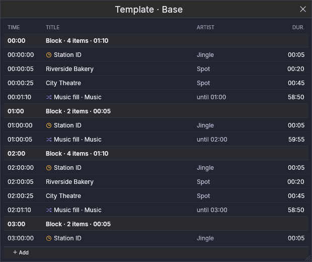
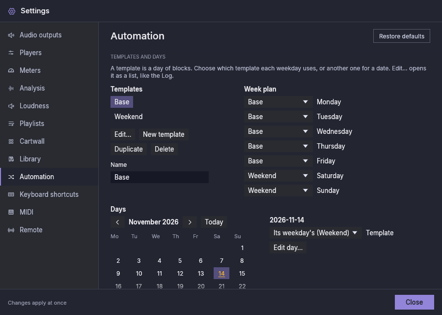

# Automatisierung

Die Automatisierung hält den Sender auf Sendung, wenn niemand im Studio ist.
Diese Version hat den **Musikfüller**, einen Player, der die Musik nach
Regeln, die du festlegst, selbst auswählt und nie aus Mangel an einer Liste
stehen bleibt, und die Spalte **Sendeplan**, die die zeitgesteuerten Blöcke
des Tages ausführt, samt dem Editor, in dem du sie erstellst.
Die Player, die du schon benutzt (P1 … Pn), bleiben unberührt: Sie gehören
weiterhin dir für Sendungen, die du vorbereitest und live spielst.

## Die Spalte Sendeplan {#the-schedule-column}

Die Spalte **Sendeplan** spielt die **Blöcke** des Tages: Gruppen von
Elementen mit einer Startzeit (eine Stundenkennung, Spots, eine Sendung).
Blende sie über die Kachel **Sendeplan** in der oberen Leiste ein, so wie du
einen Player einblendest.

Ihre Liste ist der Sendeplan, nach Blöcken gruppiert: die Startzeit jedes
Blocks, dann seine Elemente. Sie zeigt heute, den letzten Block von gestern
und den ersten von morgen. Ein für einen Tag geänderter Block sagt es. Das
Element on Air und das nächste sind wie bei einem Player markiert; Elemente,
die schon gelaufen sind, sind abgeblendet, und ein Element, das nicht lief
(**verpasst**), ist durchgestrichen. Eine Uhr kennzeichnet ein
**zeitkritisches** Element, das nur zu seiner Zeit spielt.

Über der Liste:

- **Starten** führt den Sendeplan aus: Jeder Block spielt zu seiner Zeit, und
  der Musikfüller spielt zwischen den Blöcken. Nichts läuft von selbst: Nach
  jedem Start der Anwendung ist die Automatisierung gestoppt, bis du Starten
  drückst.
- **Nach aktuellem stoppen** lässt aus, was on Air ist, zu Ende laufen, und
  danach spielt nichts mehr von selbst.
- **Läuft** oder **Gestoppt** sagt, welcher Zustand gilt.

Um zu ändern, was als Nächstes spielt, doppelklicke ein Element oder klicke es
mit der rechten Maustaste an und wähle **Als Nächstes spielen**; es folgt auf
den Titel on Air. **Zurück zur Uhr** im selben Menü lässt den Sendeplan wieder
nach der Uhrzeit entscheiden.

## Den Sendeplan bearbeiten {#editing-the-schedule}

**Sendeplan bearbeiten** in der Spalte Sendeplan öffnet den Editor. Er hat
drei Tabs, und **Rotationen…** führt zu Einstellungen → Automatisierung, wo
die Rotationen erstellt werden.

- **Vorlagen.** Eine Vorlage ist ein Tag aus Blöcken; eine neue Installation
  hat eine, „Base“, für jeden Tag. Links kannst du Vorlagen erstellen,
  duplizieren, umbenennen oder löschen; die Blöcke der gewählten stehen rechts.
  Gib den Beginn eines Blocks als `HH:MM:SS` ein (eine Zeit, die es nicht
  gibt, bleibt mit einem Hinweis im Feld stehen, und nichts ändert sich).
  Ziehe Tracks aus der Bibliothek auf einen Block, um sie hinzuzufügen; **Aus
  Kategorie hinzufügen** fügt ein Element hinzu, das einen Track dieser
  Kategorie spielt, jedes Mal einen anderen; **Musik danach** wählt die
  Rotation, die der Musikfüller nach dem Block spielt (die Standardrotation,
  wenn keine gewählt ist). Jedes Element kann als **Zeitkritisch** markiert,
  verschoben oder entfernt werden. Sind die Elemente eines Blocks länger als
  die Zeit bis zum nächsten Block, sagt der Block in Bernstein, um wie viel;
  du kannst ihn trotzdem so lassen.
- **Wochenplan.** Welche Vorlage jeder Wochentag verwendet.

  

- **Tage.** Wähle ein Datum im Kalender (Daten mit Änderungen sind bernsteinfarben).
  Ein Datum kann eine andere Vorlage als die seines Wochentags verwenden (ein
  Feiertag an einem Donnerstag kann die des Wochenendes nutzen). Seine Blöcke
  können nur für dieses Datum geändert werden: Die Änderung ist markiert, und
  **Zurück zur Vorlage** macht sie rückgängig. **Nicht an diesem Tag**
  entfernt einen Block nur von diesem Datum, und **Block an diesem Tag
  hinzufügen** fügt einen hinzu. Spätere Änderungen an der Vorlage erreichen
  weiterhin die Blöcke, die du an diesem Datum nicht geändert hast.

  

## Der Musikfüller {#the-music-filler}

Der Musikfüller ist die Spalte **Musik**. Sie ist ausgeblendet, bis du sie
einblendest: Klicke links in der oberen Leiste auf die Kachel **Musik**. Sie
sitzt links von P1.

Sie sieht aus und funktioniert wie ein Player: die große Uhr, die Wellenform,
die Transport-Buttons, der Fader und die Track-Liste. Der Unterschied ist die
Liste:

- sie **füllt sich selbst** aus einer **Rotation** (unten), immer etwa eine
  halbe Stunde im Voraus (*Vorlauf*, in Einstellungen → Automatisierung);
- sie **kürzt sich selbst**: Sie behält die letzten 50 Tracks, die sie
  gespielt hat, und entfernt ältere, damit sie wochenlang laufen kann;
- vor einem Block des Sendeplans kann sie **Titel, die sie selbst gewählt hat,
  austauschen** gegen andere, deren Länge zur verbleibenden Zeit passt (siehe
  unten); die Titel, die du hinzugefügt hast, werden nie angetastet;
- du kannst sie weiterhin **von Hand ändern**: Tracks aus der Bibliothek
  ziehen, Zeilen umordnen, einen unerwünschten Titel entfernen. Eine Zeile, die
  du hinzufügst, ist mit einer Hand markiert und wird nie ersetzt; eine Zeile,
  die du entfernst, zählt nicht als gespielt.

Ihre Ausgänge werden in Einstellungen → Audioausgänge in der Zeile **Musik**
festgelegt, wie bei jedem Player. Sie hat keine Nummer, keine Tastenkürzel
und keine MIDI-Belegungen, und die Fernsteuerung sieht sie nicht.

Drücke **Play**, um sie zu starten, und **Nach aktuellem stoppen**, um den
Titel on Air zu Ende laufen zu lassen und zu stoppen. Wie jeder Player startet
sie nie von selbst, auch nicht nach einem Neustart.

Über ihrer Liste, wo ein Player seine Playlist-Tabs hat, zeigt die Spalte
Musik die **Rotation**, die sie spielt. Wähle dort eine andere: Die Titel, die
sie in der Warteschlange hatte, werden ersetzt, die von dir hinzugefügten
bleiben. Findet die Rotation nichts zum Spielen (ihre Kategorien sind leer
oder jede Datei fehlt), sagt es die Leiste.

## Rotationen {#rotations}

Eine **Rotation** ist eine kurze Liste von **Schritten**, die der Füller der
Reihe nach spielt, dann wieder vom ersten. Jeder Schritt nennt, woher seine
Tracks kommen (eine Kategorie der Bibliothek mit ihren Unterkategorien oder
jeder Track einer Art) und wie viele er jedes Mal spielt, als Bereich:

| Schritt | Spielt |
|---|---|
| Aktuelle Hits | 2–3 |
| Senderkennungen | 1 |
| Gold | 0–1 |

Mit einem Bereich kommt eine Senderkennung einmal nach zwei Titeln und das
nächste Mal nach drei. Ein Bereich ab **0** lässt einen Schritt manche
Durchgänge aussetzen: Bei Gold mit 0–1 spielt manchmal nach der Senderkennung
ein Gold-Titel und manchmal nicht. Das Maximum ist immer mindestens 1. Eine
Rotation ist der **Standard**: Eine neue Installation hat eine, **Music**, die
deine gesamte Musik spielt.

Rotationen werden in Einstellungen → Automatisierung erstellt:

## Wie er auswählt {#how-it-chooses}

Innerhalb eines Schritts bevorzugt der Füller die Tracks, die am längsten
nicht gelaufen sind, mit etwas Zufall unter ihnen, damit die Reihenfolge nie
zu einem festen Zyklus wird. Außerdem hält er auseinander:

- **denselben Track:** Er darf wieder spielen, sobald 3 Stunden vergangen sind
  oder die Hälfte der anderen Tracks seines Schritts seither gelaufen ist,
  was zuerst eintritt;
- **denselben Interpreten:** nicht innerhalb von 30 Minuten.

Alles, was on Air ging, zählt, vom Füller, von einem Player oder von der
Cartwall; das Vorhören nicht. Kann eine kleine Kategorie die Regeln nicht
einhalten, gibt der Füller nach, statt zu verstummen: zuerst beim Interpreten,
dann beim Track. Einstellungen → Automatisierung hat jeden Wert und ist der
Ort, an dem du Rotationen erstellst, umbenennst und änderst (siehe
[Einstellungen](settings.md#automation)).

Vor einem Block des Sendeplans wählt der Füller außerdem seine letzten Titel
nach ihrer Länge, damit die Musik sauber endet: Der Titel, der ausgeblendet
wird, wenn der Block beginnt, verliert höchstens 30 Sekunden, und es beginnt
kein Titel, der weniger als 45 Sekunden spielen würde. Kann kein Titel der
Rotation beides, spielt der, der am wenigsten verliert. Beide Werte lassen sich
vorerst nur in der Konfigurationsdatei ändern (`automation.max_fade_cut_secs`
und `automation.min_song_play_secs`).

Eine **Stundenkennung** ist eine eigene Track-Art (Bibliothek → Art ▸
Stundenkennung) für die Kennung des Senders zur vollen Stunde.
