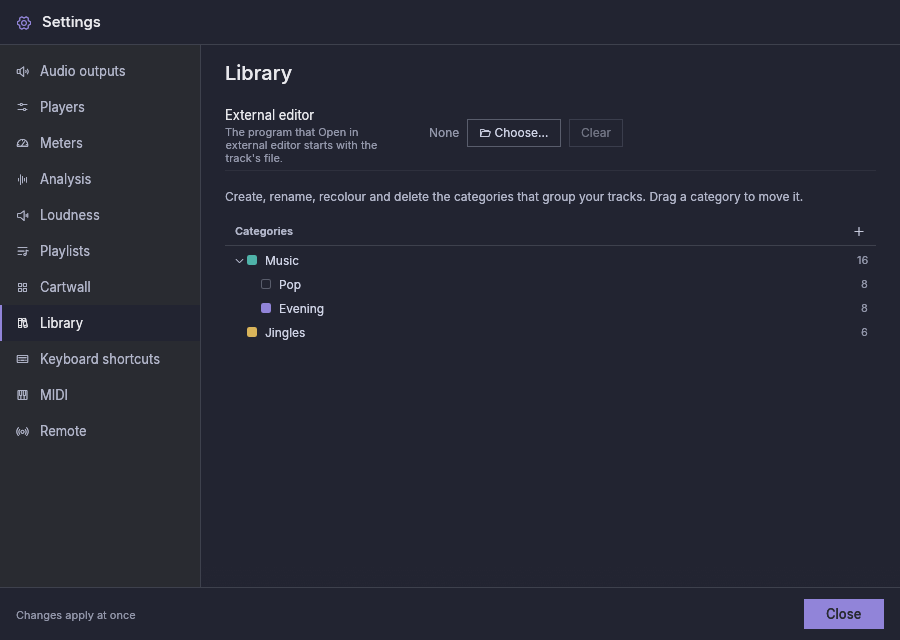

# Bibliothek

Die Bibliothek umfasst alle Tracks, die Fauste Player kennt: Jede Datei, die du
zu einer Playlist, einem Cart oder der Bibliothek selbst hinzugefügt hast, ist
ein Track, mit ihren Tags, Markern und Lautheitseinstellungen. Das
Bibliotheksfenster listet sie auf, gruppiert sie in *Kategorien*, findet sie
per Text und schickt sie an die Playlists und die Cartwall. Auf dem Desktop und
auf einem Tablet ist sie ein Fenster; ein Telefon zeigt die Bibliothek
stattdessen in seinem Tab **Bibliothek** (siehe [Auf einem
Telefon](#on-a-phone)).

## Das Fenster öffnen {#opening-the-window}

Klicke auf die Kachel **Bibliothek** in der oberen Leiste. Sie leuchtet,
solange das Fenster offen ist; klicke erneut darauf oder auf den
Schließen-Button des Fensters, um es zu schließen. Das Fenster schwebt über den
Playern und der Cartwall und blockiert sie nicht: Nichts darin stoppt das Audio
oder die Kürzel des Hauptfensters.

Verschiebe es an seiner Titelleiste und ändere seine Größe an Kanten und Ecken.
Die Titelleiste hat drei Buttons: **Bibliothek minimieren** (nur die
Titelleiste bleibt übrig, dort, wo das Fenster war, oder oben im Hauptbereich,
wenn das Fenster maximiert ist; erneut anklicken, um es aufzuklappen),
**Bibliothek maximieren** (das Fenster füllt den Hauptbereich;
**Bibliothek wiederherstellen** bringt es zurück) und **Bibliothek schließen**.
Ein Fenster, das nicht mehr hineinpasst, weil das Hauptfenster schrumpft oder
auf einen kleineren Bildschirm wechselt, wird in den Hauptbereich
zurückgeholt.

Position und Größe des Fensters, sein minimierter oder maximierter Zustand, die
Breite des Baums, die Spalten, die Sortierung und die gewählte Kategorie werden
mit der Sitzung gespeichert und kommen beim nächsten Start wieder. Ob das
Fenster offen ist, wird ebenfalls gespeichert, aber deswegen spielt nichts von
selbst. Der Text im Suchfeld wird nicht gespeichert.

## Kategorien {#categories}

Der Baum links gruppiert die Tracks. Oben **Alle Titel**; dann deine
Kategorien, die Unterkategorien enthalten können; dann **Ohne Kategorie**,
die Tracks, die zu keiner Kategorie gehören; und, nur solange ein Track es
braucht, **Zu prüfende Marker** (siehe [Wenn sich eine Datei
ändert](#when-a-file-changes)). Jeder Eintrag zeigt seine Farbe
und eine Zahl: Eine Kategorie zählt ihre eigenen Tracks und die ihrer
Unterkategorien. Ein Track gehört höchstens zu einer Kategorie.

- **Klicke** auf einen Eintrag, um seine Tracks in der Tabelle aufzulisten. Eine
  Kategorie listet auch die Tracks ihrer Unterkategorien auf.
- Der **Pfeil** vor einer Kategorie öffnet oder schließt ihre Unterkategorien.
  Welche offen sind, wird gespeichert.
- **Neue Kategorie** (＋ über dem Baum) fragt nach einem Namen, einer Farbe und
  einer *Art*. Eine neue Kategorie übernimmt Farbe und Art der Kategorie, in der
  sie angelegt wird; die Art ist das, was ein Track annimmt, wenn er der
  Kategorie beitritt, und eine spätere Änderung lässt die Tracks, die schon
  darin sind, unverändert. Ein Name darf nicht leer sein und nicht den Namen
  einer gleichrangigen Kategorie wiederholen; Kategorien lassen sich nur bis zu
  einer Grenze verschachteln.
- **Rechtsklick** auf eine Kategorie (oder langes Drücken auf einem
  Touchscreen) bietet **Neue Unterkategorie…**, **Umbenennen…**, **Farbe**,
  **Art** und **Löschen…**. Auf dem Desktop hat das Menü außerdem **Ordner
  überwachen…** (**Überwachten Ordner ändern…** und **Ordner nicht mehr
  überwachen**, sobald sie einen überwacht) und **Fehlende Titel entfernen…**;
  siehe [Überwachte Ordner](#watched-folders) und [Tracks
  entfernen](#removing-tracks).
- **Ziehe** eine Kategorie, um sie zu verschieben: auf eine andere Kategorie,
  um sie darin zu verschachteln, oder in die Lücke zwischen zwei Kategorien, um
  sie dort einzufügen. Eine Kategorie kann nicht in sich selbst verschoben
  werden. Auf einem Touchscreen nimmt der Baum unter einem Finger nur Tipps und
  Scrollen an; eine Kategorie lässt sich dort nicht ziehen.

**Löschen…** nennt, was mit der Kategorie verschwindet: Ihre Unterkategorien
und alle Tracks darin werden aus der Bibliothek entfernt. Die Dateien werden nie
gelöscht. Wird einer dieser Tracks verwendet, sagt eine zweite Frage, wie viele
Playlist-Einträge und Carts sie verwenden: **Trotzdem entfernen** entfernt die
Einträge aus ihren Playlists und leert die Carts. Solange einer davon on Air
ist, wird nichts entfernt; ein Hinweis sagt, was spielt.

Derselbe Baum steht unter **Einstellungen → Bibliothek**, um Kategorien
anzulegen, umzubenennen, umzufärben, ihre Art zu ändern, sie zu verschieben und
zu löschen, ohne das Fenster zu öffnen (er hat weder *Alle Titel* noch *Ohne
Kategorie* noch eine Auswahl).

## Überwachte Ordner {#watched-folders}

Auf dem Desktop kann eine Kategorie einen Ordner überwachen. Klicke sie mit der
rechten Maustaste an und wähle **Ordner überwachen…**, dann den Ordner. Die
Kategorie zeigt eine Markierung ⟳ vor ihrer Zahl; fahre mit der Maus darüber,
um den Ordner zu lesen.

- Jede Audiodatei im Ordner und seinen Unterordnern tritt der Kategorie bei.
  Unterordner legen keine Unterkategorien an.
- Ein Track, der schon in einer anderen Kategorie ist, bleibt dort. Ein Track,
  der in keiner Kategorie ist, tritt dieser bei. Das Festlegen, Ändern oder
  Beenden einer Überwachung verschiebt nie einen Track: Die Tracks eines Ordners,
  der nicht mehr überwacht wird, bleiben in ihrer Kategorie.
- Solange die Anwendung läuft, wird der Ordner verfolgt: Eine neue Datei tritt
  bei, sobald sie einen Moment ruhig war (`library.watch_debounce_ms`,
  standardmäßig 1 Sekunde, damit eine Datei, die noch kopiert wird, nicht halb
  geschrieben gelesen wird). Der Ordner wird außerdem bei jedem Start der
  Anwendung durchsucht, um zu erfassen, was sich geändert hat, während sie
  geschlossen war.
- Eine Datei, die aus dem Ordner verschwindet (gelöscht, verschoben oder
  umbenannt), lässt ihren Track in der Bibliothek, als fehlend markiert, mit
  seinen Markern. Kommt die Datei zurück, ist der Track von selbst wieder
  normal. Eine umbenannte Datei tritt als neuer Track unter ihrem neuen Namen
  bei.
- Überwachte Ordner können verschachtelt sein. Eine Datei unter zweien davon
  geht an die Kategorie des innersten; wird einer von ihnen beendet, bleibt der
  andere verfolgt. Derselbe Ordner kann nicht von zwei Kategorien überwacht
  werden: Die Anwendung nennt die Kategorie, die ihn schon hat.
- Nichts, was ein überwachter Ordner tut, lädt oder spielt einen Track.

Kann der Ordner nicht verfolgt werden, ändert die Markierung ⟳ ihre Farbe, und
ihr Tooltip nennt den Grund: *Überwachter Ordner nicht gefunden: …. Er wird
erneut gesucht.* (zum Beispiel ein Laufwerk, das nicht eingehängt ist),
*Überwachter Ordner kann nicht gelesen werden: …. Es wird erneut versucht.*
oder *Änderungen in … werden nicht verfolgt; der Ordner wird beim Start
durchsucht und erneut versucht.* (das System hat die Überwachung verweigert).
Ein Ordner, der als unvollständiger Pfad gespeichert ist (von Hand bearbeitet),
wird gar nicht überwacht, und die Markierung sagt es.

Alle 30 Sekunden (`tuning.missing_recheck_ms`) prüft die Anwendung, ob jeder
überwachte Ordner noch da ist, sodass auch ein Laufwerk gemeldet wird, das
abgezogen wurde, während sie läuft. Ein Ordner mit Problemen wird in diesem
Takt erneut versucht und durchsucht, sobald er zurück ist. Ein Ordner, der
nicht da ist, nicht gelesen werden kann oder leer ist, obwohl die Bibliothek
noch Tracks daraus hat (ein nicht eingehängtes Laufwerk oder eine Freigabe sieht
oft wie ein leerer Ordner aus), gilt als nicht gefunden. Die Überwachung
markiert dann keinen seiner Tracks als fehlend und entfernt nichts, auch dann,
wenn der Ordner in einem anderen überwachten Ordner liegt.

Leerst du einen überwachten Ordner mit Absicht, bleibt die Warnung, bis wieder
Dateien darin sind oder du die Überwachung beendest, und seine Tracks bleiben in
der Bibliothek, ohne als fehlend markiert zu werden. Um sie loszuwerden,
wähle sie in der Tabelle aus und wähle **Aus der Bibliothek entfernen…**, oder
wähle **Neu analysieren** für sie: Die Analyse markiert die Tracks, deren Datei
fehlt, als fehlend, und **Fehlende Titel entfernen…** entfernt sie dann (wird
der Ordner noch überwacht, verschwindet seine Warnung bei der nächsten
Prüfung).

Eine Ausnahme von der obigen Regel: Ein Track, der nie analysiert wurde, wird
weiterhin als fehlend markiert, wenn die Analyse seine Datei nicht finden kann,
wo auch immer sie liegt.

Ein Unterordner, der nicht gelesen werden kann, wird übersprungen, und das Log
sagt es; Ordner-Links (symbolische Links auf Ordner) werden nicht verfolgt.

Neue Dateien kommen in der Analyse hinter alles, was ein Player oder ein Cart
braucht, daher dauert ein Ordner mit tausenden Dateien eine Weile; der
Analysefortschritt zeigt es.

Dasselbe Menü und dieselbe Markierung gibt es unter **Einstellungen →
Bibliothek**. Unter Android gibt es sie nicht, weil es keine Ordner überwacht:
Dort kann eine Kategorie ihre Dateien aus einem Geräteordner beziehen, den du
nach Belieben neu einliest (siehe [Android →
Bibliothek](android.md#library)).

## Die Track-Tabelle {#the-track-table}

Die Tabelle listet die Tracks des gewählten Eintrags in denselben Spalten wie
die Playlist-Tabellen (die unter **Einstellungen → Playlists →
Tabellenspalten** gewählten, ohne die Position `#`), gefolgt von **Kategorie**
und **Art**. Eine schmale Zelle links kennzeichnet einen Track, dessen Datei
fehlt oder nicht gelesen werden kann. Ein Track, der auf seine Analyse wartet,
wird rechts in seiner Zelle **Titel** gekennzeichnet (also nur, wenn die Spalte
Titel angezeigt wird).

- Ziehe einen Spaltentrenner, um die Breite einer Spalte zu ändern; klicke auf
  eine Spaltenüberschrift, um danach zu sortieren, und erneut, um umzukehren.
  Breiten und Sortierung werden gespeichert.
- **Klick** wählt eine Zeile, **Strg** (**Cmd** unter macOS) **+ Klick** fügt
  eine hinzu oder entfernt sie, **Umschalt + Klick** wählt die Zeilen zwischen
  dem letzten Klick und diesem. Die Auswahl behält nur Zeilen, die aufgelistet
  sind: Eine Zeile, die die Tabelle verlässt, wegen einer Suche, einer anderen
  Kategorie oder einer Entfernung, verlässt die Auswahl. Jede Aktion gilt für die
  gewählten Zeilen in Tabellenreihenfolge.
- **Dateien hinzufügen** (über der Tabelle) wählt Audiodateien aus und fügt sie
  der Bibliothek hinzu, in der gewählten Kategorie (ohne Kategorie, wenn *Alle
  Titel* oder *Ohne Kategorie* gewählt ist).

Auf einem Touchscreen nehmen die Zeilen unter einem Finger nur Tipps an und
scrollen; langes Drücken öffnet das Menü, und Tracks werden mit den Menüs
(unten) gesendet, nicht durch Ziehen.

## Suche {#search}

Das Feld über der Tabelle findet Tracks per Text. Es sucht in Titel,
Interpret, Album, Album-Interpret, Komponist, Genre, Kommentar und Dateiname,
ohne Beachtung von Groß- und Kleinschreibung und Akzenten, und ein Track wird
aufgelistet, wenn er jedes eingetippte Wort enthält (in beliebiger Reihenfolge
und in einem beliebigen dieser Felder). Es durchsucht den gewählten Eintrag;
schalte **Ganze Bibliothek** ein, um jeden Track unabhängig von der Auswahl zu
durchsuchen. Der Bereich wird gespeichert, der Text nicht. Leere das Feld, um
wieder den ganzen Eintrag zu sehen.

## Das Zeilenmenü {#the-row-menu}

Klicke eine Zeile mit der rechten Maustaste an. Ist die Zeile nicht ausgewählt,
wird sie zur Auswahl; andernfalls wirkt das Menü auf jede gewählte Zeile. Die
erste Zeile zeigt den Titel des Tracks, wenn das Menü für einen Track gilt, und
wie viele Tracks ausgewählt sind, wenn es für mehrere gilt.

| Eintrag | Aktion |
|---|---|
| Hinzufügen zu ▸ | Eine Playlist: Die Tracks werden an ihrem Ende hinzugefügt |
| Zu Cart hinzufügen ▸ | Ein Cart der angezeigten Cartwall-Seite: Die Tracks füllen das gewählte Cart und die nächsten leeren Carts der Seite, in Rasterreihenfolge. Die Tracks, die nicht passen, bleiben außen vor, und ein Hinweis zählt sie |
| In Kategorie verschieben ▸ | Eine Kategorie oder Ohne Kategorie |
| Art ▸ | Musik, Jingle, Effekt, Werbung, Sprache oder Stundenkennung |
| Tags bearbeiten… | Der Tag-Editor (ein Track) |
| In externem Editor öffnen | Deinen Audio-Editor mit der Datei des Tracks starten (ein Track; siehe [Wenn sich eine Datei ändert](#when-a-file-changes)) |
| Als geprüft markieren | Die Markierung *Marker müssen geprüft werden* löschen (erscheint, wenn ein gewählter Track sie hat) |
| Lautheit… | Das Lautheits-Popup (ein Track) |
| Neu analysieren | Die Tracks erneut analysieren |
| Marker auf automatisch zurücksetzen | Die manuellen Marker verwerfen |
| Dateispeicherort anzeigen | Den Ordner der Datei öffnen (ein Track) |
| Aus der Bibliothek entfernen… | Die Tracks nach einer Rückfrage aus der Bibliothek entfernen (unten) |

## Wenn sich eine Datei ändert {#when-a-file-changes}

Material vorzubereiten heißt oft, eine Datei in einem Audio-Editor zu kürzen
oder zu korrigieren. Fauste Player hilft bei beiden Hälften.

**In externem Editor öffnen** (das Zeilenmenü der Bibliothek und der
Playlist-Zeilen) startet das Programm, das du unter [Einstellungen →
Bibliothek](settings.md#library) gewählt hast, mit der Datei des Tracks. Es
wirkt auf einen Track. Der Eintrag ist abgeblendet, mit dem Grund als Tooltip,
wenn kein Editor festgelegt ist, wenn die Datei fehlt oder nicht gelesen
werden kann oder wenn der Track *klingt*: der aktuelle Track eines Players
(spielend oder pausiert), ein Track, der auf seinen Start wartet oder im CUE
ist, der ausgehende Track einer Blende, ein spielendes Cart oder das
CUE-Cart der Cartwall oder das Vorhören der Bibliothek, solange es spielt oder
pausiert ist. Der Editor wird unter Android nicht angeboten, ebenso wenig in
den Flatpak- und Snap-Builds, die keine anderen Programme starten können; der
Rest dieses Abschnitts gilt dort trotzdem.

Fauste Player bemerkt, wenn sich eine Datei, die es kennt, geändert hat (ihre
Größe oder Änderungszeit weicht von der letzten Analyse ab), egal wer sie
geändert hat, und analysiert sie von selbst neu: Dauer, Marker, Lautheit,
Wellenform, Format und Tags. Es schaut nach:

- einmal beim Start, bei jedem Track der Bibliothek;
- wenn ein überwachter Ordner eine Änderung an einem bekannten Track meldet;
- im Ordner jeder Datei, die du im Editor geöffnet hast, bis du beendest, damit
  ein Speichern sofort bemerkt wird;
- wenn ein Track in einen Player, ein Cart oder das Vorhören geladen wird und
  wenn seine Marker zum Bearbeiten geöffnet oder auf der Wellenform gezogen
  werden;
- wenn du in [Einstellungen → Analyse](settings.md#analysis) auf **Nach
  geänderten Dateien suchen** drückst, was die ganze Bibliothek prüft und in
  einem Hinweis sagt, wie viele Dateien sich geändert haben.

Es gibt kein periodisches Abfragen. Eine Datei außerhalb der überwachten
Ordner, die ein anderes Programm ändert, während Fauste Player läuft, und die
seither nicht benutzt wurde, wird bei ihrer nächsten Verwendung oder durch
**Nach geänderten Dateien suchen** gefunden.

Ein geänderter Track wird nie neu analysiert, während er klingt: Er wartet,
bis er stoppt, und seine Marker und seine Lautheit bewegen sich nie unter einer
spielenden Quelle. (**Alle Tracks neu analysieren** ist deine ausdrückliche
Anforderung und wartet nicht.) Editoren speichern oft, indem sie die Datei
löschen und neu anlegen, deshalb wird eine Datei, die verschwindet, zweimal
angesehen, bevor sie als fehlend markiert wird. Eine Datei, die sich während
ihrer Analyse ändert (ein Editor speichert sie noch), wird nicht verwendet: Sie
wird kurz danach oder bei ihrer nächsten Änderung, Verwendung oder Suche neu
analysiert. Ein fehlender Track, dessen Datei in einem Ordner wieder auftaucht,
der nur wegen des Editors verfolgt wird, wird nicht von selbst wiederhergestellt.

**Zu prüfende Marker.** Hat sich das *Audio* einer Datei geändert und hat der
Track von Hand gesetzte Marker, zeigt der Track in seiner Zeile ein bernsteinfarbenes
Warnsymbol (sein Tooltip nennt alle verworfenen Marker). Manuelle Marker, die
jetzt hinter dem Ende des Audios liegen, werden verworfen, und der automatische
Wert tritt an ihre Stelle; die übrigen bleiben, wie sie sind (wurde das Cue-in
oder Cue-out verworfen, werden die Marker Intro, Outro und MIX in den neuen
Cue-Bereich verschoben). Die Markierung hindert den Track nie am Laden, Cuen oder
Spielen. Sie verschwindet, wenn du im Menü des Tracks **Als geprüft markieren**
wählst (bei mehreren gewählten Zeilen löscht es alle) oder einen beliebigen
Marker des Tracks änderst. Der Eintrag **Zu prüfende Marker** des Baums, nach
*Ohne Kategorie*, listet die markierten Tracks auf, solange es welche gibt
(nicht auf einem Telefon). Eine Änderung nur an den Tags oder am Cover
aktualisiert die Tags und löst keine Markierung aus, was auch geschieht, wenn
du Tags in Fauste Player bearbeitest. Die erste Analyse nach einem Update löst
die Markierung nur aus, wenn sie einen Marker hinter dem Ende des Audios
verwerfen musste.

## Vorhören {#pre-listening}

Die Leiste unter der Titelleiste hört den gewählten Track auf dem eigenen
Ausgang **Bibliothek** der Bibliothek vor (gewählt unter [Einstellungen →
Audioausgänge](settings.md#audio-outputs)), zum Beispiel auf Kopfhörern. Ein
Telefon hört stattdessen von seiner Track-Liste aus vor (siehe [Auf einem
Telefon](#on-a-phone)).

Die Leiste zeigt:

- **Vorhören**, **Vorhören pausieren** und **Vorhören stoppen**;
- die große Restzeit des Tracks, seinen Titel, Interpreten und seine Kategorie;
- rechts einen Pegelmesser und einen Lautstärke-Fader, gezeichnet wie bei einem
  Player. Der Pegelmesser liest nur dieses Vorhören, nie den Pegelmesser eines
  Players oder der Cartwall; klicke ihn an, um sein Maximum neu zu starten. Der
  Fader ist dein **Hörpegel** auf Kopfhörern oder Monitoren: Er legt fest, wie
  laut das Vorhören klingt, und ändert nie einen Track (seine Datei, seine
  Lautheitsverstärkung oder seine Marker), einen Player oder die Cartwall. Er
  bleibt, wie du ihn gelassen hast, wenn die Vorschau zu einem anderen Track
  wechselt, und wird für den nächsten Start gespeichert; sein Tooltip und die
  Anzeige darunter zeigen den Pegel in dB. Teilt der Ausgang Bibliothek
  Kanäle mit einem On-Air-Ausgang, legt der Fader auch dort fest, wie laut das
  Vorhören ist. Die Vorhör-Karte eines Telefons hat keinen Fader;
- die Wellenform der ganzen Datei, so hoch wie die eines Players, mit ihren
  Markern und darunter eine Zeile `verstrichen / gesamt`.

Das Vorhören startet den gewählten Track an seinem Cue-in und spielt ihn bis zum
Ende der Datei. Vorhören bei einer pausierten Vorschau setzt sie fort, und
Vorhören bei einer laufenden bewirkt nichts: Stoppen, dann Vorhören startet
erneut am Cue-in. Die Lautheitsnormalisierung gilt wie auf dem CUE eines
Players.

Die Wellenform funktioniert wie im CUE-Fenster eines Players: Klicke darauf, um
zu springen (ein Klick oder das Loslassen der Maus springt; Ziehen nicht),
zoome und verschiebe sie mit dem Mausrad, und bearbeite die Marker und öffne
**Lautheit…** über ihr Menü (siehe [Marker
bearbeiten](markers-and-mixing.md#editing-markers)). Solange die Vorschau
gestoppt ist, legt ein Klick stattdessen fest, wo das nächste Vorhören beginnt.

**Die Vorschau folgt der Auswahl.** Sind mehrere Zeilen ausgewählt, verwendet
sie die zuletzt angeklickte.

- Solange sie spielt, wechselt die Auswahl einer anderen Zeile ohne Rückfrage
  zu diesem Track ab seinem Cue-in, und sie spielt weiter.
- Solange sie pausiert ist, wird der neue Track pausiert geladen.
- Solange sie gestoppt ist, bleibt sie gestoppt, und die Leiste zeigt den neuen
  Track.
- Wird nichts ausgewählt (keine Zeile gewählt oder die gewählte Zeile
  herausgefiltert), bleibt eine laufende Vorschau unverändert.
- Die Auswahl eines Tracks, der nicht gespielt werden kann (seine Datei fehlt
  oder ist nicht lesbar), stoppt die Vorschau, und die Leiste sagt, dass die
  Datei nicht abgespielt werden kann.

**Was sie stoppt.** Stopp; das Entfernen ihres Tracks aus der Bibliothek; das
Schließen des Fensters (das Minimieren nicht). Nach einem Neustart spielt sie
nie.

**Ohne Ausgang Bibliothek** (auf dem Desktop; Android spielt stattdessen auf dem
Standardausgang, siehe [Android → Bibliothek](android.md#library)) ist
Vorhören abgeblendet (fahre mit der Maus darüber für den Grund), und eine Zeile
daneben sagt, dass das Vorhören einen CUE-Ausgang der Bibliothek braucht, mit
einem Link, der Einstellungen → Audioausgänge bei der Zeile **Bibliothek**
öffnet. Die Leiste zeigt weiterhin den Track, seine Wellenform und seine Marker.

**Auf einem Sendeausgang.** Der Ausgang Bibliothek darf ein Sendeausgang sein
(dasselbe Gerät und dieselben Kanäle wie der Main eines Players oder der
Cartwall). Er funktioniert dann wie das CUE der Player und der Cartwall (siehe
[CUE (Vorhören)](players.md#cue-pre-listen)): Solange dort etwas spielt, fragt
Vorhören zuerst nach (**Trotzdem vorhören** oder **Abbrechen**), und ein
Vorhören, das du nicht bestätigt hast, stoppt, sobald auf diesem Ausgang etwas
startet.

## Auf Playlists und Carts ziehen {#dragging-to-playlists-and-carts}

Ziehe die gewählten Zeilen (oder die Zeile, von der aus du ziehst, wenn sie
nicht ausgewählt ist) mit der Maus:

- auf einen **Playlist-Tab** eines Players: Die Tracks gehen ans Ende dieser
  Playlist;
- auf eine **Playlist-Tabelle**: Die Tracks gehen dorthin, wo die violette Linie
  es zeigt;
- auf ein **Cart**: Das Cart erhält den ersten Track (ein Cart enthält eine
  Datei) und ersetzt seine Datei, wenn es gestoppt ist. Ein Cart, das spielt
  oder auf CUE läuft, lehnt das Ablegen ab, weil eine neue Datei es auf Sendung
  stoppen würde.

## Tracks entfernen {#removing-tracks}

**Aus der Bibliothek entfernen…** fragt zuerst: Die Dateien werden nicht
gelöscht. Wird einer der Tracks verwendet, zählt eine zweite Frage die
Playlist-Einträge und Carts, die sie verlieren. Ein Track, der on Air ist (in
einem Player oder auf der Cartwall spielt), kann nicht entfernt werden: Es wird
nichts entfernt, und ein Hinweis sagt, was spielt.

**Fehlende Titel entfernen…** (im Menü der Kategorie, bei jeder Kategorie)
entfernt die Tracks dieser Kategorie und ihrer Unterkategorien, deren Datei
fehlt und die kein Playlist-Eintrag und kein Cart verwendet. Es fragt zuerst,
mit ihrer Anzahl; keine Datei wird angetastet. Verwendete Tracks bleiben
erhalten, und eine Kategorie ohne solche sagt es in einem Hinweis. Nutze es zum
Aufräumen, nachdem Dateien einen überwachten Ordner verlassen haben: Die
Anwendung entfernt sie nie von selbst.

## Aus einer Playlist {#from-a-playlist}

Auf dem Desktop hat das Track-Menü einer Playlist-Zeile **In der Bibliothek
anzeigen** und **In Kategorie verschieben ▸**, nach **Lautheit…**. *In der
Bibliothek anzeigen* öffnet das Fenster bei der Kategorie des Tracks und wählt
seine Zeile aus; *In Kategorie verschieben* legt den Track ab, ohne das Fenster
zu öffnen. Bei einem Track, der nicht in der Bibliothek ist, wird *In der
Bibliothek anzeigen* abgeblendet angezeigt, und *In Kategorie verschieben*
erscheint nicht.

## Auf einem Telefon {#on-a-phone}

Ein Telefon hat kein Bibliotheksfenster: Sein Tab **Bibliothek** öffnet sich bei
den Kategorien (*Alle Titel*, deine Kategorien, *Ohne Kategorie* und **Musik auf
dem Gerät**), und ein Tipp auf eine listet ihre Tracks mit einer Suche und
**Ganze Bibliothek** auf. Hake Tracks an, um sie einer Playlist hinzuzufügen,
halte eine Zeile für ihr Menü gedrückt, höre einen Track mit seinem 🎧 vor und
füge die Musik des Geräts mit dem **＋** seiner Liste einer Kategorie hinzu.
Unter Android spielt das Vorhören ohne Ausgang Bibliothek auf dem
Standardausgang. Siehe [Android → Bibliothek](android.md#library).
