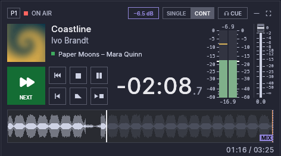
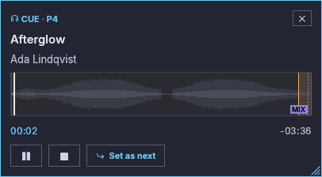

# Player

Jede Spalte ist ein Player. Die Player sind unabhängig: Jeder hat seine
eigenen Playlist-Tabs, sein Transportfeld, seine Lautstärke und seine
Ausgänge.

## Kopfzeile {#header}

| Element | Bedeutung |
|---|---|
| `P1` … `Pn` | Player-Nummer (die Zifferntaste, die ihn abspielt) |
| Buttons **Ausblenden** und **Maximieren** / **Wiederherstellen** | Die zwei kleinen Buttons am rechten Ende der Kopfzeile: den Player ausblenden oder ihn für einen Moment maximieren (**Wiederherstellen**, solange er maximiert ist). Abgeblendet, solange das Layout gesperrt ist, **Ausblenden** am letzten sichtbaren Panel und **Maximieren**, wenn nur ein Panel sichtbar ist (siehe [Layout](layout.md#maximize-a-panel)) |
| Statuspunkt und Beschriftung | **On Air** (rot), **Pausiert** (bernsteinfarben), **Gestoppt** (grau) |
| Schmale Spalten | Ist die Spalte für alle Symbole zu schmal, lässt die Kopfzeile zuerst das unwichtigste weg (den Statustext, dann **Andere stumm**, den Hinweis des Eintrags, **Stopp danach**, **Mix** / **Blende**, den Statuspunkt), sodass sich nie etwas überlappt. Die Player-Nummer, **CUE**, der Modus, **BP**, das Verstärkungs-Badge und die Buttons **Ausblenden** und **Maximieren** bleiben immer. Mache die Spalte breiter, um alle zu sehen |
| Symbol **Mix** / **Blende** | Ein Crossfade in den nächsten Track oder ein Ausblenden läuft. **Mix** leuchtet nie bei einem Player, dessen Main-Ausgang bit-perfect ist: Er überblendet nicht (siehe [Was es kostet](bit-perfect.md#what-it-costs)) |
| Symbol **Stopp danach** | Der Player stoppt, wenn der aktuelle Track endet |
| Symbol **Wiederholen** / **Stopp nach Track** | Der aktuelle Track wird wiederholt oder stoppt den Player an seinem Ende, aufgrund seiner eigenen Markierung im Playlist-Menü. Mit der Maus darüberfahren zeigt den ganzen Satz. Der eigene Button **Nach dem aktuellen Track stoppen** des Players hat Vorrang: Solange er aktiv ist, wird nur sein Symbol angezeigt |
| Verstärkungs-Badge | Bei eingeschalteter [Lautheitsnormalisierung](loudness.md#the-gain-in-the-player-header) die Verstärkung, mit der der Track on Air spielt (**+4.0 dB**), oder ein bernsteinfarbenes **0.0 dB**, wenn der Track unverändert spielt (noch keine Messung, ein Bit-perfect-Ausgang oder ein von der Normalisierung ausgenommener Track). Fahre mit der Maus darüber für den Grund. Wird angezeigt, solange der Player spielt oder pausiert ist |
| **BP** / **DSD** | Das Symbol erscheint nur bei einem Player, dessen Main-Gerät bit-perfect läuft; **BP** leuchtet, solange der aktuelle Track dieses Gerät unverändert erreicht. **DSD** ersetzt es, solange ein DSD-Track unverändert als DSD ausgegeben wird (siehe [Bit-perfect-Ausgabe](bit-perfect.md)). **Andere stumm** erscheint daneben, wenn dieser DSD-Stream andere Quellen vom Ausgang fernhält |
| **SINGLE** \| **CONT** | Wiedergabemodus (siehe unten): ein verbundenes Bedienelement, die leuchtende Hälfte ist der aktive Modus |
| **CUE** | Den nächsten Track auf dem CUE-Ausgang vorhören |

Die zwei kleinen Buttons am rechten Ende der Kopfzeile, **Ausblenden** und
**Maximieren** (oder **Wiederherstellen**), blenden den Player aus oder maximieren
ihn für einen Moment; dieselben zwei stehen im Menü eines Rechtsklicks auf den
Hintergrund der Kopfzeile (nicht auf einen ihrer Buttons) (siehe
[Layout](layout.md#maximize-a-panel)).

## Infozeile {#info-row}

- **Cover** des Tracks, der on Air ist, oder ein Schallplatten-Platzhalter.
- **Titel und Interpret** des Tracks, der on Air ist. Ein gestoppter Player
  zeigt den Track, den Play starten wird (seinen nächsten), mit Cover, Länge
  und Wellenform, bereit am Cue-in oder dort, wohin du in seine Wellenform
  geklickt hast.
- Ein Track, der abgespielt oder geladen wird, bevor seine Analyse fertig
  ist, hat seine Länge bereits, wenn der Header seiner Datei sie angibt:
  Countdown, `verstrichen / gesamt` und Klicken zum Springen funktionieren
  sofort, über einer flachen Linie, bis die Wellenform fertig ist. Speichert
  der Header sie nicht (rohe AAC-Dateien, MP3-Dateien ohne Längen-Frame,
  Matroska und WebM), zeigt die Gesamtzeit „—“, und die Wellenform lässt sich
  erst anklicken, wenn die Analyse beendet ist.
- **Stereo-Pegelmesser** (in der Spalte rechts vom Player, neben dem Fader; er
  erstreckt sich über die Infozeile und den Transport): der Pegel, den der
  Player ausgibt, nach seiner Lautstärke.
  - Ein durchgehender Balken pro Kanal, auf der Skala der Norm des
    Messertyps (standardmäßig der digitale Spitzenpegelmesser: −60 bis
    0 dBFS, wobei die obersten 20 dB die halbe Höhe einnehmen). Die Skala ist
    ein Lineal auf jeder Seite der Balken, auf beiden Seiten in den eigenen
    Einheiten des Messers beschriftet. Ihr oberes und ihr unteres Ende (beim
    digitalen Messer die Skalenuntergrenze) sind immer markiert; jede
    Beschriftung hat auf jedem Lineal einen Teilstrich, und kürzere
    Teilstriche zwischen den Beschriftungen funktionieren wie bei einem
    Messlineal: gleichmäßig verteilt auf runden Werten, alle 1 dB beim
    EBU-Messer und alle 5 dB unterhalb von −20 beim digitalen, wenn der
    Messer hoch genug ist, und alle 2, 2,5, 5 oder 10 dB (oder gar keine),
    wo er dafür zu niedrig ist. Beim digitalen (und benutzerdefinierten)
    Messer beschriftet ein hoher Messer mehr Werte: alle 1 dB von −20 bis 0
    und alle 5 dB zwischen den 10-dB-Marken unterhalb von −20 (−45, −55),
    immer gleichmäßig verteilt und nur dort, wo sie passen, ohne dass sich die
    Beschriftungen berühren; die anderen Messertypen behalten die
    Beschriftungen, die ihre Norm vorgibt. Der Abgleichpegel (−18 dBFS beim
    digitalen Messer) ist ein dickerer weißer Teilstrich auf beiden
    Linealen. Über den Balken oder zwischen ihnen wird nichts gezeichnet; was
    du in den Balken siehst, sind also nur der Pegel, das Halten der Spitze
    und die Farben.
  - Der Balken ist grün, gelb ab dem Warnpegel (−9 dBFS) und rot ab dem
    Gefahrenpegel (−3 dBFS). Die anderen Messertypen werden dort rot, wo es
    ihre Skala vorsieht (ab 0 VU, ab dem erlaubten Höchstpegel bei einem PPM).
  - K-System-Messer zeigen zwei Abschnitte: Der volle Balken ist der
    Durchschnittspegel (RMS), und der hellere Teil darüber reicht bis zur
    Spitze. Ihre Farben sind die des K-Systems: grün unter 0, bernsteinfarben
    von 0 bis +4, rot darüber.
  - Digitale Spitzenpegel-, K-System- und benutzerdefinierte Messer halten den
    höchsten Pegel einen Moment lang als Linie fest (das Halten der Spitze;
    seine Dauer ist **Spitzenwert halten** unter
    [Einstellungen → Pegelmesser](settings.md#meters), und 0 schaltet es aus).
    EBU-PPM-, DIN-PPM- und VU-Messer halten nichts.
  - Die Zahl darüber ist der höchste Pegel, seit der Eintrag gestartet wurde,
    in dBFS, rot im Gefahrenbereich. Sie bleibt nach einem Stopp stehen und
    beginnt von neuem, wenn ein Eintrag spielt (der nächste oder derselbe
    erneut) oder wenn du darauf klickst.
  - Die Zahl darunter ist die Lautheit in LUFS (EBU R128), grün innerhalb von
    ±1 LU um das Ziel (−23 LUFS).
  - Der Messertyp und jeder Pegel lassen sich unter
    [Einstellungen → Pegelmesser](settings.md#meters) ändern.
  - **Anzeigen über 0 dBFS.** Der Messer zeigt, was der Player ausgibt, und das
    kann den Vollausschlag überschreiten. Der Balken endet am oberen Ende der
    Skala, sodass dasselbe Rot 0 dBFS und alles darüber zeigt; nur die Zahl
    darüber sagt, wie weit, mit ihrem Vorzeichen (zum Beispiel `+3.5`).
    - Eine Datei kann selbst Pegel über dem Vollausschlag enthalten (eine
      Float-Datei oder eine verlustbehaftete Datei, deren dekodierte Spitzen
      ihn überschreiten).
    - Die Umrechnung der Rate kann Spitzen zwischen den Samples erzeugen: Ein
      Signal, das 0 dBFS berührt, zeigt nach 44,1 → 48 kHz etwa +3 dBFS. Die
      True-Peak-Option liest auch diese Spitzen.
    - Der Messer liest jeden Player für sich, nicht die Summe auf dem Gerät:
      Zwei Player auf einem Ausgang können sich über dem Vollausschlag
      aufsummieren, ohne dass einer der Messer es zeigt.
    - Nichts im Player fügt über 100 % hinaus Verstärkung hinzu. Ein
      Integer-Gerät clippt am Vollausschlag; ein Float-Gerät erhält den Pegel
      unverändert, und das Soundsystem oder der Treiber clippt ihn.
- **Lautstärke-Fader** (rechts vom Messer, so hoch wie dieser). Er folgt einem
  Mischpult-Gesetz: Er ist oben fein und wird nach unten steiler, sodass ein
  wenig Absenken den Pegel ein wenig senkt (90 % des Wegs sind etwa −2,5 dB, 50 %
  etwa −15,9 dB, 10 % etwa −48 dB). Oben ist 0 dB und unten Stille. Rastungen
  quer über den Fader markieren 0, −2, −4, −6, −8, −10, −12, −15, −20, −25, −30,
  −40, −50 und −∞ dB, mit dem Pegel rechts davon geschrieben.
  - Ziehe ihn: Der Fader bewegt sich um so viel wie der Zeiger, von dort aus, wo
    er ist, sodass er beim Greifen nie springt; ein Klick ohne Bewegen ändert
    nichts. Ein Ziehen über das obere oder untere Ende hinaus und zurück lässt den
    Knopf am Ende, bis der Zeiger dorthin zurückkehrt, wo er es erreicht hat, sodass
    der Knopf nie vom Zeiger entfernt landet.
  - Nutze das Mausrad: ein Schritt pro Rastung (etwa 0,6 dB nahe 0 dB).
  - Halte **Strg** oder **Umschalt** beim Ziehen oder Verwenden des Rads, um ihn
    zehnmal feiner zu bewegen.
  - Doppelklicke auf den Knopf, um zu 0 dB zurückzukehren (ein Doppelklick
    anderswo auf dem Fader bewirkt nichts).

  Der Pegel in dB (eine Nachkommastelle, oder −∞ für Stille) steht unter dem Fader,
  in derselben Zeile wie die Lautheitszeile des Messers, und der Tooltip zeigt ihn
  ebenfalls. Eine vor diesem Gesetz gespeicherte Session behält den Pegel jedes
  Players; nur die Position des Faders ändert sich. Bei einem Player, dessen
  Main-Ausgang bit-perfect ist, ist der Fader auf 100 % gesperrt und grau, er
  zeigt ein abgeblendetes 0.0, und sein Tooltip nennt den Grund (siehe [Was es
  kostet](bit-perfect.md#what-it-costs)).
- **Titel, Interpret** und die Zeile **Nächster** mit einem grünen Quadrat.
  Ist CUE aktiv, wird die Vorhörposition blau angezeigt.

## Transport {#transport}

| Button | Aktion |
|---|---|
| **Play / Weiter** (groß) | Gestoppt: den nächsten Track starten. On Air: in den nächsten Track überblenden (die Überblendzeit wird in den [Einstellungen](settings.md) festgelegt); solange er für einen von Weiter oder einem Segue gestarteten Crossfade überblendet, läuft über die Länge der Blende ein grünes Band über den Button, dessen Rand sich wie bei einem Cart von links nach rechts bewegt (ein von Zurück gestarteter Crossfade läuft stattdessen über den Button Zurück). Pausiert: fortsetzen. Ist der Track, der on Air ist, als nächster gesetzt, startet Play diesen Track mit der üblichen Blende neu. Bei einem Bit-perfect-Ausgang wechselt er sofort, ohne Blende, und sein Tooltip sagt es (siehe [Was es kostet](bit-perfect.md#what-it-costs)). |
| **Stopp** | Sofort stoppen (mit einer kurzen Rampe gegen Knacken) |
| **Ausblenden** | Über die Ausblendzeit (standardmäßig 2 s, in den [Einstellungen](settings.md) festgelegt) ausblenden und stoppen. Solange ein Ausblenden läuft, läuft über die Länge der Blende ein Band über den Button, dessen Rand sich von links nach rechts bewegt |
| **Pause** | Pausieren oder fortsetzen; blinkt bernsteinfarben, solange pausiert ist |
| **Nach dem aktuellen Track stoppen** (ein Play-Dreieck, dann ein Quadrat) | Stoppen, wenn der aktuelle Track endet, einmalig. Im SINGLE-Modus ist er nur verfügbar, solange der aktuelle Track wiederholt wird: Er beendet die Wiederholung, wenn der laufende Durchlauf endet. Um nach einem Track jedes Mal zu stoppen, wenn er gespielt wird, oder um einen Track zu wiederholen, nutze sein Menü in der Playlist (siehe [Playlists](playlists.md)) |
| **Vorheriger Track** (ein Balken und zwei Dreiecke) | Solange on Air: in den Track zurückblenden, den dieser Player zuvor gespielt hat, wie Weiter es tut. Erneut drücken, um weiter zurückzugehen. Der Track, den du verlässt, wird zum nächsten. Bei einem Bit-perfect-Ausgang wechselt er sofort, ohne Blende (siehe [Was es kostet](bit-perfect.md#what-it-costs)). |
| **Track neu starten** (ein Balken und ein Dreieck) | Zurück zum Anfang des aktuellen Tracks (sein Cue-in). Ein pausierter Player bleibt pausiert. |

Auf der Tastatur bewegen `Up` und `Down` die Auswahl durch die Playlist, `Enter`
setzt den ausgewählten Track als nächsten, und ein zweites `Enter` darauf
innerhalb der Zeit eines Doppelklicks spielt ihn ab. Siehe
[Tastatur](keyboard.md).

Buttons, die gerade nichts bewirken können, sind abgeblendet: Stopp und Neustart,
wenn nichts geladen ist, Pause und Ausblenden bei gestopptem Player, Zurück ohne
früheren Track oder während einer Blende. Ein Player merkt sich die letzten 50
gespielten Tracks (`players.history_len` in `config.json`, 0 bis 1000).

## Modi {#modes}

- **CONT (durchgehend):** Am MIX-Punkt startet der Player den nächsten Track
  und überlappt das Ende des aktuellen. Siehe
  [Marker und Mixen](markers-and-mixing.md).
- **SINGLE:** Jeder Track stoppt an seinem Ende. *Stopp danach* ist in diesem
  Modus nicht verfügbar, weil ohnehin jeder Track stoppt, außer solange der
  aktuelle Track wiederholt wird: Dann beendet es die Wiederholung, wenn der
  laufende Durchlauf endet.

## Countdown {#countdown}

Die große Zahl ist die Zeit bis zum Ende des Tracks (sein Cue-out), mit
Zehntelsekunden. Die verstrichene Zeit und die Gesamtzeit stehen in der Zeile
unter der Wellenform, rechts. In den letzten Sekunden vor dem Ende (standardmäßig
10, in den Einstellungen festgelegt) blinkt der Countdown rot.

## Wellenform {#waveform}

- Der bereits gespielte Teil ist in der Farbe der Wellenform gezeichnet, der
  Rest blasser.
  Bei einer violetten Wellenformfarbe hebt sich die violette MIX-Linie weniger
  ab; wähle eine andere Wellenformfarbe, wenn du sie unterscheiden musst.
- Die Kontur zeigt die Spitzen, schwach; der volle Körper darin ist der
  Durchschnittspegel (RMS). Bei einem lauten Track füllen die Spitzen die
  Höhe, und der Körper zeigt dennoch, wo der Track leiser oder lauter ist.
- Ein blauer schattierter Bereich am Anfang markiert das **Intro**, und ein
  Symbol zählt es herunter. Das Intro wird nur angezeigt, wenn es gesetzt ist.
- Ein orangefarbener schattierter Bereich am Ende markiert das **Outro**, mit
  eigenem Countdown.
- Eine gestrichelte violette Linie (die Farbe des Symbols **Mix**, damit sie
  nicht mit dem orangefarbenen Outro verwechselt wird) mit der Marke **MIX** zeigt,
  wo im CONT-Modus der nächste Track beginnt. Im SINGLE-Modus ist sie abgeblendet,
  ebenso bei einem Player, dessen Main-Ausgang bit-perfect ist und der nicht mischt
  (siehe [Was es kostet](bit-perfect.md#what-it-costs)).
- Die ganze Datei wird gezeichnet. Der stille Anfang und das stille Ende, die
  die Wiedergabe überspringt (vor dem Cue-in und nach dem Cue-out), sind dunkler
  gezeichnet, mit einer dünnen Linie, wo die Wiedergabe beginnt und endet. Ist
  **Cue-in und Cue-out verwenden** ausgeschaltet (Einstellungen → Player), ist
  nichts dunkler, und die beiden Linien sind abgeblendet: Die Wiedergabe läuft
  vom Anfang bis zum Ende der Datei, und Cue-in und Cue-out bedeuten in diesem
  Handbuch diese beiden Enden.
- Fahre mit der Maus darüber, um die Zeit unter dem Zeiger zu sehen. **Klicke,
  um dorthin zu springen.** Bei einem gestoppten Player wählt ein Klick, wo
  **Play** den nächsten Track startet: Die Abspielposition und der Countdown
  wandern dorthin, und nichts spielt, bis du Play drückst. Einen anderen
  nächsten Track zu wählen, ihn zu verschieben oder zu entfernen oder Stopp
  führt zurück zum Cue-in; ebenso jede andere Art, einen Track zu starten, und
  Neustart, Zurück und das automatische Weiterschalten verwenden immer das
  Cue-in. Ein Klick vor dem Cue-in (im dunkleren Anfang) wählt das Cue-in. Ein
  Klick am oder nach dem Cue-out (im dunkleren Ende) hebt eine frühere Wahl auf:
  Play startet am Cue-in. Ein Klick ist Drücken und Loslassen, ohne den Zeiger
  mehr als ein paar Pixel zu bewegen.
- **Drücken und Ziehen** verschiebt die gezoomte Ansicht entlang des Tracks,
  als würdest du ihn greifen. Ein Ziehen springt nie, und ohne Zoom bewirkt es
  nichts. Alt-Ziehen bearbeitet weiterhin Marker.
- **Mausrad** über der Wellenform: um den Zeiger herum hinein- und
  herauszoomen, bis zum feinsten Detail, das die Analyse hat. **Shift+Rad**
  (oder ein seitliches Rad) bewegt entlang des Tracks. Solange gezoomt ist,
  folgt die Ansicht der Wiedergabeposition, außer in den 10 Sekunden, nachdem
  du gezoomt oder sie verschoben hast (`ui.follow_current_grace_secs`; 0
  schaltet das Folgen aus). **Gesamtansicht** in der oberen rechten Ecke, ganz
  Herauszoomen oder ein neuer Track zeigen wieder den ganzen Track.

## CUE (Vorhören) {#cue-pre-listen}

Ein Druck auf **CUE** (oder **Auf CUE vorhören** im Menü eines Tracks) spielt
den Track auf dem CUE-Ausgang des Players ab, zum Beispiel einem Kopfhörer,
und öffnet ein kleines **CUE-Fenster** für diesen Player. Es können mehrere
Fenster offen sein, eines pro Player. Siehe [Einstellungen](settings.md), um das
CUE-Gerät zu wählen. Ein Player braucht einen Cue-Ausgang: Ohne einen sind **CUE**
und **Auf CUE vorhören** abgeblendet, und beim Darüberfahren steht der Grund.

Mit einer einzigen Soundkarte kann der Cue-Ausgang der Sendeausgang selbst sein
(oder ihn mit einem anderen Player oder der Cartwall teilen). Ein Vorhören dort ist
auf Sendung zu hören, daher:

- solange nichts auf diesem Ausgang spielt, startet CUE sofort;
- solange dort etwas spielt (ein Player spielt oder ist pausiert, ein Cart, ein
  anderes Vorhören, das Vorhören der Bibliothek), fragt CUE zuerst:
  **Trotzdem vorhören** oder **Abbrechen** (Abbrechen ist die Vorgabe: Esc und
  Enter brechen ab). Dieselbe Frage kommt vom Track-Menü, vom CUE-Fenster, von der
  Cartwall und vom Bibliotheksfenster;
- startet etwas auf diesem Ausgang, während ein Vorhören spielt, das du nicht
  bestätigt hast, stoppt das Vorhören, und die Statusleiste sagt, warum. Ein
  Vorhören, das du bestätigt hast, spielt weiter.

Der Tooltip des CUE-Buttons sagt, wenn sein Vorhören auf dem Sendeausgang
ausgegeben wird.

Das Fenster zeigt:

- den Titel und den Interpreten;
- die Wellenform der ganzen Datei mit der CUE-Position. Sie funktioniert wie
  die des Players: klicken, um dorthin zu springen, mit dem Rad zoomen, zum
  Verschieben ziehen, **Gesamtansicht**, die Intro- und Outro-Countdowns und die
  Intro-, Outro- und MIX-Marker, die du hier wie am Player bearbeitest (siehe
  [Marker und Mixen](markers-and-mixing.md)). Ein CUE spielt die ganze Datei,
  daher ist nichts dunkler gezeichnet, Cue-in und Cue-out sind abgeblendete
  Linien, und das Outro zählt bis zum Ende der Datei herunter. Ihr Zoom ist ihr
  eigener: Die Wellenform des Players bewegt sich nicht. Solange das CUE
  spielt, folgt eine gezoomte Ansicht seiner Position wie die des Players; ein
  pausiertes CUE behält die Ansicht, die du eingestellt hast, sodass du
  hineinzoomen und Marker setzen kannst. Ein CUE, das nach dem Schließen seines
  Fensters oder auf einem anderen Track gestartet wird, zeigt die ganze Datei;
- die verstrichene Zeit und die Restzeit bis zum Ende der Datei (ein CUE spielt
  ganze Dateien);
- **CUE pausieren** / **CUE fortsetzen**, **CUE stoppen** und **Als nächsten
  setzen**. **Als nächsten setzen** macht den vorgehörten Track zum nächsten
  des Players und lässt das CUE weiterspielen. Der Button ist abgeblendet,
  wenn der Track bereits der nächste ist. Ist der vorgehörte Track der, der on
  Air ist, spielt er noch einmal, wenn der aktuelle Durchlauf endet.

Solange das CUE pausiert ist, blinkt sein Button **CUE pausieren** (angezeigt
als **CUE fortsetzen**) bernsteinfarben, wie der des Players selbst.

Ziehe eine Kante oder eine Ecke des Fensters, um es zu vergrößern: Die
Wellenform nimmt die zusätzliche Breite und Höhe ein, was beim Setzen von
Markern hilft. Du kannst es wieder verkleinern, bis auf seine erste Größe. Das
nächste CUE-Fenster, von jedem Player, öffnet sich in der zuletzt gewählten
Größe, auch nach einem Neustart.

Ein Sprung bei pausiertem CUE lässt es pausiert. Der Schließen-Button des
Fensters (**Schließen und CUE stoppen**) oder **CUE stoppen** stoppt das CUE.

Läuft ein CUE, setzt das Setzen eines nächsten Tracks (Doppelklick) oder ein
einzelner Klick auf eine Zeile das CUE auf diesen Track, von seinem Cue-in aus;
war es pausiert, spielt es wieder. Ein Track, dessen Datei fehlt oder nicht
lesbar ist, lässt das CUE, wo es ist.
