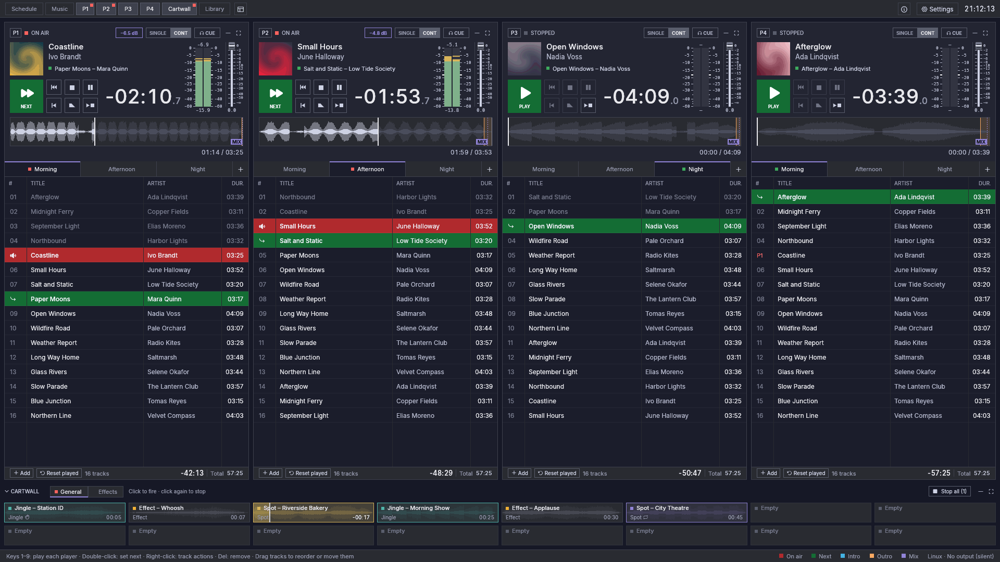

# Fauste Player — Guide de l'utilisateur

Ce guide a été traduit par IA à partir du guide en anglais (v0.12.0-308-gdf2987e0, commit df2987e) et peut contenir des erreurs. En cas de différence, la version anglaise fait foi. <a href="../index.html" hreflang="en">Lire l'original en anglais</a>

Fauste Player est une application de diffusion (playout) pour les studios de
radio. Elle exécute plusieurs **lecteurs** indépendants côte à côte. Chaque
lecteur a ses propres playlists et son propre transport. Les lecteurs peuvent
enchaîner les pistes avec des mixages en recouvrement, pré-écouter sur une
sortie **CUE** séparée et survivre aux plantages sans rien mettre à
l'antenne d'eux-mêmes.

> **Conçu avec l'aide de l'IA, fourni tel quel.** Fauste Player, ce guide et
> ses traductions ont été développés avec l'aide substantielle d'outils d'IA.
> Il est fourni sans aucune garantie et vous l'utilisez à vos risques et
> périls : voir l'[avertissement](https://github.com/sanchezfauste/fauste-player#disclaimer).

| Guide | Contenu |
|---|---|
| [Premiers pas](getting-started.md) | Installation, premier démarrage, ajout de musique, lecture |
| [Lecteurs](players.md) | La colonne du lecteur : transport, modes, compte à rebours, forme d'onde, CUE |
| [Playlists](playlists.md) | Onglets, tableau des pistes, glisser-déposer, menu contextuel, fichiers M3U/PLS |
| [Mur de cartouches](cartwall.md) | Cartouches instantanées : lancement, pages, boucles, cartouches exclusives, configuration |
| [Marqueurs et mixage](markers-and-mixing.md) | Cue-in/cue-out, point MIX, intro et outro, analyse automatique |
| [Paramètres](settings.md) | Sorties audio, lecteurs, analyse, playlists, MIDI, contrôle à distance |
| [Normalisation du loudness](loudness.md) | Toutes les pistes et cartouches au même loudness avec un gain fixe par piste : le badge de gain, exclure et ajuster une piste, sorties bit-perfect |
| [Sortie bit-perfect](bit-perfect.md) | Un mode particulier : pas de fondus enchaînés, volume à 100 %. Périphériques exclusifs qui suivent la fréquence de chaque fichier, le badge BP, sortie DSD, vérification d'une chaîne |
| [Clavier](keyboard.md) | Raccourcis |
| [Surfaces de contrôle MIDI](midi.md) | Boutons, faders et voyants sur des contrôleurs MIDI |
| [Contrôle à distance](remote-control.md) | Piloter Fauste Player par le réseau : API HTTP, sécurité |
| [Données et sauvegardes](data-and-backups.md) | Emplacement des fichiers, sauvegarde automatique, récupération après un plantage, mode portable |
| [Dépannage](troubleshooting.md) | Pas de son, périphérique perdu, fichiers marqués indisponibles, journaux |

L'interface est disponible en anglais, espagnol, catalan, néerlandais,
français, galicien, allemand, italien, basque, polonais et portugais. Elle
suit la langue du système d'exploitation, sauf si vous en choisissez une dans
les Paramètres. L'interface, dans toutes les langues, anglais et espagnol
compris, a été produite par IA et peut contenir des erreurs. Les corrections
sont les bienvenues sous forme d'issues ou de pull requests.

Le guide est aussi disponible dans d'autres langues, traduit par IA
à partir de ce guide en anglais : dans le [guide en ligne](https://sanchezfauste.com/fauste-player/guide/),
choisissez-en une avec le bouton en forme de globe dans la barre supérieure.
Une page traduite l'indique en haut et
renvoie vers la page en anglais, qui fait référence quand les deux
diffèrent.
