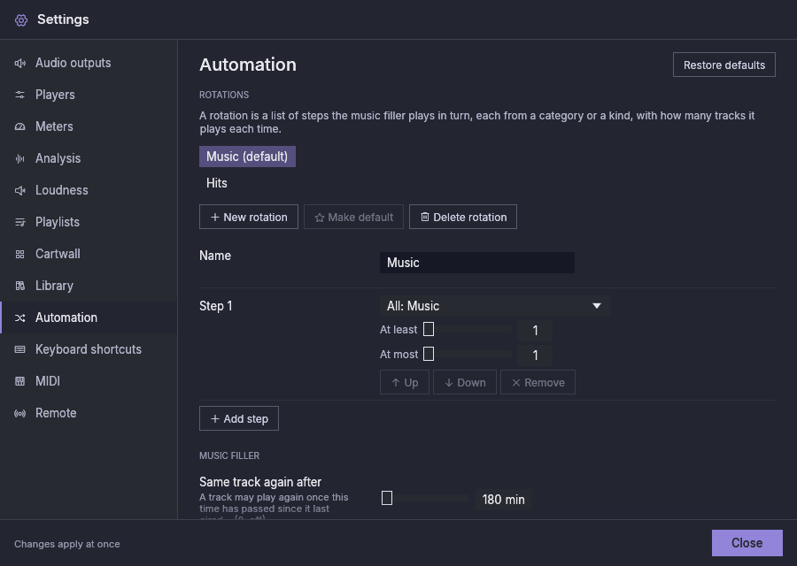

# Automatisation

L'automatisation garde la station à l'antenne quand personne n'est au studio.
Cette version a le **remplissage musical**, un lecteur qui choisit la musique
tout seul, à partir des règles que vous fixez, et qui ne s'arrête jamais faute
de liste, et la colonne **Grille**, qui exécute les blocs horaires du jour,
faits à partir de modèles dans les Paramètres.
Les lecteurs que vous utilisez déjà (P1 … Pn) ne sont pas touchés : ils
restent les vôtres pour les émissions que vous préparez et jouez en direct.

## La colonne Grille {#the-log-column}

La colonne **Grille** joue les **blocs** du jour : des groupes d'éléments avec
une heure de début (un indicatif horaire, des spots, une émission). Affichez-la
avec la tuile **Grille** de la barre supérieure, comme vous affichez un
lecteur.

Sa liste ressemble à une playlist, groupée par blocs. Chaque bloc commence par
une ligne d'en-tête : son heure de début, combien d'éléments il a et combien de
temps ils durent, « modifié pour ce jour » quand vous l'avez modifié
aujourd'hui et, en ambre, de combien il déborde sur le bloc suivant. Viennent
ensuite ses éléments, avec l'**Heure** à laquelle chacun doit commencer. La
liste montre aujourd'hui, le dernier bloc d'hier et le premier de demain.
L'élément à l'antenne et le suivant sont marqués comme sur un lecteur ; les
éléments déjà diffusés sont atténués, et un élément qui n'a pas été diffusé
(**non diffusé**) est barré. Une horloge marque un élément à **heure fixe**,
qui ne joue qu'à son heure. Un **titre de catégorie** montre la piste choisie
pour lui dès qu'il devient le suivant (ou vient après le suivant dans son
bloc), suivie de la catégorie : c'est la piste qui jouera. Si la catégorie n'a
aucune piste qui puisse jouer (aucune ne lui est assignée, ou leurs fichiers
manquent), la ligne le dit en ambre, et l'élément ne sera pas diffusé. Un
élément dont le fichier s'avère illisible au moment de jouer est sauté et
marqué non diffusé lui aussi. Les pistes s'assignent à une catégorie dans la
bibliothèque. La ligne du **remplissage musical** dit jusqu'à quand il joue, et
apparaît à l'antenne tant que le remplissage musical joue pour la Grille. Un
suivant dont l'heure est passée affiche son heure en ambre. Faites glisser la
ligne entre deux en-têtes de colonne pour changer la largeur des colonnes,
comme sur une playlist ; les fenêtres de modèle et de jour utilisent les mêmes
largeurs.

### Modifier la grille du jour {#changing-todays-log}

La Grille se modifie comme une playlist, et la modification ne vaut que pour
ce jour-là : le modèle reste tel quel.

- Les boutons en bas de la colonne : **+ Titre…** ouvre la bibliothèque, pour
  y glisser des pistes vers la liste ; **+ Titre de catégorie…** et
  **+ Remplissage musical (rotation)…** demandent lequel et l'ajoutent juste
  sous la ligne sélectionnée (cliquez sur une ligne pour la sélectionner ;
  sélectionnez un en-tête de bloc pour ajouter au début de ce bloc), ou, sans
  rien de sélectionné ou sous une ligne qui ne peut plus changer, à la fin du
  bloc à venir ; **+ Bloc horaire…** demande une heure, la première libre étant
  déjà remplie. Quand la colonne est trop étroite pour tous, ceux qui ne
  tiennent pas sont derrière **⋯**.
- Glissez des pistes de la bibliothèque, ou des fichiers audio de votre
  gestionnaire de fichiers, sur une ligne pour les mettre avant elle (ou après,
  sur la moitié inférieure de la ligne, comme sur une playlist : c'est ainsi
  qu'ils vont à la fin d'un bloc), et glissez des lignes au sein du même jour
  pour les déplacer. La ligne que vous ajoutez est sélectionnée et amenée à
  l'écran, si bien que la suivante que vous ajoutez va dessous.
- Clic droit sur une ligne pour **Heure fixe** et **Retirer de la grille du
  jour**. Cliquez (ou clic droit) sur un en-tête de bloc pour ajouter un
  **Titre…**, un **Titre de catégorie…** ou un **Remplissage musical
  (rotation)…** à la fin de ce bloc, ou pour **Changer l’heure…**, **Retirer
  le bloc** et, sur un bloc modifié, **Revenir au modèle**.
- Pendant que vous glissez sur un en-tête de bloc, la ligne en dessous montre
  que le dépôt va au début de ce bloc ; pour mettre des lignes à la fin du bloc
  du dessus, déposez-les sur la moitié inférieure de sa dernière ligne.
- Ce qui a déjà joué, l'élément à l'antenne et les jours passés ne peuvent pas
  être modifiés. Une modification du bloc à l'antenne prend effet après
  l'élément à l'antenne.

La colonne Grille a l'en-tête et les boutons d'un lecteur, et ils fonctionnent
comme sur un lecteur :

- **Lecture** joue l'élément marqué comme suivant et lance l'automatisation :
  chaque bloc joue alors à son heure, et le remplissage musical joue entre les
  blocs. Quand le suivant a été choisi par l'horloge et que son bloc commence
  plus tard, la musique joue jusque-là. Rien ne démarre tout seul : après
  chaque démarrage de l'application, l'automatisation est arrêtée jusqu'à ce
  que vous appuyiez sur Lecture.
- **Pause**, **Stop** et **Stop en fondu** agissent sur ce qui est à l'antenne
  pour la Grille (son élément, ou la chanson du remplissage musical entre les
  blocs) et arrêtent l'automatisation. Lecture après Pause reprend là où elle
  en était ; pendant la pause, le suivant ne bouge pas, et à la reprise le bloc
  suivant garde son heure. Lecture après un Stop pendant la musique remet de la
  musique, et le bloc suivant commence à son heure.
- **Stop à la fin** laisse se terminer ce qui est à l'antenne, puis
  l'automatisation s'arrête. Si la musique joue et que l'heure d'un bloc
  arrive d'abord, le bloc commence à l'heure et l'automatisation s'arrête après
  son premier élément.
- **Piste précédente** ne fait rien sur la Grille.
- **SINGLE** rend la Grille manuelle : Lecture joue l'élément suivant, et
  s'arrête après lui ; aucun bloc ne démarre tout seul.

Pendant que le remplissage musical joue entre les blocs, l'en-tête de la
Grille indique **Remplissage musical · *rotation*** (la rotation qu'il joue)
et ses boutons fonctionnent toujours ; la chanson, son vumètre et sa forme
d'onde ne sont que dans la colonne Remplissage musical.

Quand l'automatisation s'arrête après un élément, le suivant reste sur
l'élément situé sous celui qui a joué, et Lecture le joue, quelle que soit
l'heure : c'est vous qui choisissez. Quand elle s'arrête pendant la musique,
Lecture remet de la musique jusqu'au bloc suivant, sauf si vous avez choisi un
autre suivant. Pour changer ce qui passe ensuite, double-cliquez sur un
élément, ou faites un clic droit dessus et choisissez **Passer ensuite**.
**Revenir à l’horloge**, dans le même menu, met comme suivant ce que dit
l'heure.

## Modèles et jours {#templates-and-days}

La Grille joue chaque jour à partir d'un **modèle** : une journée de blocs.
Une nouvelle installation en a un, « Base », pour tous les jours. Les modèles
se font dans Paramètres → **Automatisation**, sous **Modèles et jours** (pas
sur Android) ; la colonne Grille ne modifie que le jour même, comme ci-dessus.

- **Modèles.** Choisissez-en un et appuyez sur **Modifier…** (ou
  double-cliquez dessus) pour l'ouvrir ; **Nouveau modèle**, **Dupliquer** et
  **Supprimer** sont à côté, et son nom en dessous.
- **Semaine type.** Le modèle qu'utilise chaque jour de la semaine.
- **Jours.** Choisissez une date dans le calendrier (les dates modifiées sont
  en ambre). Une date peut utiliser un autre modèle que celui de son jour de la
  semaine (un jour férié un jeudi peut utiliser celui du week-end).
  **Modifier le jour…** ouvre cette date, pour modifier ses blocs pour cette
  date seulement ; les dates passées ne peuvent pas être modifiées.

Un modèle ou une date s'ouvre dans sa propre fenêtre, qui ferme les
Paramètres. C'est la même liste que la colonne Grille, et elle se modifie de
la même façon : les boutons en bas (Titre…, Titre de catégorie…, Remplissage
musical (rotation)…, Bloc horaire…, qui ajoutent sous la ligne sélectionnée),
des pistes glissées depuis la bibliothèque (ou des fichiers depuis votre
gestionnaire de fichiers) sur une ligne, des lignes glissées pour les
déplacer, le menu du clic droit des lignes et le menu des en-têtes de bloc.
Elle ne joue jamais, et peut rester ouverte à côté de la bibliothèque. La
fenêtre d'aujourd'hui montre ce qui a joué et ce qui joue, comme la Grille ;
la fenêtre d'un jour se ferme à minuit, quand ce jour ne peut plus changer.

Un **titre de catégorie** dans un modèle joue une piste de cette catégorie,
une différente à chaque fois. L'élément **Remplissage musical** choisit la
rotation que le remplissage musical joue après le bloc (la rotation par défaut
quand le bloc n'en a pas). Quand les éléments d'un bloc durent plus longtemps
que le temps jusqu'au bloc suivant, son en-tête dit de combien, en ambre ;
vous pouvez quand même le garder ainsi.

Une modification d'une date est marquée « modifié pour ce jour » sur son bloc,
et **Revenir au modèle**, dans le menu de l'en-tête du bloc, l'annule. Les
modifications ultérieures du modèle atteignent toujours les blocs que vous
n'avez pas modifiés à cette date. Une modification d'un modèle faite pendant
qu'un de ses blocs est à l'antenne laisse ce bloc tel quel pour aujourd'hui
(il affiche « modifié pour ce jour ») ; la modification l'atteint à partir du
lendemain.

## Le remplissage musical {#the-music-fill}

Le remplissage musical est la colonne **Remplissage musical**. Elle est
masquée tant que vous ne l'affichez pas : cliquez sur la tuile **Remplissage
musical** à gauche de la barre supérieure. Elle se place à gauche de P1.

Elle ressemble à un lecteur et fonctionne comme lui : la grande horloge, la
forme d'onde, les boutons de transport, le fader et la liste de pistes. La
différence est la liste :

- elle **se remplit toute seule** à partir d'une **rotation** (plus bas),
  toujours environ une demi-heure à l'avance (*avance*, dans Paramètres →
  Automatisation) ;
- elle **se rogne toute seule** : elle garde les 50 dernières pistes jouées et
  retire les plus anciennes, si bien qu'elle peut tourner pendant des
  semaines ;
- avant un bloc de la grille, elle peut **échanger des chansons qu'elle a
  choisies elle-même** contre d'autres dont la durée convient au temps restant
  (voir plus bas) ; les chansons que vous avez ajoutées ne sont jamais
  touchées ;
- vous pouvez toujours la **modifier à la main** : glisser des pistes de la
  bibliothèque, réordonner les lignes, retirer une chanson dont vous ne voulez
  pas. Une ligne que vous ajoutez est marquée d'une main et n'est jamais
  remplacée ; une ligne que vous retirez ne compte pas comme jouée.

Ses sorties se règlent dans Paramètres → Sorties audio, sur la ligne
**Remplissage musical**, comme pour tout lecteur. Elle n'a pas de numéro, ni
de raccourcis clavier ou d'assignations MIDI, et le contrôle à distance ne la
voit pas.

Appuyez sur **Lecture** pour la démarrer et sur **Stop à la fin** pour laisser
se terminer la chanson à l'antenne puis s'arrêter. Comme tout lecteur, elle ne
démarre jamais toute seule, pas même après un redémarrage. Tant qu'elle joue
pour la Grille entre les blocs, l'arrêter ou la mettre en pause arrête aussi
l'automatisation, et son Stop à la fin arrête l'automatisation quand la
chanson se termine ; si l'heure d'un bloc arrive d'abord, le bloc joue et la
marque est effacée. Après une pause de la Grille pendant la musique, Lecture
sur la colonne Remplissage musical joue la chanson pour elle-même : la Lecture
de la Grille ne la reprend plus, et son Stop ne l'arrête plus.

Au-dessus de sa liste, là où un lecteur a ses onglets de playlist, la colonne
Remplissage musical montre la **rotation** qu'elle joue. Choisissez-en une
autre là : les chansons qu'elle avait en file sont remplacées, celles que vous
avez ajoutées restent. Quand la rotation ne trouve rien à jouer (ses
catégories sont vides, ou tous les fichiers sont manquants), la barre le dit.

## Rotations {#rotations}

Une **rotation** est une courte liste d'**étapes** que le remplissage musical
joue à tour de rôle, puis de nouveau depuis la première. Chaque étape nomme
d'où viennent ses pistes (une catégorie de la bibliothèque avec ses
sous-catégories, ou toutes les pistes d'un type) et combien elle en joue à
chaque fois, sous la forme d'une plage :

| Étape | Joue |
|---|---|
| Succès actuels | 2–3 |
| Indicatifs de la station | 1 |
| Or | 0–1 |

Avec une plage, un indicatif de la station vient après deux chansons une fois
et après trois la fois suivante. Une plage qui part de **0** permet à une
étape de sauter certains tours : avec Or à 0–1, une chanson d'or joue après
l'indicatif de la station tantôt oui, tantôt non. Le maximum est toujours d'au
moins 1. L'une d'elles est celle **par défaut** : une nouvelle installation en
a une, **Musique**, qui joue toute votre musique.

Une étape dont la catégorie n'a aucune piste qui puisse jouer (une catégorie
vide, ou des fichiers manquants) joue à son tour une chanson de la rotation
par défaut (n'importe quelle musique, si l'étape appartient à la rotation par
défaut elle-même), si bien que les autres étapes gardent leur place : un
indicatif de la station vient toujours entre les chansons.

Les rotations se font dans Paramètres → Automatisation :

## Comment il choisit {#how-it-chooses}

Dans une étape, le remplissage musical préfère les pistes qui sont restées le
plus longtemps sans passer à l'antenne, avec un peu de hasard parmi elles pour
que l'ordre ne devienne jamais un cycle fixe. Il tient aussi à distance :

- **la même piste :** elle peut rejouer une fois 3 heures écoulées, ou quand la
  moitié des autres pistes de son étape sont passées depuis, selon ce qui
  arrive en premier ;
- **le même artiste :** pas avant 30 minutes.

Tout ce qui est passé à l'antenne compte, qu'il vienne du remplissage musical,
d'un lecteur ou du mur de cartouches ; la pré-écoute ne compte pas. Quand une
petite catégorie ne peut pas tenir les règles, le remplissage musical cède
plutôt que de se taire : d'abord sur l'artiste, puis sur la piste.
Paramètres → Automatisation a toutes les valeurs, et c'est là que l'on fait,
renomme et modifie les rotations (voir [Paramètres](settings.md#automation)).

Avant un bloc de la grille, le remplissage musical choisit aussi ses dernières
chansons d'après leur durée, pour que la musique se termine proprement : la
chanson qui s'estompe au début du bloc joue encore à l'heure du bloc et perd
au plus 30 secondes après elle, et aucune chanson ne démarre si elle ne devait
jouer que moins de 45 secondes. Il respecte aussi les règles d'artiste et de
piste chaque fois qu'il le peut. Quand aucune chanson de la rotation ne
satisfait les deux, c'est celle qui perd le moins qui joue, si bien que
quelques secondes d'une chanson peuvent parfois s'entendre. Une pause de la
musique décale les chansons qui suivent, et le remplissage musical les choisit
de nouveau. Le remplissage musical évite aussi les chansons, et les artistes,
qu'un bloc joue peu après. Ces deux valeurs ne peuvent être changées pour
l'instant que dans le fichier de configuration (`automation.max_fade_cut_secs`
et `automation.min_song_play_secs`).

Un **Indicatif horaire** est un type de piste à part entière (Bibliothèque →
Type ▸ Indicatif horaire), pour l'identification de la station en début
d'heure.
