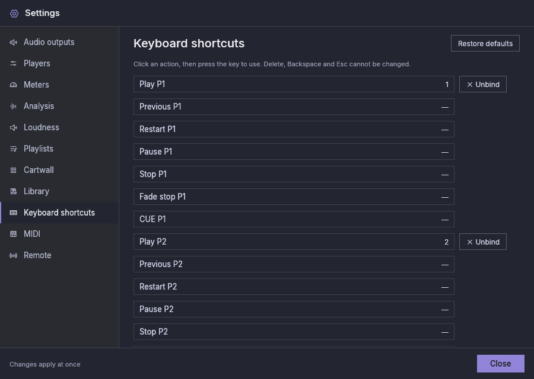

# Clavier

| Touche par défaut | Action |
|---|---|
| `1` … `9` | Lecture sur les lecteurs 1 à 9 (comme leur bouton PLAY) |
| `F1` … `F12` | Lancer les cartouches 1 à 12 de la page affichée |
| `Ctrl+Space` | Arrêter toutes les cartouches, ainsi que le CUE des cartouches (le bouton **Tout arrêter** du mur de cartouches) |
| `Up` / `Down` | Déplacer la sélection dans la playlist affichée par le lecteur que vous avez utilisé en dernier (le premier lecteur affiché au démarrage), en faisant défiler la ligne dans la vue. Sans sélection, la première pression sélectionne la piste suivante du lecteur, ou la première piste |
| `Enter` | Définir la piste sélectionnée comme piste suivante du lecteur. Appuyez une seconde fois sur `Enter` sur la même piste dans le délai d'un double clic (le délai de double clic du système) pour la lire, comme le raccourci de lecture du lecteur. Une autre touche, un clic ou un changement de sélection entre les deux, ou une attente plus longue, en refait un premier `Enter` |
| `Delete` / `Backspace` | Retirer la piste sélectionnée de la playlist affichée (pas pendant qu'elle est à l'antenne). Masquer un lecteur efface sa sélection |
| `Esc` | Fermer les menus et les Paramètres ; annuler la boîte de dialogue « De l'audio est à l'antenne » ; effacer la sélection |

- Maintenir une touche enfoncée ne la répète pas : un `1` maintenu appuie une
  seule fois sur PLAY.
- Une touche de raccourci ne fait que son raccourci : si un bouton a le focus
  du clavier, `Space` ou `Enter` associée à un raccourci n'appuie pas en
  plus sur ce bouton, et un raccourci sur `Tab` ou sur une flèche ne déplace
  pas le focus.
- Les raccourcis sont ignorés pendant que vous saisissez du texte dans un
  champ, comme le nom d'une playlist.
- Un raccourci dont le bouton est grisé ne fait rien (par exemple Stop sur un
  lecteur arrêté). La seule exception est le raccourci qui arrête toutes les
  cartouches, et qui arrête aussi le CUE des cartouches.

## Changer les raccourcis {#changing-shortcuts}

Dans **Paramètres → Raccourcis clavier**, cliquez sur une action et appuyez
sur la touche (avec Ctrl, Alt, Shift ou Cmd si vous le souhaitez). Si une autre
action utilise déjà cette touche, son nom est affiché. Choisissez **Attribuer**
pour déplacer la touche, ou **Annuler**. **Retirer** supprime un raccourci et
**Rétablir les valeurs par défaut** (en haut à droite de la section) rétablit
le tableau ci-dessus. Actions disponibles, pour chaque lecteur (P1 … Pn ; la colonne **Musique**
n'a pas de raccourcis) et chaque cartouche :

- lecture, précédente, reprise au début, pause, stop, stop en fondu et CUE
  sur un lecteur (précédente et reprise au début n'ont pas de touche par
  défaut) ;
- lancer une cartouche de la page affichée ;
- arrêter toutes les cartouches (le **Tout arrêter** du mur de cartouches) ;
- afficher ou masquer le mur de cartouches ;
- page de cartouches suivante ou précédente.

`Delete`, `Backspace` et `Esc` ne peuvent pas être modifiées. `Up`, `Down` et `Enter` sur la playlist ne fonctionnent que si aucun raccourci ne les utilise et si aucun bouton ni curseur n'a le focus du clavier.
