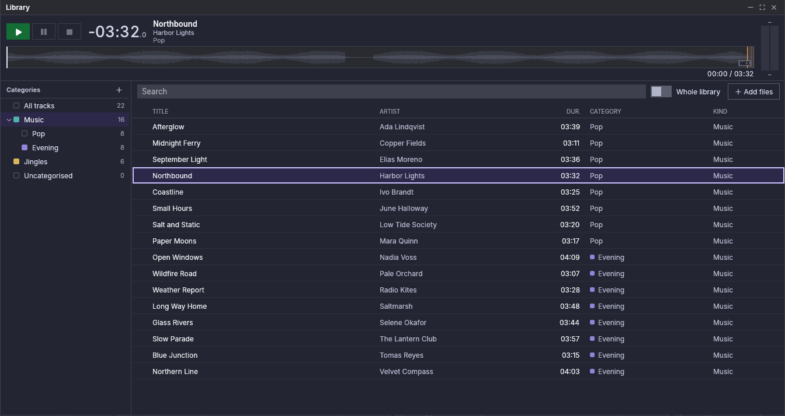

# Biblioteca

A biblioteca é todas as pistas que Fauste Player coñece: cada ficheiro que
engadiches a unha lista, a un cartucho ou á propia biblioteca é unha pista,
coas súas etiquetas, marcadores e axustes de sonoridade. A xanela da
biblioteca lístaas, agrúpaas en *categorías*, atópaas por texto e envíaas ás
listas e á cartucheira. É unha xanela no escritorio e nunha tablet; un
teléfono mostra a biblioteca na súa lapela **Biblioteca** (consulta [Nun
teléfono](#on-a-phone)).

## Abrir a xanela {#opening-the-window}

Fai clic na tesela **Biblioteca** da barra superior. Está acesa mentres a
xanela está aberta; fai clic nela de novo, ou no botón de pechar da xanela,
para pechala. A xanela flota sobre os reprodutores e a cartucheira e non os
bloquea: nada nela detén o audio nin os atallos da xanela principal.

Móvea pola súa barra de título e cambia o seu tamaño desde os bordos e as
esquinas. A barra de título ten tres botóns: **Minimizar a biblioteca** (só
queda a barra de título, onde estaba a xanela, ou na parte de arriba da área
principal cando a xanela está maximizada; fai clic de novo para
despregala), **Maximizar a biblioteca** (a xanela enche a área principal;
**Restaurar a biblioteca** devólvea ao seu tamaño) e **Pechar a biblioteca**.
Unha xanela que non caiba, despois de que a xanela principal encolla ou pase
a unha pantalla máis pequena, tráese de volta dentro da área principal.

A posición e o tamaño da xanela, o seu estado minimizado ou maximizado, o
ancho da árbore, as columnas, a orde e a categoría seleccionada gárdanse coa
sesión e volven no seguinte inicio. Tamén se garda se a xanela está aberta,
pero por iso non se reproduce nada por si só. O texto do campo de busca non se
garda.

## Categorías {#categories}

A árbore da esquerda agrupa as pistas. Arriba, **Todas as pistas**; despois as
túas categorías, que poden conter subcategorías; ao final, **Sen categoría**,
as pistas que non pertencen a ningunha categoría. Cada elemento mostra a súa
cor e unha conta: unha categoría conta as súas propias pistas e as das súas
subcategorías. Unha pista pertence como máximo a unha categoría.

- **Fai clic** nun elemento para listar as súas pistas na táboa. Unha
  categoría lista tamén as pistas das súas subcategorías.
- A **frecha** antes dunha categoría abre ou pecha as súas subcategorías.
  Gárdase cales están abertas.
- **Nova categoría** (＋ sobre a árbore) pide un nome, unha cor e un *tipo*. Unha
  categoría nova toma a cor e o tipo da categoría na que se crea; o tipo é o
  que toma unha pista cando entra na categoría, e cambialo despois deixa as
  pistas que xa están nela como están. Un nome non pode estar baleiro nin
  repetir o nome dunha irmá; as categorías aniñan só ata un límite.
- **Fai clic dereito** nunha categoría (ou pulsación longa nunha pantalla
  táctil) para **Nova subcategoría…**, **Cambiar o nome…**, **Cor**, **Tipo** e
  **Eliminar…**. No escritorio o menú tamén ten **Vixiar cartafol…**
  (**Cambiar cartafol vixiado…** e **Deixar de vixiar o cartafol** cando xa
  vixía un) e **Quitar pistas que faltan…**; consulta
  [Cartafoles vixiados](#watched-folders) e
  [Quitar pistas](#removing-tracks).
- **Arrastra** unha categoría para movela: sobre outra categoría para aniñala,
  ou ao oco entre dúas categorías para colocala alí. Unha categoría non pode
  ir dentro de si mesma. Nunha pantalla táctil a árbore só acepta toques e
  desprázase baixo un dedo; alí non se pode arrastrar unha categoría.

**Eliminar…** nomea o que se vai coa categoría: as súas subcategorías e todas
as pistas que hai nelas quítanse da biblioteca. Os ficheiros nunca se borran.
Se algunha desas pistas está en uso, unha segunda pregunta di cantas entradas
de listas e cartuchos as usan: **Quitar igualmente** quita as entradas das
súas listas e baleira os cartuchos. Non se quita nada mentres algunha delas
estea en antena; un aviso di o que soa.

A mesma árbore está en **Configuración → Biblioteca**, para crear, renomear,
cambiar a cor, cambiar o tipo, mover e eliminar categorías sen abrir a xanela
(non ten *Todas as pistas*, *Sen categoría* nin selección).

## Cartafoles vixiados {#watched-folders}

No escritorio unha categoría pode vixiar un cartafol. Fai clic dereito nela e
escolle **Vixiar cartafol…**, e despois elixe o cartafol. A categoría mostra
unha marca ⟳ antes da súa conta; pon o punteiro enriba para ler o cartafol.

- Cada ficheiro de audio do cartafol e dos seus subcartafoles únese á
  categoría. Os subcartafoles non crean subcategorías.
- Unha pista que xa está noutra categoría queda alí. Unha pista que non está
  en ningunha categoría únese a esta. Definir, cambiar ou deixar de vixiar
  nunca move unha pista: as pistas dun cartafol que xa non se vixía quedan na
  súa categoría.
- Mentres a aplicación funciona, o cartafol séguese: un ficheiro novo únese
  cando leva un momento quieto (`library.watch_debounce_ms`, 1 segundo de forma
  predeterminada, para que un ficheiro que aínda se está copiando non se lea a
  medio escribir). O cartafol tamén se examina cada vez que a aplicación
  inicia, para recoller o que cambiou mentres estaba pechada.
- Un ficheiro que desaparece do cartafol (borrado, movido ou renomeado) deixa a
  súa pista na biblioteca, marcada como ausente, cos seus marcadores. Se o
  ficheiro volve, a pista é normal de novo por si soa. Un ficheiro renomeado
  únese como pista nova co seu novo nome.
- Os cartafoles vixiados poden aniñarse. Un ficheiro baixo dous deles vai á
  categoría do máis interior; deixar de vixiar un deixa o outro seguido. O
  mesmo cartafol non pode vixiarse por dúas categorías: a aplicación di cal xa
  o ten.
- Nada do que fai un cartafol vixiado carga nin reproduce unha pista.

Se o cartafol non se pode seguir, a marca ⟳ cambia de cor e a súa dica di por
que: *Non se atopa o cartafol vixiado: …. Búscase de novo.* (por exemplo unha
unidade que non está montada), *Non se pode ler o cartafol vixiado: ….
Tentarase de novo.*, ou *Os cambios en … non se seguen; revísase ao iniciar e
tentarase de novo.* (o sistema negouse a vixialo). Un cartafol gardado como
unha ruta que non está completa (editada a man) non se vixía en absoluto, e a
marca dío.

Cada 30 segundos (`tuning.missing_recheck_ms`) a aplicación comproba que cada
cartafol vixiado siga aí, así que tamén se informa dunha unidade desenchufada
mentres funciona. Un cartafol con problemas inténtase de novo a ese ritmo e
examínase en canto volve. Un cartafol que non está aí, non se pode ler, ou
está baleiro mentres a biblioteca aínda ten pistas del (unha unidade ou un
recurso compartido sen montar adoita parecer un cartafol baleiro) conta como
non atopado. A vixilancia non marca entón ningunha das súas pistas como
ausente e non quita nada, tamén cando o cartafol está dentro doutro cartafol
vixiado.

Se baleiras un cartafol vixiado adrede, o aviso queda ata que volva haber
ficheiros nel ou deixes de vixialo, e as súas pistas quedan na biblioteca sen
marcarse como ausentes. Para quitalas, selecciónaas na táboa e escolle
**Quitar da biblioteca…**, ou escolle **Volver analizar** nelas: a análise
marca como ausentes as pistas cuxo ficheiro desapareceu, e **Quitar pistas
que faltan…** quítaas entón (se o cartafol aínda se vixía, o seu aviso
desaparece na seguinte comprobación).

Unha excepción á regra de arriba: unha pista que nunca foi analizada sempre se
marca como ausente cando a análise non atopa o seu ficheiro, estea onde estea.

Un subcartafol que non se pode ler sáltase e o rexistro dío; as ligazóns a
cartafoles (ligazóns simbólicas a cartafoles) non se seguen.

Os ficheiros novos van á análise detrás de todo o que precisa un reprodutor ou
un cartucho, así que un cartafol con miles de ficheiros tarda un pouco; o
progreso da análise móstrao.

O mesmo menú e a mesma marca están en **Configuración → Biblioteca**. Non
están en Android, que non vixía cartafoles: alí unha categoría pode tomar os
seus ficheiros dun cartafol do dispositivo que volves ler cando queiras
(consulta [Android → Biblioteca](android.md#library)).

## A táboa de pistas {#the-track-table}

A táboa lista as pistas do elemento seleccionado, nas mesmas columnas ca as
táboas das listas (as escollidas en **Configuración → Listas → Columnas da
táboa**, sen a posición `#`) seguidas de **Categoría** e **Tipo**. Unha cela
estreita á esquerda sinala unha pista cuxo ficheiro falta ou non se pode ler.
Unha pista que agarda a súa análise sinálase á dereita da súa cela de
**Título** (así que só cando a columna Título se mostra).

- Arrastra un separador da cabeceira para cambiar o ancho dunha columna; fai
  clic nunha cabeceira para ordenar por ela e outra vez para inverter. Os
  anchos e a orde gárdanse.
- **Clic** selecciona unha fila, **Ctrl** (**Cmd** en macOS) **clic** engade ou
  quita unha, **Shift clic** selecciona as filas entre o último clic e este. A
  selección só conserva filas que están listadas: unha fila que sae da táboa,
  por unha busca, outra categoría ou unha eliminación, sae da selección. Cada
  acción aplícase ás filas seleccionadas na orde da táboa.
- **Engadir ficheiros** (sobre a táboa) escolle ficheiros de audio e engádeos á
  biblioteca, na categoría seleccionada (sen categoría cando está seleccionado
  *Todas as pistas* ou *Sen categoría*).

Nunha pantalla táctil as filas só aceptan toques e desprázanse baixo un dedo;
unha pulsación longa abre o menú, e as pistas envíanse cos menús (abaixo), non
arrastrando.

## Busca {#search}

O campo sobre a táboa atopa pistas por texto. Mira no título, artista, álbum,
artista do álbum, compositor, xénero, comentario e nome do ficheiro, sen ter
en conta maiúsculas nin acentos, e unha pista lístase cando contén todas as
palabras que escribiches (en calquera orde e en calquera deses campos). Busca
no elemento seleccionado; activa **Toda a biblioteca** para buscar en todas as
pistas sexa cal for a selección. O alcance gárdase; o texto non. Baleira o
campo para ver de novo o elemento enteiro.

## O menú da fila {#the-row-menu}

Fai clic dereito nunha fila. Se a fila non está seleccionada, pasa a ser a
selección; se non, o menú actúa sobre todas as filas seleccionadas. A primeira
liña mostra o título da pista cando o menú é para unha pista, e cantas pistas
están seleccionadas cando é para varias.

| Elemento | Acción |
|---|---|
| Engadir a ▸ | Unha lista: as pistas engádense ao seu final |
| Engadir a un cartucho ▸ | Un cartucho da páxina da cartucheira que se ve: as pistas énchen o cartucho escollido e os seguintes cartuchos baleiros da páxina, na orde da grella. As pistas que non caben quedan fóra e un aviso conta cantas |
| Mover á categoría ▸ | Unha categoría, ou Sen categoría |
| Tipo ▸ | Música, Jingle, Efecto, Anuncio ou Voz |
| Editar etiquetas… | O editor de etiquetas (unha pista) |
| Sonoridade… | A xanela emerxente de sonoridade (unha pista) |
| Volver analizar | Analiza as pistas de novo |
| Volver aos marcadores automáticos | Descarta os marcadores manuais |
| Amosar a localización do ficheiro | Abre o cartafol do ficheiro (unha pista) |
| Quitar da biblioteca… | Quita as pistas da biblioteca, despois de preguntar (abaixo) |

## Preescoita {#pre-listening}

A barra baixo a barra de título preescoita a pista seleccionada na propia
saída **Biblioteca** da biblioteca (escollida en [Configuración → Saídas de
audio](settings.md#audio-outputs)), por exemplo uns auriculares. Un teléfono
preescoita desde a súa lista de pistas (consulta [Nun
teléfono](#on-a-phone)).

A barra mostra:

- **Preescoitar**, **Pausar a preescoita** e **Deter a preescoita**;
- o tempo restante da pista en grande, o seu título, artista e categoría;
- un vúmetro pequeno á dereita. Le só esta preescoita, nunca o vúmetro dun
  reprodutor nin o da cartucheira; fai clic nel para reiniciar o seu máximo;
- a forma de onda do ficheiro enteiro, cos seus marcadores, e unha liña
  `transcorrido / total` debaixo dela.

Preescoitar inicia a pista seleccionada desde o seu cue-in e reprodúcea ata o
final do ficheiro. Preescoitar nunha vista previa en pausa retómaa, e
Preescoitar nunha que soa non fai nada: Deter a preescoita e despois
Preescoitar comeza de novo desde o cue-in. A normalización de sonoridade
aplícase como no CUE dun reprodutor.

A forma de onda funciona como a da xanela CUE dun reprodutor: fai clic nela
para buscar (un clic ou soltar o rato busca; arrastrar non), amplíaa e móvea
coa roda, e edita os marcadores e abre **Sonoridade…** desde o seu menú
(consulta [Editar marcadores](markers-and-mixing.md#editing-markers)). Mentres
a vista previa está detida, un clic fixa en cambio onde comeza a seguinte
preescoita.

**A vista previa segue a selección.** Con varias filas seleccionadas, usa a
última na que fixeches clic.

- Mentres soa, seleccionar outra fila cambia a esa pista desde o seu cue-in e
  segue reproducindo, sen preguntar.
- Mentres está en pausa, a pista nova cárgase en pausa.
- Mentres está detida, queda detida e a barra mostra a pista nova.
- Non seleccionar nada (ningunha fila seleccionada, ou a fila seleccionada
  filtrada) deixa como está unha vista previa en marcha.
- Seleccionar unha pista que non se pode reproducir (o seu ficheiro falta ou
  é ilexible) detén a vista previa, e a barra di que o ficheiro non se pode
  reproducir.

**O que a detén.** Deter a preescoita; quitar a súa pista da biblioteca; pechar
a xanela (minimizala non). Nunca reproduce despois dun reinicio.

**Sen unha saída Biblioteca** (no escritorio; Android reproduce na saída
predeterminada en cambio, consulta [Android → Biblioteca](android.md#library))
Preescoitar aparece atenuado (pon o punteiro enriba para ver a razón) e unha
liña ao seu carón di «A preescoita necesita unha saída CUE da biblioteca», cunha
ligazón que abre Configuración → Saídas de audio na fila **Biblioteca**. A
barra aínda mostra a pista, a súa forma de onda e os seus marcadores.

**Nunha saída de antena.** A saída Biblioteca pode ser unha saída de antena (o
mesmo dispositivo e canles ca a Main dun reprodutor ou da cartucheira). Entón
funciona como o CUE dos reprodutores e da cartucheira (consulta [CUE
(preescoita)](players.md#cue-pre-listen)): mentres algo soa alí, Preescoitar
pregunta primeiro (**Preescoitar igualmente** ou **Cancelar**), e unha
preescoita que non confirmaches para cando algo comeza nesa saída.

## Arrastrar a listas e cartuchos {#dragging-to-playlists-and-carts}

Arrastra as filas seleccionadas (ou a fila desde a que empezas a arrastrar,
cando non está seleccionada) co rato:

- a unha **lapela de lista** dun reprodutor: as pistas van ao final desa
  lista;
- a unha **táboa de lista**: as pistas van onde mostra a liña violeta;
- a un **cartucho**: o cartucho recibe a primeira pista (un cartucho garda un
  ficheiro), substituíndo o seu ficheiro cando está parado. Un cartucho que
  está soando ou en CUE rexeita o que se solta, porque un ficheiro novo
  detérao en antena.

## Quitar pistas {#removing-tracks}

**Quitar da biblioteca…** pregunta primeiro: os ficheiros non se borran.
Cando algunha das pistas está en uso, unha segunda pregunta conta as entradas
de listas e os cartuchos que as perden. Unha pista que está en antena
(reproducíndose nun reprodutor ou na cartucheira) non se pode quitar: non se
quita nada e un aviso di o que soa.

**Quitar pistas que faltan…** (no menú da categoría, en calquera categoría)
quita as pistas desa categoría e das súas subcategorías cuxo ficheiro falta e
que non usa ningunha entrada de lista nin cartucho. Pregunta primeiro, co seu
número; non se toca ningún ficheiro. As pistas en uso consérvanse, e unha
categoría sen ningunha di isto nun aviso. Úsao para limpar despois de que
ficheiros saísen dun cartafol vixiado: a aplicación nunca os quita por si
soa.

## Desde unha lista {#from-a-playlist}

No escritorio, o menú de pista dunha fila de lista ten **Mostrar na
biblioteca** e **Mover á categoría ▸**, despois de **Sonoridade…**. *Mostrar na
biblioteca* abre a xanela na categoría da pista e selecciona a súa fila;
*Mover á categoría* arquiva a pista sen abrir a xanela. Para unha pista que non
está na biblioteca, *Mostrar na biblioteca* aparece desactivado e *Mover á
categoría* non se mostra.

## Nun teléfono {#on-a-phone}

Un teléfono non ten xanela da biblioteca: a súa lapela **Biblioteca** abre as
categorías (*Todas as pistas*, as túas categorías, *Sen categoría* e **Música
do dispositivo**), e tocar unha lista as súas pistas cunha busca e **Toda a
biblioteca**. Marca pistas para engadilas a unha lista, mantén premida unha fila
para o seu menú, preescoita unha pista cos seus 🎧, e engade a música do
dispositivo a unha categoría co **＋** da súa lista. En Android, sen unha saída
Biblioteca, a preescoita reprodúcese na saída predeterminada. Consulta
[Android → Biblioteca](android.md#library).
