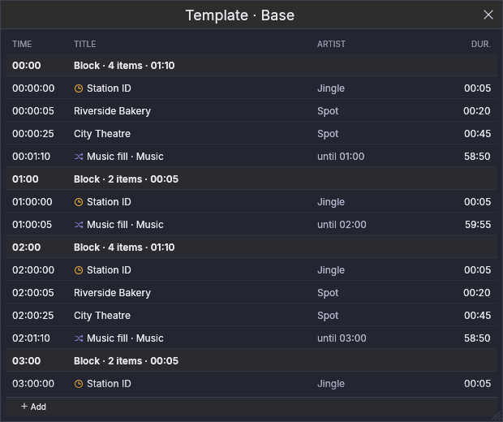
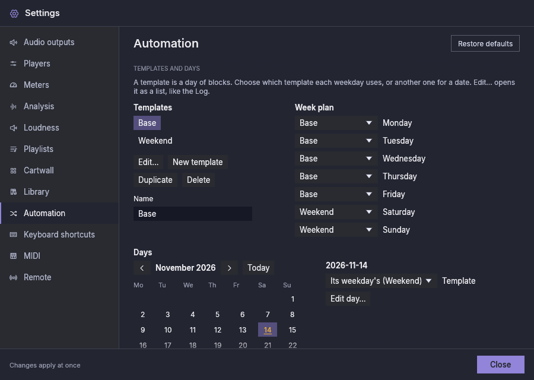

# Automazione

L'automazione tiene la stazione in onda quando nessuno è in studio. Questa
versione ha il **riempitivo musicale**, un lettore che sceglie la musica da
solo, secondo le regole che imposti, e non si ferma mai per mancanza di una
lista, e la colonna **Palinsesto**, che esegue i blocchi a orario del giorno,
con l'editor in cui li crei.
I lettori che usi già (P1 … Pn) non vengono toccati: restano tuoi per i
programmi che prepari e mandi in onda in diretta.

## La colonna Palinsesto {#the-schedule-column}

La colonna **Palinsesto** riproduce i **blocchi** del giorno: gruppi di
elementi con un'ora di inizio (un identificativo orario, spot, un programma).
Mostrala dalla tessera **Palinsesto** della barra superiore, come mostri un
lettore.

Il suo elenco è il palinsesto, raggruppato per blocchi: l'ora di inizio di
ogni blocco, poi i suoi elementi. Mostra oggi, l'ultimo blocco di ieri e il
primo di domani. Un blocco modificato per un giorno lo dice. L'elemento in
onda e il successivo sono segnati come su un lettore; gli elementi già andati
in onda sono attenuati, e un elemento che non è andato in onda (**Non
trasmesso**) è barrato. Un orologio segna un elemento **puntuale**, che va in
onda solo alla sua ora.

Sopra l'elenco:

- **Avvia** esegue il palinsesto: ogni blocco suona alla sua ora, e il
  riempitivo musicale suona tra i blocchi. Nulla parte da solo: dopo ogni
  avvio dell'applicazione, l'automazione è ferma finché non premi Avvia.
- **Ferma dopo l'attuale** lascia finire ciò che è in onda, e poi non suona
  più nulla da solo.
- **In funzione** o **Ferma** dice quale dei due stati è attivo.

Per cambiare ciò che suona dopo, fai doppio clic su un elemento, oppure fai
clic destro su di esso e scegli **Riproduci dopo**; segue il brano in onda.
**Torna all'orologio**, nello stesso menu, lascia che il palinsesto scelga di
nuovo in base all'ora.

## Modificare il palinsesto {#editing-the-schedule}

**Modifica palinsesto**, sulla colonna Palinsesto, apre l'editor. Ha tre
schede, e **Rotazioni…** ti porta a Impostazioni → Automazione, dove si
creano le rotazioni.

- **Modelli.** Un modello è un giorno di blocchi; una nuova installazione ne
  ha uno, "Base", per tutti i giorni. Crea, duplica, rinomina o elimina i
  modelli a sinistra; i blocchi di quello scelto sono a destra. Scrivi
  l'inizio di un blocco come `HH:MM:SS` (un'ora che non esiste resta nel
  campo con una nota, e nulla cambia). Trascina brani dalla libreria su un
  blocco per aggiungerli; **Aggiungi da categoria** aggiunge un elemento che
  riproduce un brano di quella categoria, uno diverso ogni volta; **Musica
  dopo** sceglie la rotazione che il riempitivo musicale riproduce dopo il
  blocco (la rotazione predefinita se non ne è scelta nessuna). Ogni
  elemento può essere segnato come **Puntuale**, spostato o rimosso. Quando
  gli elementi di un blocco durano più del tempo che manca al blocco
  successivo, il blocco dice di quanto, in ambra; puoi comunque lasciarlo
  così.
- **Settimana tipo.** Quale modello usa ogni giorno della settimana.

  

- **Giorni.** Scegli una data sul calendario (le date con modifiche sono in
  ambra). Una data può usare un modello diverso da quello del suo giorno
  della settimana (un festivo di giovedì può usare quello del weekend). I
  suoi blocchi possono essere cambiati solo per quella data: la modifica è
  segnata, e **Torna al modello** la annulla. **Non in questo giorno** toglie
  un blocco da quella sola data, e **Aggiungi blocco in questo giorno** ne
  aggiunge uno. Le modifiche successive al modello raggiungono comunque i
  blocchi che non hai cambiato in quella data.

  

## Il riempitivo musicale {#the-music-filler}

Il riempitivo musicale è la colonna **Musica**. È nascosta finché non la
mostri: fai clic sulla tessera **Musica** a sinistra della barra superiore.
Si trova a sinistra di P1.

Ha l'aspetto e il funzionamento di un lettore: il grande orologio, la forma
d'onda, i pulsanti di trasporto, il fader e l'elenco dei brani. La differenza
è l'elenco:

- **si riempie da solo** a partire da una **rotazione** (sotto), sempre con
  circa mezz'ora di anticipo (*anticipo*, in Impostazioni → Automazione);
- **si sfoltisce da solo**: conserva gli ultimi 50 brani che ha riprodotto e
  rimuove quelli più vecchi, così può funzionare per settimane;
- prima di un blocco del palinsesto può **sostituire i brani che ha scelto
  lui** con altri la cui durata si adatta al tempo che resta (vedi sotto); i
  brani che hai aggiunto tu non vengono mai toccati;
- puoi comunque **modificarlo a mano**: trascina brani dalla libreria,
  riordina le righe, rimuovi un brano che non vuoi. Una riga che aggiungi è
  segnata con una mano e non viene mai sostituita; una riga che rimuovi non
  conta come riprodotta.

Le sue uscite si impostano in Impostazioni → Uscite audio, nella riga
**Musica**, come per qualsiasi lettore. Non ha un numero, né scorciatoie da
tastiera o associazioni MIDI, e il controllo remoto non lo vede.

Premi **Play** per avviarlo e **Ferma dopo l'attuale** per lasciar finire il
brano in onda e fermarsi. Come ogni lettore, non parte mai da solo, nemmeno
dopo un riavvio.

Sopra il suo elenco, dove un lettore ha le schede delle playlist, la colonna
Musica mostra la **rotazione** che riproduce. Sceglierne un'altra lì: i brani
che aveva in coda vengono sostituiti, quelli che hai aggiunto restano. Quando
la rotazione non trova nulla da riprodurre (le sue categorie sono vuote, o
ogni file manca), la barra lo dice.

## Rotazioni {#rotations}

Una **rotazione** è un breve elenco di **passi** che il riempitivo riproduce a
turno, poi di nuovo dal primo. Ogni passo indica da dove vengono i suoi brani
(una categoria della libreria con le sue sottocategorie, o ogni brano di un
tipo) e quanti ne riproduce ogni volta, come intervallo:

| Passo | Riproduce |
|---|---|
| Successi attuali | 2–3 |
| Identificativi della stazione | 1 |
| Oldies | 0–1 |

Con un intervallo, un identificativo della stazione arriva dopo due brani una
volta e dopo tre la volta successiva. Un intervallo che parte da **0** lascia
che un passo salti alcuni turni: con Oldies a 0–1, un brano oldies suona dopo
l'identificativo della stazione alcune volte e altre no. Il massimo è sempre
almeno 1. Una rotazione è quella **predefinita**: una nuova installazione ne
ha una, **Music**, che riproduce tutta la tua musica.

Le rotazioni si creano in Impostazioni → Automazione:

## Come sceglie {#how-it-chooses}

All'interno di un passo, il riempitivo preferisce i brani che sono rimasti
più a lungo senza andare in onda, con un po' di casualità tra loro perché
l'ordine non diventi mai un ciclo fisso. Tiene anche separati:

- **lo stesso brano:** può suonare di nuovo quando sono passate 3 ore o quando
  è andata in onda la metà degli altri brani del suo passo, a seconda di quale
  accade prima;
- **lo stesso artista:** non entro 30 minuti.

Conta tutto ciò che è andato in onda, dal riempitivo, da un lettore o dalla
cartwall; il preascolto no. Quando una piccola categoria non riesce a
rispettare le regole, il riempitivo cede piuttosto che restare in silenzio:
prima sull'artista, poi sul brano. Impostazioni → Automazione ha tutti i
valori, ed è dove crei, rinomini e modifichi le rotazioni (vedi
[Impostazioni](settings.md#automation)).

Prima di un blocco del palinsesto, il riempitivo sceglie anche i suoi ultimi
brani in base alla durata, così la musica finisce in modo pulito: il brano
che sfuma quando il blocco inizia perde al massimo 30 secondi, e non parte
nessun brano che suonerebbe per meno di 45 secondi. Quando nessun brano della
rotazione riesce a rispettare entrambi, suona quello che perde meno. Per ora
entrambi i valori si possono cambiare solo nel file di configurazione
(`automation.max_fade_cut_secs` e `automation.min_song_play_secs`).

Un **Identificativo orario** è un tipo di brano a sé (Libreria → Tipo ▸
Identificativo orario), per l'identificazione della stazione all'inizio
dell'ora.
