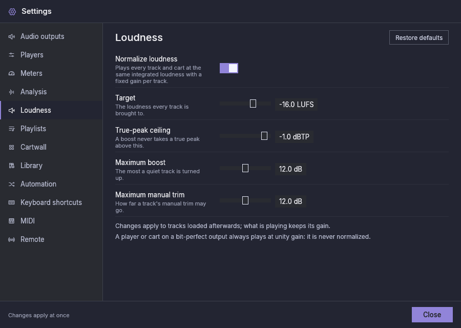

# Normalizzazione del loudness

I brani arrivano da molte fonti e sono masterizzati a livelli molto diversi:
un singolo pop recente può suonare due volte più forte di una registrazione
degli anni Settanta o di una promo parlata. La **normalizzazione del
loudness** riproduce ogni brano e ogni cart alla stessa sonorità percepita,
così l'operatore non deve rincorrere il fader da un brano all'altro.

È **attiva per le nuove installazioni**; una configurazione esistente
mantiene la sua impostazione attuale (ogni configurazione salvata la
memorizza già). Si cambia in [Impostazioni → Loudness](settings.md#loudness).

## Come funziona {#how-it-works}

**Un guadagno fisso per brano.** Ogni brano riceve un solo guadagno, in dB,
deciso quando il brano viene caricato e mantenuto finché non si ferma. Nulla
viene compresso o limitato: l'intero brano viene reso più forte o più piano
della stessa quantità, quindi la sua dinamica resta com'era stata masterizzata.
Il fader del lettore lavora sopra di esso, come prima.

**La misura.** L'analisi in background misura ogni file una volta:

- la sua **loudness integrata**, in LUFS: quanto suona forte l'intero file,
  come la definiscono ITU-R BS.1770 e EBU R128 (i passaggi piani e il
  silenzio vengono esclusi dal gating, quindi una lunga dissolvenza finale o
  una pausa non la abbassano);
- il suo **true peak**, in dBTP: il livello più alto che il segnale raggiunge
  tra i campioni una volta convertito in analogico.

I file nuovi vengono misurati con la loro prima analisi. I file aggiunti
prima che la loudness venisse misurata vengono misurati da un **passaggio in
background** che gira mentre l'analisi normale non ha nulla da fare, senza
toccare i loro marker. Gira con la normalizzazione attiva o no, così le
misure sono pronte quando la attivi. **Rianalizza** (nel menu della
playlist) misura di nuovo un file, rileggendolo anche se la sua dimensione e
la sua data non sono cambiate. Un file più corto di 0,4 s non viene mai
misurato, e un file silenzioso non ha loudness: entrambi suonano inalterati.

**Il guadagno.** Il guadagno porta la loudness misurata all'**Obiettivo**,
più il **Trim** del brano (vedi [Per brano](#per-track-exclude-and-trim)):

> guadagno = obiettivo − loudness misurata + trim

Un brano più forte dell'obiettivo viene abbassato di quanto serve. Un brano
più piano viene alzato, ma mai di più del **Guadagno massimo**, e mai così
tanto che il suo true peak vada sopra il **Tetto di true peak**: non c'è un
limiter, quindi è il tetto a evitare che un brano alzato vada in clipping. Un
brano il cui true peak è già sopra il tetto non viene alzato affatto.

Esempi, con i valori predefiniti (obiettivo −16 LUFS, tetto −1 dBTP,
guadagno massimo 12 dB):

| Brano | Misurato | True peak | Guadagno |
|---|---|---|---|
| Un master moderno forte | −9,0 LUFS | +0,5 dBTP | −7,0 dB |
| Un master più vecchio e piano | −20,0 LUFS | −10,0 dBTP | +4,0 dB |
| Un brano piano con picchi alti | −22,0 LUFS | −3,0 dBTP | +2,0 dB (limitato dal tetto) |
| Una registrazione molto piana | −35,0 LUFS | −20,0 dBTP | +12,0 dB (limitato dal guadagno massimo) |

**Quando viene deciso il guadagno.** Quando un brano viene caricato:
preparato come successivo di un lettore, avviato, caricato in pausa,
preascoltato nel CUE o lanciato come cart. Un brano in riproduzione o in
pausa **mantiene il suo guadagno** finché non si ferma, attraverso
spostamenti e pause. Cambiare le impostazioni, la misura di un brano o il suo
trim si applica la volta successiva che il brano viene caricato; il brano
successivo già in attesa su un lettore viene preparato di nuovo con il nuovo
guadagno, così parte con esso.

**Preascolto.** Il preascolto CUE e quello dei cart riproducono un brano con
lo stesso guadagno che riceve in onda, così ciò che senti in cuffia
corrisponde al programma.

**Meter.** I meter e la loro lettura di loudness misurano dopo il guadagno,
quindi mostrano il livello normalizzato. L'**obiettivo di loudness** proprio
dei meter (Impostazioni → Meter) colora soltanto la lettura; non cambia
alcun guadagno.

## Uscite bit-perfect {#bit-perfect-outputs}

Un lettore o un cart la cui uscita è [bit-perfect](bit-perfect.md) **non
viene mai normalizzato**: suona sempre a guadagno unitario (0 dB), qualunque
siano le impostazioni, perché qualsiasi guadagno cambierebbe i campioni che
il dispositivo riceve. Con la normalizzazione attiva, la sua intestazione
mostra un badge **0.0 dB** ambra il cui tooltip dice «Uscita bit-perfect: i
brani suonano inalterati.» Lo stesso vale per il preascolto su un dispositivo
Cue bit-perfect, mentre l'uscita Main del lettore, se non è bit-perfect,
riceve comunque il guadagno.

Un brano che sta già suonando (o è in pausa) quando il suo dispositivo
diventa bit-perfect mantiene il guadagno con cui è partito, e il badge **BP**
resta spento per lui. Il brano successivo suona a 0 dB e bit-perfect. Un
brano DSD in quella situazione suona convertito in PCM con il suo guadagno,
mai come flusso DSD inalterato.

## Il guadagno nell'intestazione del lettore {#the-gain-in-the-player-header}

Mentre un lettore suona o è in pausa, un badge a sinistra di **BP** mostra il
guadagno del brano in onda. Il badge ha un bordo del suo colore e sempre la
stessa larghezza. Passa il puntatore per il motivo.

| Badge | Significato |
|---|---|
| **+4.0 dB**, **−7.0 dB** (blu) | Il brano è normalizzato con questo guadagno. Il tooltip è il dettaglio del guadagno descritto sotto. Quando le impostazioni, la misura o il trim sono cambiati dopo che il brano è stato caricato, dice solo che il brano mantiene il guadagno fissato quando è stato caricato, e mostra quel guadagno. |
| **0.0 dB** (ambra) | Il brano suona inalterato. Il tooltip è lo stesso dettaglio, e la sua riga **Guadagno automatico** ne dice il motivo: non ha ancora una misura (o è troppo corto per essere misurato), l'uscita è bit-perfect, oppure il brano è escluso dalla normalizzazione. |
| Nessun badge | La normalizzazione era disattivata quando il brano è partito, il brano è silenzioso, oppure il lettore è fermo. Neanche un lettore bit-perfect ne mostra uno mentre la normalizzazione è disattivata. |

Il badge mostra il guadagno che il lettore ha chiesto quando il brano è
partito.

### Il dettaglio del guadagno {#the-gain-breakdown}

Ovunque il programma spieghi il guadagno di un brano mostra lo stesso blocco
di righe, con l'etichetta a sinistra e il valore a destra: il tooltip del
badge del guadagno, il popup del loudness (sotto i suoi controlli), l'editor
dei cart e il tooltip del brano della tabella della playlist.

| Riga | Significato |
|---|---|
| **Loudness integrata** | La loudness misurata del brano, in LUFS (oppure «non misurata»). |
| **True peak** | Il suo true peak più alto, in dBTP (solo quando misurato). |
| **Obiettivo** | La loudness a cui viene portato ogni brano (Impostazioni → Loudness). |
| **Guadagno automatico** | Obiettivo meno loudness misurata, prima del trim e di qualsiasi limite, oppure «nessuno» e il motivo: escluso, uscita bit-perfect, normalizzazione disattivata, non ancora misurato o silenzioso. |
| **Trim** | Il trim manuale del brano in uso, quando non è 0 (con il valore salvato e il massimo quando un **Trim massimo** abbassato lo limita). |
| **Guadagno voluto** e **Limitato da** | Solo quando il tetto di true peak o il guadagno massimo ha trattenuto il guadagno: il guadagno automatico più il trim (mostrato quando c'è un trim) e il limite che l'ha fermato. |
| **Guadagno risultante** | Sempre l'ultima, sotto una linea e in grassetto: il guadagno con cui suona il brano. 0.0 dB quando non è normalizzato. |

Con la normalizzazione disattivata, una nota sopra il guadagno risultante
dice che in onda non cambia nulla e che il trim si applica quando viene
attivata.

## Per brano: escludere e regolare {#per-track-exclude-and-trim}

Alcuni brani non dovrebbero seguire l'obiettivo: un identificativo della
stazione masterizzato forte di proposito, un tono di prova, un brano la cui
misura non corrisponde a come suona (il parlato spesso suona più forte della
musica allo stesso LUFS). Ogni brano ha due impostazioni per questo:

- **Escludi dalla normalizzazione:** il brano suona sempre inalterato.
- **Trim:** dB aggiunti al guadagno del brano, da − a + il **Trim massimo**
  (Impostazioni → Loudness), a passi di 0,5 dB. Fai doppio clic sul cursore
  per riportarlo a 0. Il trim è attenuato mentre il brano è escluso.

Il cursore è un **trim**: uno scostamento sopra il guadagno automatico, quindi
legge 0 dB per ogni brano che non hai modificato. Il popup e l'editor dei
cart mostrano perciò il [dettaglio del guadagno](#the-gain-breakdown) con i
loro controlli: la riga **Guadagno risultante** segue il cursore mentre lo
muovi. Nel popup i controlli vengono per primi e il dettaglio sotto di essi,
così il cursore resta dov'è mentre il dettaglio cresce o si riduce. Mentre il
brano suona, il popup aggiunge che una modifica si applica dal suo prossimo
caricamento.

Dove cambiarle:

- **Su una forma d'onda:** fai clic destro sulla forma d'onda di un lettore
  (o su quella della sua finestra CUE) e scegli **Loudness…**. Il popup
  nomina il brano e mostra la sua misura. Continua a modificare quel brano
  anche quando il lettore passa a un altro; chiudilo con il suo pulsante
  **×**. Si chiude da solo se il brano viene rimosso.
- **Su una riga della playlist:** fai clic destro sulla riga e scegli
  **Loudness…**: lo stesso popup, per il brano di quella riga.
- **Nell'editor dei cart:** Impostazioni → Cartwall, fai clic su un cart: gli
  stessi due controlli sono sotto **Ferma gli altri cart al lancio**, con la
  misura sotto l'etichetta.
- **Da remoto:** `PUT /api/v1/tracks/<id>/loudness` (vedi
  [Controllo remoto](remote-control.md)).

Le impostazioni appartengono al brano e vengono salvate con esso. Una
modifica si applica la volta successiva che il brano viene caricato, come
qualsiasi altra modifica.

**Il tooltip del brano** della tabella della playlist mostra i tag del brano
e, sotto una linea, lo stesso [dettaglio del guadagno](#the-gain-breakdown),
calcolato per il lettore a cui appartiene quell'elenco (un lettore
bit-perfect lo riproduce inalterato).

## Scegliere le impostazioni {#choosing-the-settings}

- **Obiettivo.** −16 LUFS va bene per la maggior parte dei programmi musicali
  in onda e online. −23 LUFS (EBU R128) o −24 LUFS (ATSC A/85) lasciano più
  margine, ma i brani piani richiedono allora aumenti più grandi, che il
  tetto e il guadagno massimo possono trattenere. Scegli un obiettivo vicino
  a quanto è già forte il tuo materiale.
- **Tetto di true peak.** −1 dBTP lascia spazio per la conversione e per gli
  encoder con perdita a valle. Abbassalo quando un encoder dello stream va in
  clipping.
- **Guadagno massimo.** Evita che una registrazione molto piana (o quasi
  tutta silenziosa) venga alzata fino a diventare rumore. 0 dB abbassa solo i
  brani forti.
- **Trim massimo.** Fin dove può arrivare il trim per brano. Abbassarlo
  limita i trim già impostati senza cambiarli, finché non modifichi di nuovo
  la loudness di quel brano: la modifica salva allora il trim limitato.

## Gli standard dietro i valori predefiniti {#standards-behind-the-defaults}

- **Misura.** Loudness integrata e true peak come definiti da ITU-R BS.1770
  (ponderazione K, con gating).
- **Obiettivo −16 LUFS.** Segue le raccomandazioni AES per lo streaming e la
  distribuzione online. AES TD1008 (2021) sostituisce la precedente AES
  TD1004.1.15-10, che raccomandava da −16 a −20 LUFS per lo streaming. Non è
  un valore di radiodiffusione: EBU R128 usa −23 LUFS e ATSC A/85 usa
  −24 LKFS. Usa uno di quelli quando una specifica di consegna lo richiede
  (EBU R128 per lo scambio di programmi radiotelevisivi europei, ATSC A/85
  per la televisione digitale statunitense), e −16 per uno stream o un
  programma online.
- **Tetto di true peak −1 dBTP.** Il true peak massimo di EBU R128, usato
  anche dalle raccomandazioni AES. Gli encoder con perdita possono andare
  oltre in decodifica, quindi uno stream inviato attraverso un encoder a
  basso bitrate può richiedere un tetto più basso, come −2 dBTP (una pratica
  comune, non parte di quegli standard).
- **Guadagno massimo e trim massimo, 12 dB.** Scelte di prodotto senza uno
  standard dietro: abbastanza per alzare una registrazione piana e per
  correggere un brano a orecchio, non così tanto da alzare il rumore o da far
  sì che il trim vanifichi l'obiettivo.
- **La normalizzazione è attiva per le nuove installazioni.** Aggiornare
  l'applicazione mantiene l'impostazione che la tua configurazione ha già,
  quindi un'installazione che l'aveva disattivata resta disattivata finché non
  la attivi.
- **L'obiettivo di loudness del meter** (Impostazioni → Meter) è
  un'impostazione separata, per impostazione predefinita il valore R128 di
  −23 LUFS. La normalizzazione non lo usa.
