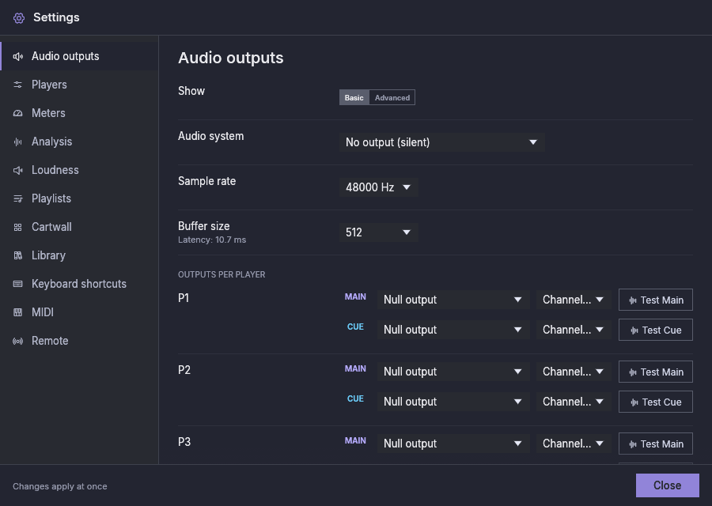
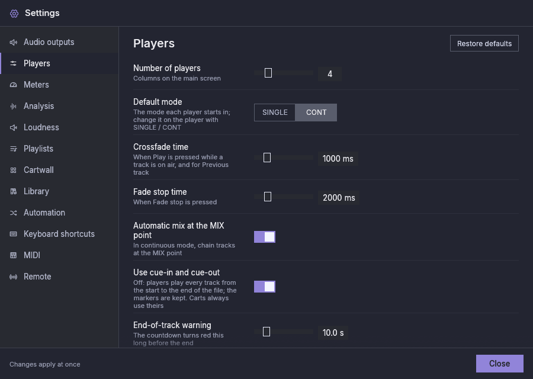
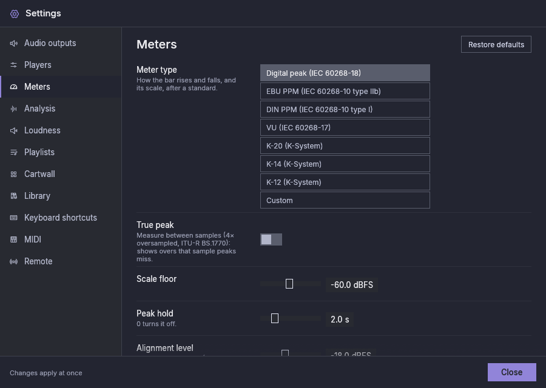
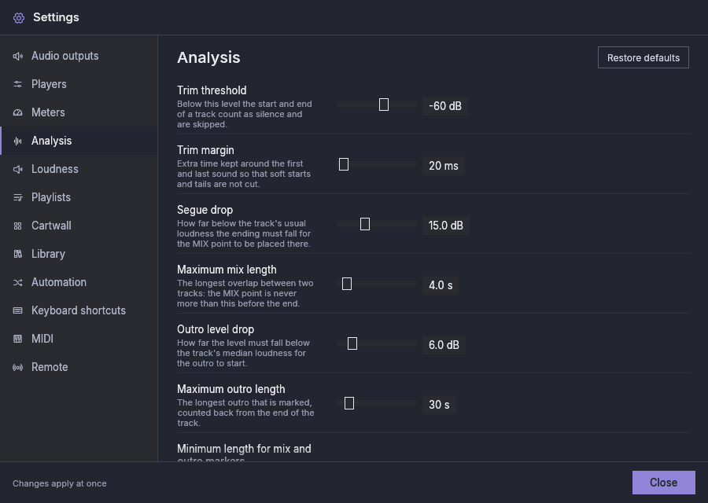
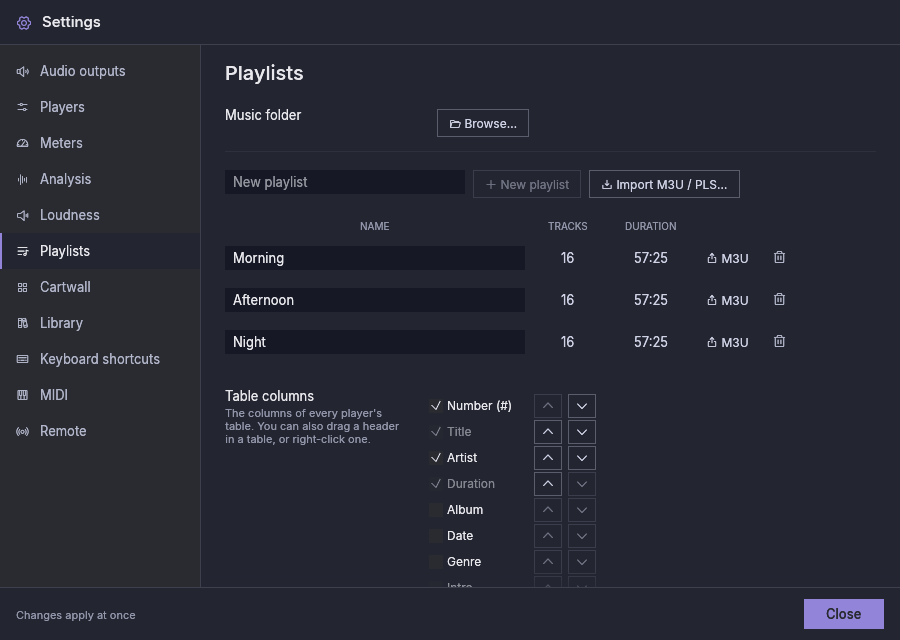
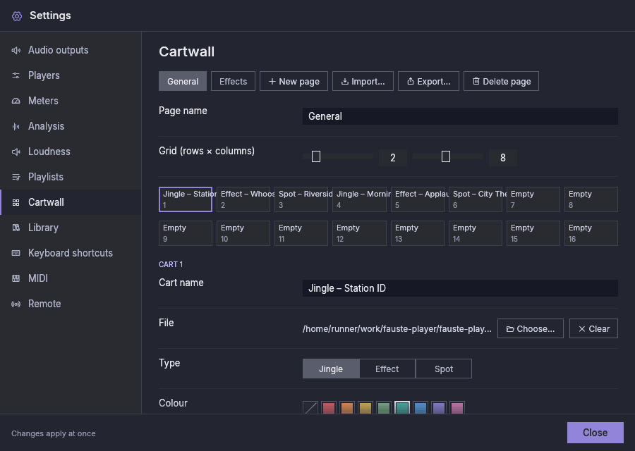
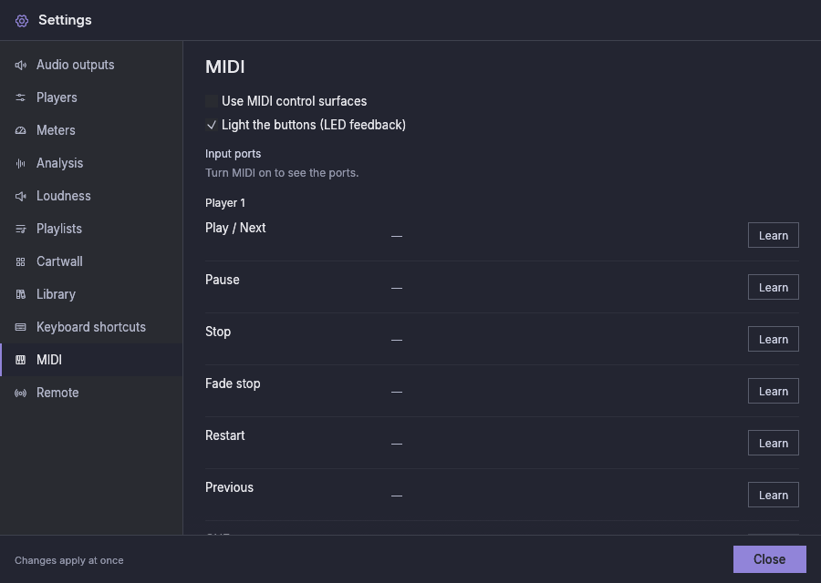

# Impostazioni

Apri **Impostazioni** nella barra superiore. Chiudile con **Chiudi** o con
`Esc`. La maggior parte delle modifiche si applica subito e viene salvata
automaticamente.

La finestra ha un'unica dimensione (900 × 640, più piccola su uno schermo
piccolo) qualunque sia la sezione, e la sezione scorre al suo interno. Ogni
sezione allinea le sue etichette in un'unica colonna.

Le sezioni Lettori, Meter, Analisi, Loudness, Automazione e Scorciatoie da tastiera hanno nella
loro intestazione un pulsante **Ripristina i valori predefiniti**. Chiede
conferma e poi reimposta soltanto quella sezione (Lettori mantiene il numero
di lettori e la lingua; Scorciatoie non ha altri pulsanti di ripristino).
Uscite audio, Playlist, Cartwall, Libreria, MIDI e Remoto non lo hanno.

## Impostazioni in sospeso {#settings-pending}

Ogni impostazione si applica mentre l'applicazione è in esecuzione. Il
sistema audio, la frequenza di campionamento, la dimensione del buffer
(anche quella propria di un dispositivo), le uscite Main e Cue (lettori e
cartwall), i dispositivi bit-perfect e le impostazioni DSD cambiano il modo
in cui si apre un dispositivo di uscita, quindi si applicano appena è sicuro
farlo:

- Le impostazioni di un dispositivo si applicano quando su quel dispositivo
  non suona nulla: nessun lettore instradato su di esso sta suonando,
  sfumando o preascoltando (CUE, anche quando è trattenuto), e nessun cart
  vi suona. Un lettore in pausa, o con un brano solo caricato, non trattiene
  un dispositivo: il suo brano resta in pausa dov'era.
- L'uscita di un lettore o della cartwall si sposta quando quel lettore (o la
  cartwall) non sta suonando; gli altri lettori sugli stessi dispositivi non
  vengono interrotti.
- Un nuovo sistema audio si applica quando non suona nulla da nessuna parte.

Una modifica in attesa viene eseguita al primo momento in cui non suona nulla
di ciò che riguarda. Può essere lo spazio tra la fine di un brano e l'inizio
del successivo: il brano successivo parte allora più tardi del tempo che il
dispositivo impiega a riaprirsi. **Applica ora** (sotto) forza invece la
modifica subito.

Una frequenza o un buffer assegnati a un dispositivo contano solo quando
cambiano con cosa il dispositivo si apre: assegnare a un dispositivo lo
stesso valore di quello globale, o cancellare un tale valore, non cambia
nulla.

Fino ad allora la barra superiore mostra **Impostazioni in sospeso**. Passa il
puntatore per vedere cosa attende e su cosa; fai clic per l'elenco, che
mostra anche ogni modifica che un dispositivo o un'uscita ha rifiutato (il
dispositivo mantiene le sue impostazioni attuali; la modifica viene
riprovata quando la cambi o premi **Applica ora**). Il piè di pagina delle
Impostazioni dice «Alcune modifiche attendono che le uscite interessate siano
libere.» e offre **Applica ora**; un breve avviso (per esempio, che
un'impostazione è stata salvata) può prendere per un momento il posto di quel
testo.

**Applica ora** applica subito ogni modifica alle uscite in attesa. Quando
questo interromperebbe qualcosa, prima elenca i dispositivi e ciò che vi
suona; **Interrompi e applica** interrompe poi brevemente l'audio su quei
dispositivi: ciò che suonava riprende da dove era dopo una breve pausa, e
nulla che fosse in pausa o fermo parte. **Annulla** (o `Esc`) continua ad
aspettare.

I limiti e le regolazioni del motore si modificano nel file di
configurazione con l'applicazione chiusa (vedi
[Dati e backup](data-and-backups.md)).

## Uscite audio {#audio-outputs}

Le modifiche in questa sezione si applicano mentre l'applicazione è in
esecuzione, appena nulla di ciò che riguardano sta suonando: vedi
[Impostazioni in sospeso](#settings-pending).

In alto, **Mostra** sceglie **Base** o **Avanzate**. Base mostra il sistema
audio, la frequenza di campionamento, la dimensione del buffer e le uscite.
Avanzate aggiunge, per ogni dispositivo che un'uscita usa, la sua frequenza e
il suo buffer, l'interruttore bit-perfect e la modalità DSD, e poi le
impostazioni DSD. Cambiare vista mostra o nasconde soltanto delle righe:
nulla viene modificato o reimpostato. Quando Base nasconde
un'impostazione in uso, una riga lo dice. Quando nessuna uscita usa più un
dispositivo, la sua frequenza e il suo buffer, il suo interruttore
bit-perfect e la sua modalità DSD vengono dimenticati alla prossima
partenza dell'applicazione: se dopo di allora un'uscita lo usa di nuovo,
parte dai valori globali. Fino ad allora, sceglierlo di nuovo (per esempio
dopo aver scambiato due dispositivi) li mantiene.

| Impostazione | Significato |
|---|---|
| Sistema audio | L'ultima scelta, **Nessuna uscita (silenzio)**, non riproduce nulla: le linee temporali scorrono a passo reale senza scheda audio (per una macchina che non ne ha una, o per fare prove). Linux: PipeWire (nelle build che lo includono), PulseAudio, JACK o ALSA. Windows: WASAPI, ASIO (nelle build che lo includono) o JACK. macOS: Core Audio o JACK. I sistemi assenti su questo computer, o senza dispositivo di uscita (un server JACK non in esecuzione), sono mostrati come non disponibili. «Predefinito di sistema» usa il primo disponibile in quell'ordine. |
| Frequenza di campionamento | La frequenza a cui funziona ogni uscita, a meno che un dispositivo non ne abbia una propria (Avanzate); i file vengono convertiti a essa con un ricampionamento di alta qualità. I dispositivi bit-perfect partono alla loro frequenza e poi seguono i file. |
| Dimensione del buffer | Frame per blocco audio, a meno che un dispositivo non ne abbia uno proprio; la latenza risultante è mostrata sotto. Le uscite attraverso un server audio o un mixer di sistema (PulseAudio, il dispositivo ALSA `default`) chiedono almeno 50 ms qualunque sia questa dimensione, o quanto il dispositivo accetta, così un computer occupato non si sente; la latenza lo dice allora (`shared_buffer_ms` nel file di configurazione) |
| Uscite per lettore | Per ogni lettore, un dispositivo **Main** (in onda) e un dispositivo **Cue** (preascolto), ciascuno con una coppia di canali. Una scheda audio che offre più profili di uscita (ALSA elenca anteriore, surround, hardware diretto…) mostra ciascuno come *scheda — profilo*; due voci che altrimenti risulterebbero uguali ricevono tra parentesi l'id del dispositivo. Le interfacce multicanale possono portare più lettori su coppie diverse. Un'uscita Cue che condivide un'uscita in onda (il Main di qualsiasi lettore o quello della cartwall) è consentita: una nota sotto di essa dice che il suo preascolto si sente in onda e che chiede prima finché lì suona qualcosa. |
| Prova Main / Prova Cue | Riproduce un breve tono (1 kHz su Main, 440 Hz su Cue, 1,5 s, −18 dBFS) sull'uscita scelta, così puoi controllare i collegamenti prima di andare in onda |
| Libreria | L'uscita Cue della libreria, con il suo **Prova Cue**: dove si sente il [preascolto](library.md#pre-listening) della finestra della libreria (su un telefono, quello della scheda Libreria). Senza, il Play della barra di preascolto è attenuato. Su Android la sua scelta vuota si legge *Predefinito di sistema* invece di *Nessuna*: il preascolto e **Prova Cue** suonano allora sull'uscita predefinita (vedi [Android → Libreria](android.md#library)). Un'uscita Libreria su un'uscita in onda funziona come il Cue di un lettore: una nota sotto di essa dice che il suo preascolto si sente in onda e che chiede prima finché lì suona qualcosa. È nelle viste Base e Avanzate, anche su un telefono |
| Cartwall | Le uscite Main e Cue della cartwall. Main usa per impostazione predefinita l'uscita di sistema. Senza un Cue non c'è il preascolto dei cart; un Cue su un'uscita in onda funziona come per i lettori. |
| Frequenza di campionamento: *dispositivo* (Avanzate) | **Globale (...)** usa la frequenza di campionamento qui sopra; un valore dà a questo dispositivo una frequenza propria. Vengono offerte solo le frequenze che il dispositivo indica; una frequenza salvata che non indica più resta in elenco con una nota che potrebbe non aprirsi (il dispositivo ripiega allora sulla frequenza globale). I valori propri si applicano solo ai dispositivi che un'uscita nomina, non all'uscita predefinita di sistema, a meno che una non la nomini. |
| Dimensione del buffer: *dispositivo* (Avanzate) | **Globale (...)** usa la dimensione del buffer qui sopra (con il minimo che chiede un'uscita condivisa, come sopra); un valore dà a questo dispositivo una dimensione propria, usata così com'è, con la sua latenza sotto. Un dispositivo che non accetta una dimensione propria del buffer ripiega su quella globale, e anche sulla frequenza globale quando non accetta nemmeno una frequenza propria. |
| Bit-perfect: *dispositivo* (Avanzate) | Disattivato per impostazione predefinita. Una modalità speciale per l'ascolto audiofilo, non per i programmi mixati: il dispositivo viene aperto con accesso esclusivo e segue la frequenza di campionamento di ogni brano. I lettori il cui Main è su di esso non fanno mai dissolvenze incrociate né mix, un cambio di frequenza lascia un breve silenzio tra due brani, e il loro volume è mantenuto al 100 %. L'interruttore è disattivato dove il dispositivo non può dare l'accesso esclusivo. Vedi [Cosa costa](bit-perfect.md#what-it-costs). |
| DSD: *dispositivo* (Avanzate) | **Converti in PCM** (il valore predefinito), **DoP** o, su Linux, **DSD nativo**. Ogni dispositivo lo mostra; vengono offerte solo le modalità che il dispositivo può accettare, e una riga sotto dice perché le altre no. Vedi [DSD](bit-perfect.md#dsd). |
| Quando un'altra sorgente ha bisogno di un'uscita DSD (Avanzate) | **Prosegui il brano DSD in PCM** (il valore predefinito), oppure **Mantieni il DSD e silenzia le altre sorgenti**. Vedi [DSD](bit-perfect.md#dsd). |
| Silenzio DSD (Avanzate) | Silenzio inviato prima che inizi un flusso DSD, dopo la sua fine e al passaggio a PCM, perché il convertitore si agganci senza clic; 200 ms per impostazione predefinita, da 0 a 2000. |

Un'uscita Cue non ripiega mai sull'uscita che usa Main. Un Cue che nomina un
dispositivo di un sistema audio che questo computer non ha significa «nessun
cue». Un Cue su un'uscita in onda (lo stesso dispositivo e gli stessi canali
di un Main, o che li sovrappongono) è consentito: una nota sotto di esso dice
che il suo preascolto si sente in onda e che chiede prima finché lì suona
qualcosa. Un lettore senza un'uscita Cue ha il pulsante **CUE** attenuato;
passandoci sopra il puntatore ti dice di scegliere qui un'uscita Cue. Lo
stesso vale per **Preascolta nel CUE** della cartwall.

Se un dispositivo scompare durante la riproduzione, i lettori mantengono le
loro linee temporali, e il dispositivo viene riaperto quando torna (vedi
[Risoluzione dei problemi](troubleshooting.md)).

## Lettori {#players}

| Impostazione | Predefinito | Significato |
|---|---|---|
| Lingua | Sistema | Lingua dell'interfaccia |
| Numero di lettori | 4 | Colonne nella schermata principale (un lettore in onda non si può rimuovere). Il numero si applica quando rilasci il cursore; un numero digitato nella casella si applica quando premi Invio o esci dalla casella, ed Esc lo annulla |
| Modalità predefinita | CONT | La modalità con cui partono i lettori |
| Durata della dissolvenza incrociata | 1000 ms | Per quanto tempo il brano in onda sfuma quando premi Play (successivo) mentre suona, e per Brano precedente. Non vale per un lettore la cui uscita Main è bit-perfect |
| Durata dello Stop in dissolvenza | 2000 ms | Per quanto tempo **Stop in dissolvenza** impiega a sfumare il brano. Vale per ogni lettore, anche quelli bit-perfect |
| Mix automatico al punto MIX | Attivo | Sovrappone i brani in modalità continua. Non vale per un lettore la cui uscita Main è bit-perfect |
| Usa cue-in e cue-out | Attivo | Disattivato: i lettori suonano ogni brano dall'inizio alla fine del file; i marker vengono mantenuti e i cart usano comunque i propri. Le durate e i totali delle playlist seguono lo stesso intervallo |
| Avviso di fine brano | 10 s | Quando il conto alla rovescia inizia a lampeggiare in rosso |

Mentre l'uscita Main di un lettore è bit-perfect, una nota sotto **Mix
automatico al punto MIX** dice che tali lettori non mixano né fanno
dissolvenze incrociate, quindi la durata della dissolvenza incrociata e il mix automatico non valgono per loro. Entrambe le impostazioni restano modificabili:
valgono ancora per gli altri lettori. Vedi [Cosa costa](bit-perfect.md#what-it-costs).

## Meter {#meters}

Le modifiche si applicano subito. Le Impostazioni mostrano solo ciò che usa
il tipo di meter scelto: i meter EBU, DIN e VU hanno la scala, la zona rossa
e il comportamento che il loro standard stabilisce (si imposta solo il
livello di allineamento), e l'allineamento di un meter K-System è il suo
0. Un valore che imposti viene mantenuto per quando sceglierai di nuovo
quel tipo.

| Impostazione | Predefinito | Significato |
|---|---|---|
| Tipo di meter | Picco digitale | Come sale e scende la barra, e la sua scala, secondo uno standard (vedi sotto) |
| Tempo di salita, Velocità di discesa | 5 ms, 11,8 dB/s | Solo per **Personalizzato**. Il tempo di salita è un tempo di integrazione: un burst di tono lungo quanto lui si legge 2 dB più basso; 0 mostra ogni picco. |
| True peak | Disattivato | Solo per picco digitale, personalizzato e K-System. Misura tra i campioni, con il filtro di sovracampionamento 4× pubblicato da ITU-R BS.1770. Mostra i picchi che superano 0 dBFS dopo la conversione, che un meter di picco di campione non vede. Come consente lo standard, un click isolato di un solo campione può leggersi fino a circa 0,3 dB sotto il suo valore di campione. |
| Fondo scala | −60 dBFS | Il fondo della scala digitale (picco digitale e personalizzato). Gli altri meter mostrano l'intervallo che dà il loro standard. |
| Tenuta del picco | 2 s | Solo per picco digitale, personalizzato e K-System: per quanto tempo resta acceso il livello più alto; 0 la disattiva. I meter di programma e il VU non hanno tenuta. |
| Livello di allineamento | −18 dBFS | Tutti tranne il K-System. Segnato sulla scala (EBU R68). È anche dove si trovano il segno EBU TEST, il segno DIN −9 e lo 0 VU. |
| Avviso da | −9 dBFS | Giallo da qui (massimo consentito EBU), per i meter di picco digitale e personalizzato |
| Pericolo da | −3 dBFS | Rosso da qui, per i meter di picco digitale e personalizzato. Gli altri diventano rossi dove lo fa la loro scala: VU da 0 VU, PPM EBU e DIN dal massimo consentito (EBU +9, DIN 0), il K-System da +4. |
| Lettura della loudness | Breve termine | La loudness sotto il meter: disattivata, momentanea (ultimi 400 ms) o a breve termine (ultimi 3 s), EBU R128 |
| Loudness di riferimento | −23 LUFS | La lettura è verde entro ±1 LU (EBU R128) |

| Tipo di meter | Standard | Comportamento |
|---|---|---|
| Picco digitale | IEC 60268-18 | Mostra ogni picco subito; scende di 20 dB in 1,7 s |
| PPM EBU | IEC 60268-10 tipo IIb | I picchi più brevi di circa 10 ms si leggono più bassi (un burst di tono di 10 ms si legge circa 1,6 dB più basso, uno di 0,5 ms circa 18 dB più basso), entro le tolleranze della EBU Tech 3205; scende di 24 dB in 2,8 s |
| PPM DIN | IEC 60268-10 tipo I | Lo stesso con un tempo di integrazione di 5 ms; scende di 20 dB in 1,5 s |
| VU | IEC 60268-17 | Il livello medio, con il movimento dell'ago di un VU meter: 99 % in 300 ms, con un leggero overshoot; una sinusoide legge il suo livello di picco |
| K-20, K-14, K-12 | K-System | Due sezioni: la media (RMS, 600 ms) come barra piena e il picco (scende di 26 dB in 3 s) attenuato sopra di essa. 0 è 20, 14 o 12 dB sotto il fondo scala; verde sotto 0, ambra da 0 a +4, rosso sopra. K-12 si adatta alla radiodiffusione, K-14 e K-20 ai programmi più dinamici. |
| Personalizzato | — | Il tuo tempo di salita e la tua velocità di discesa |

Ogni meter usa la scala del suo standard, con i suoi segni tra i canali:

| Meter | Scala |
|---|---|
| Picco digitale, personalizzato | −60 … 0 dBFS, segni ogni 10 dB fino a −40 e ogni 5 dB sopra; i 20 dB superiori occupano metà dell'altezza |
| PPM EBU | −12 … +12 attorno al livello di allineamento (TEST), ogni 4 dB; i livelli più bassi restano in fondo |
| PPM DIN | −50 … +5, dove 0 è 9 dB sopra il livello di allineamento (−9 dBFS per impostazione predefinita) |
| VU | −20 … +3 VU, 0 VU al livello di allineamento; la barra si muove in proporzione alla tensione, come l'ago |
| K-System | da +20, +14 o +12 (0 dBFS) fino a −60; uniforme in dB fino a −24 |

## Analisi {#analysis}

Le soglie descritte in [Marker e mix](markers-and-mixing.md); ogni riga ha
sotto il suo nome un suggerimento di una riga che dice cosa fa il valore.
**Rianalizza tutti i brani** esegue di nuovo l'analisi per l'intera
libreria, rileggendo ogni file; i marker manuali vengono mantenuti. Mentre è
in corso il pulsante è attenuato e mostra a che punto è arrivato
(**Analisi… 120 di 340**), così premerlo di nuovo non ricomincia da capo; il
tooltip di **Analisi di N brani** nella barra di stato dà lo stesso
avanzamento. Anche cambiare qui una soglia analizza di nuovo la libreria, e
riavvia un'esecuzione già in corso in modo che nessun brano mantenga marker
dei vecchi valori.

Dopo un aggiornamento la cui analisi è cambiata, i brani analizzati dalla
versione precedente mantengono i loro marker e le loro forme d'onda, che
funzionano ancora. All'avvio Fauste Player dice quanti sono e offre
**Analizza ora** o **Più tardi**; **Analizza i brani obsoleti (N)** qui fa lo
stesso in qualsiasi momento. I brani sui lettori vengono comunque aggiornati,
man mano che vengono mostrati, e così i brani dei cart che non hanno un
formato registrato (un cart suona bit-perfect solo quando il suo formato è
noto). I brani il cui file manca non vengono contati finché il file non
torna.

L'analisi misura anche la loudness di ogni file per la
[normalizzazione del loudness](loudness.md). I file analizzati prima che la
loudness venisse misurata vengono misurati in background, quando l'analisi
non ha altro da fare, con la normalizzazione attiva o no; i loro marker non
vengono toccati. **Rianalizza** (nel menu della playlist) e **Rianalizza
tutti i brani** misurano di nuovo.

**Cerca file modificati** controlla ogni brano della libreria alla ricerca di
un file che un altro programma ha cambiato mentre Fauste Player era in
esecuzione, e analizza di nuovo quelli cambiati; un avviso dice quanti ne ha
trovati. Il pulsante è attenuato mentre un controllo è in corso. Vedi
[Quando un file cambia](library.md#when-a-file-changes).

## Loudness {#loudness}

Riproduce ogni brano e ogni cart alla stessa loudness, con un guadagno fisso
per brano. La [normalizzazione del loudness](loudness.md) spiega come si
calcola il guadagno, il badge nell'intestazione del lettore e le impostazioni
per brano.

| Impostazione | Predefinito | Intervallo | Significato |
|---|---|---|---|
| Normalizza la loudness | Attivo | | Normalizzazione attiva o no |
| Obiettivo | −16 LUFS | da −36 a −6 LUFS, passi di 0,5 | La loudness integrata a cui viene portato ogni brano |
| Tetto di true peak | −1 dBTP | da −12 a 0 dBTP, passi di 0,1 | Un aumento non porta mai il true peak del brano sopra questo valore. Le riduzioni non sono limitate |
| Guadagno massimo | 12 dB | da 0 a 24 dB | Il guadagno più grande che un brano basso può ricevere. Le riduzioni non sono limitate |
| Trim massimo | 12 dB | da 0 a 24 dB | Fin dove arriva il trim manuale di ogni brano, in su o in giù |

Le modifiche si applicano ai brani caricati in seguito: ciò che è in
riproduzione mantiene il suo guadagno, e il brano successivo in attesa su
ogni lettore viene preparato di nuovo con quello nuovo. Una nota sotto le
impostazioni dice quanti brani aspettano ancora la loro misura; suonano
inalterati finché non è finita. Un lettore o un cart su un'uscita
bit-perfect non viene mai normalizzato. **Ripristina i valori predefiniti**
reimposta solo questa sezione (normalizzazione attiva). La normalizzazione è
attiva per le nuove installazioni; una configurazione esistente mantiene la
sua impostazione attuale (ogni configurazione salvata memorizza già il
valore).

## Playlist {#playlists}

- **Cartella della musica:** da dove partono le finestre di dialogo dei file.
- **Nuova playlist**, **rinomina** (modifica il nome e premi Enter; Esc
  annulla) ed **elimina** (icona del cestino).
- **Importa M3U / PLS…** crea una nuova playlist da un file di playlist.
  **M3U** su ogni riga la esporta come M3U8. Vedi [Playlist](playlists.md).
- **Colonne della tabella:** quali colonne mostrano le tabelle dei brani e in
  quale ordine, per ogni lettore: una casella per colonna (Titolo e Durata
  non si possono disattivare), frecce su e giù per quelle visibili, e
  **Colonne predefinite**. Vedi [Playlist](playlists.md).

**Lingua:** un elenco a discesa: **Sistema** (segue il sistema operativo),
poi ogni lingua in cui è disponibile l'interfaccia, ciascuna con il proprio
nome (prima l'inglese, poi in ordine alfabetico: per esempio Español).
L'interfaccia cambia subito. Una lingua di sistema senza una traduzione
propria usa quella più vicina (il francese canadese usa il francese, il
portoghese brasiliano usa il portoghese), e altrimenti l'inglese. Una lingua
nel file delle impostazioni che l'interfaccia non ha viene mostrata come
**Sistema** e segue il sistema operativo.

L'interfaccia in tutte le lingue, inglese e spagnolo compresi, è stata
prodotta con l'IA e può contenere errori. **Informazioni su Fauste Player**
riporta una dichiarazione generale che le copre tutte. Le correzioni sono
benvenute come issue o pull request.

## Cartwall {#cartwall}

Pagine, dimensione della griglia, l'editor dei cart, e importazione ed
esportazione delle pagine di cart. Vedi [Cartwall](cartwall.md).

## Libreria {#library}

Crea, rinomina, cambia il colore e il tipo, sposta (trascinando) ed elimina
le categorie che raggruppano i tuoi brani, sorveglia una cartella con una
categoria e rimuovi i suoi brani mancanti, senza aprire la finestra della
libreria. Vedi [Libreria](library.md#categories) e
[Cartelle sorvegliate](library.md#watched-folders).

**Editor esterno** è l'editor audio che *Apri nell'editor esterno* avvia con il
file di un brano: il percorso del programma (o *Nessuno*), **Scegli…** per
sceglierlo e **Svuota** per rimuoverlo. Su macOS si può scegliere un bundle di
applicazione (`.app`). Se il programma non può essere avviato, un avviso lo
dice. La riga non è mostrata su Android, né nelle build Flatpak e snap. Vedi
[Quando un file cambia](library.md#when-a-file-changes).

## Automazione {#automation}

Le rotazioni e le regole del [riempitivo musicale](automation.md) (non su
Android).

- **Rotazioni:** l'elenco, con la predefinita contrassegnata. **Nuova
  rotazione** ne aggiunge una che riproduce tutta la musica, **Rendi
  predefinita** rende predefinita quella selezionata, **Elimina rotazione** la
  rimuove (l'ultima non si può eliminare).
- **La rotazione selezionata:** il suo **Nome**, poi una riga per ogni
  **passo**: da dove vengono i suoi brani (una categoria con le sue
  sottocategorie, oppure *Tutti* di un tipo), quanti ne riproduce ogni volta
  (**Almeno** 0–99, **Al massimo** 1–99; un minimo di 0 permette al passo di
  saltare alcuni turni), **Su**, **Giù** e **Rimuovi**. **Aggiungi passo** ne
  aggiunge uno in fondo. Un passo la cui categoria è stata eliminata lo dice;
  il riempitivo lo salta.
- **Riempitivo musicale:** quanto tempo deve passare prima che lo stesso brano
  possa suonare di nuovo (3 ore, o quando è andata in onda la metà degli
  altri brani del suo passo, a seconda di quale accade prima; 0 disattiva
  l'uno o l'altro), lo stesso artista (30 minuti), l'**anticipo** (30 minuti
  di musica in coda) e i **brani riprodotti conservati** nel suo elenco (50).

**Ripristina i valori predefiniti** reimposta le regole; le rotazioni
restano.

## Scorciatoie da tastiera {#keyboard-shortcuts}

Vedi [Tastiera](keyboard.md).

## MIDI {#midi}

Attiva le superfici di controllo MIDI, vedi le porte di ingresso
(**Riconnetti le porte** le riapre, come ricollegare i controller) e fai
apprendere un controllo per ogni azione dei lettori. Vedi
[Superfici di controllo MIDI](midi.md).

## Remoto {#remote}

Controllo remoto in rete, per pagine web, app per telefono, automazione e
superfici di controllo. Vedi [Controllo remoto](remote-control.md).

- **Consenti il controllo remoto via HTTP**, il suo **indirizzo** e la sua
  **porta**, e una riga che dice se è in ascolto.
- **Token**, richiesto oltre questo computer. **Genera** ne crea uno
  casuale, **Mostra** lo rivela e **Copia** lo mette negli appunti. Compare
  un avviso quando l'indirizzo arriva oltre questo computer e non c'è un
  token.
- **Pagine web autorizzate a usare l'API**: un'origine per riga.
- **Consenti il controllo via OSC**, il suo **indirizzo** e la sua
  **porta**, e i **mittenti autorizzati** (indirizzi o sottoreti, uno per
  riga).
- **Pubblica i tempi ogni**: ogni quanto vengono inviati il tempo trascorso
  e quello rimanente mentre qualcosa suona.

I campi di testo e i numeri si applicano quando li lasci, il che include
aprire un'altra sezione o chiudere le Impostazioni; Esc annulla ciò che
stavi digitando. Un valore non valido viene corretto, e il campo mostra ciò
che è stato mantenuto.
