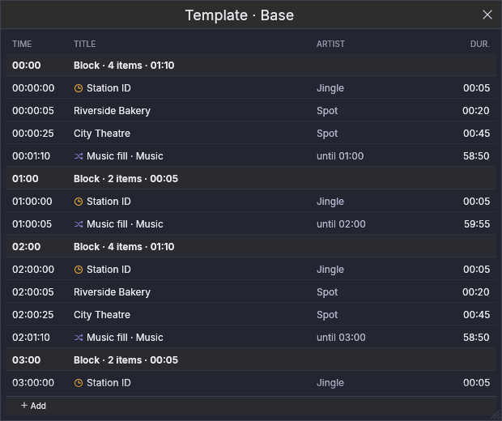
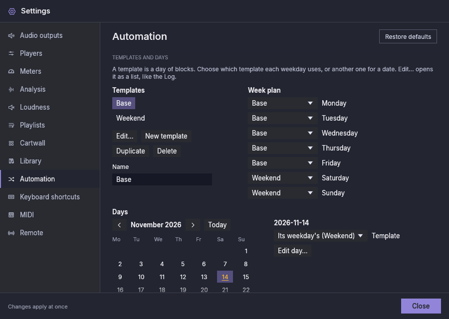

# Automatisering

Automatisering houdt het station on air wanneer er niemand in de studio is.
Deze versie heeft de **muziekvuller**, een speler die zelf muziek kiest, op
grond van regels die je instelt, en die nooit stopt bij gebrek aan een lijst,
en de kolom **Programmering**, die de getimede blokken van de dag uitvoert, met
de editor waarin je ze maakt.
De spelers die je al gebruikt (P1 … Pn) blijven ongemoeid: ze blijven van jou,
voor shows die je voorbereidt en live afspeelt.

## De kolom Programmering {#the-schedule-column}

De kolom **Programmering** speelt de **blokken** van de dag af: groepen items
met een starttijd (een uurmelding, spots, een programma). Toon hem met de tegel
**Programmering** in de bovenbalk, zoals je een speler toont.

Zijn lijst is de programmering, gegroepeerd per blok: de starttijd van elk
blok, dan zijn items. Hij toont vandaag, het laatste blok van gisteren en het
eerste van morgen. Een blok dat voor één dag is gewijzigd, zegt dat. Het item
on air en het volgende worden gemarkeerd zoals bij een speler; items die al
zijn uitgezonden zijn gedimd, en een item dat niet is uitgezonden (**gemist**)
is doorgestreept. Een klok markeert een **tijdkritisch** item, dat alleen op
zijn tijd speelt.

Boven de lijst:

- **Starten** voert de programmering uit: elk blok speelt op zijn tijd, en de
  muziekvuller speelt tussen de blokken. Niets draait vanzelf: na elke start
  van de toepassing is de automatisering gestopt tot je op Starten drukt.
- **Stoppen na huidige** laat uitspelen wat on air is, en daarna speelt er
  niets meer vanzelf.
- **Actief** of **Gestopt** zegt welke van de twee.

Om te wijzigen wat hierna speelt, dubbelklik je op een item, of klik je er met
de rechtermuisknop op en kies je **Hierna spelen**; het volgt op het nummer
on air. **Terug naar de klok**, in hetzelfde menu, laat de programmering weer
op de tijd kiezen.

## De programmering bewerken {#editing-the-schedule}

**Programmering bewerken**, op de kolom Programmering, opent de editor. Hij
heeft drie tabbladen, en **Rotaties…** brengt je naar Instellingen →
Automatisering, waar rotaties worden gemaakt.

- **Sjablonen.** Een sjabloon is een dag met blokken; een nieuwe installatie
  heeft er één, "Basis", voor elke dag. Maak, dupliceer, hernoem of verwijder
  sjablonen links; de blokken van het gekozen sjabloon staan rechts. Typ de
  start van een blok als `HH:MM:SS` (een tijd die niet bestaat blijft met een
  opmerking in het veld staan, en er verandert niets). Sleep nummers uit de
  bibliotheek op een blok om ze toe te voegen; **Toevoegen uit categorie**
  voegt een item toe dat één nummer van die categorie speelt, elke keer een
  ander; **Muziek daarna** kiest de rotatie die de muziekvuller na het blok
  speelt (de standaardrotatie als er geen is gekozen). Elk item kan als
  **Tijdkritisch** worden gemarkeerd, verplaatst of verwijderd. Als de items van
  een blok langer duren dan de tijd tot het volgende blok, zegt het blok met
  hoeveel, in amber; je kunt het toch zo laten.
- **Weekplan.** Welk sjabloon elke weekdag gebruikt.

  

- **Dagen.** Kies een datum in de kalender (data met wijzigingen zijn amber).
  Een datum kan een ander sjabloon gebruiken dan dat van zijn weekdag (een
  feestdag op een donderdag kan dat van het weekend gebruiken). Zijn blokken
  kunnen alleen voor die datum worden gewijzigd: de wijziging is gemarkeerd, en
  **Terug naar het sjabloon** maakt haar ongedaan. **Niet op deze dag**
  verwijdert een blok alleen van die datum, en **Blok toevoegen op deze dag**
  voegt er een toe. Latere wijzigingen aan het sjabloon bereiken nog steeds de
  blokken die je op die datum niet hebt gewijzigd.

  

## De muziekvuller {#the-music-filler}

De muziekvuller is de kolom **Muziek**. Hij is verborgen tot je hem toont: klik
op de tegel **Muziek** links in de bovenbalk. Hij staat links van P1.

Hij ziet eruit en werkt als een speler: de grote klok, de golfvorm, de
transportknoppen, de fader en de nummerlijst. Het verschil is de lijst:

- hij **vult zichzelf** uit een **rotatie** (hieronder), altijd ongeveer een
  half uur vooruit (*vooruitkijken*, in Instellingen → Automatisering);
- hij **snoeit zichzelf**: hij bewaart de laatste 50 nummers die hij speelde en
  verwijdert oudere, zodat hij weken kan draaien;
- vóór een blok van de programmering kan hij **nummers die hij zelf koos
  verwisselen** voor andere waarvan de lengte past bij de resterende tijd (zie
  hieronder); de nummers die je zelf toevoegde worden nooit aangeraakt;
- je kunt hem nog steeds **met de hand wijzigen**: sleep nummers uit de
  bibliotheek, orden rijen opnieuw, verwijder een nummer dat je niet wilt. Een
  rij die je toevoegt is gemarkeerd met een hand en wordt nooit vervangen; een
  rij die je verwijdert telt niet als gespeeld.

Zijn uitgangen stel je in bij Instellingen → Audio-uitgangen, op de rij
**Muziek**, zoals bij elke speler. Hij heeft geen nummer, geen sneltoetsen of
MIDI-koppelingen, en bediening op afstand ziet hem niet.

Druk op **Play** om hem te starten en op **Stoppen na huidige** om het nummer
on air te laten uitspelen en te stoppen. Zoals elke speler start hij nooit
vanzelf, ook niet na een herstart.

Boven zijn lijst, waar een speler zijn playlisttabbladen heeft, toont de kolom
Muziek de **rotatie** die hij speelt. Kies daar een andere: de nummers die hij
in de wachtrij had worden vervangen, die je zelf toevoegde blijven. Wanneer de
rotatie niets kan vinden om te spelen (zijn categorieën zijn leeg, of elk
bestand ontbreekt), zegt de balk dat.

## Rotaties {#rotations}

Een **rotatie** is een korte lijst **stappen** die de vuller om de beurt
speelt, en dan weer vanaf de eerste. Elke stap noemt waar zijn nummers vandaan
komen (een categorie van de bibliotheek met haar subcategorieën, of elk nummer
van een soort) en hoeveel hij er elke keer speelt, als bereik:

| Stap | Speelt |
|---|---|
| Current hits | 2–3 |
| Station IDs | 1 |
| Gold | 0–1 |

Met een bereik komt een stationsmelding de ene keer na twee nummers en de
volgende keer na drie. Een bereik vanaf **0** laat een stap sommige beurten
overslaan: met Gold op 0–1 speelt er soms een gouden oudje na de
stationsmelding en soms niet. Het maximum is altijd minstens 1. Eén rotatie is
de **standaard**: een nieuwe installatie heeft er één, **Muziek**, die al je
muziek speelt.

Rotaties maak je in Instellingen → Automatisering:

## Hoe hij kiest {#how-it-chooses}

Binnen een stap geeft de vuller de voorkeur aan de nummers die het langst niet
zijn uitgezonden, met een beetje kans daartussen zodat de volgorde nooit een
vaste cyclus wordt. Hij houdt ook uit elkaar:

- **hetzelfde nummer:** het mag weer spelen zodra er 3 uur zijn verstreken of
  de helft van de andere nummers van zijn stap sindsdien is uitgezonden, wat
  het eerst komt;
- **dezelfde artiest:** niet binnen 30 minuten.

Alles wat on air ging telt mee, van de vuller, een speler of de cartwall;
voorbeluisteren niet. Wanneer een kleine categorie de regels niet kan
volhouden, geeft de vuller toe in plaats van te verstommen: eerst bij de
artiest, dan bij het nummer. Instellingen → Automatisering heeft alle waarden,
en is waar je rotaties maakt, hernoemt en wijzigt (zie
[Instellingen](settings.md#automation)).

Vóór een blok van de programmering kiest de vuller ook zijn laatste nummers op
lengte, zodat de muziek netjes eindigt: het nummer dat uitfaadt wanneer het
blok begint verliest hoogstens 30 seconden, en er start geen nummer dat minder
dan 45 seconden zou spelen. Als geen nummer in de rotatie allebei kan, speelt
degene die het minst verliest. Beide waarden kunnen voorlopig alleen in het
configuratiebestand worden gewijzigd (`automation.max_fade_cut_secs` en
`automation.min_song_play_secs`).

Een **Uurmelding** is een eigen nummersoort (Bibliotheek → Soort ▸ Uurmelding),
voor de identificatie van het station op het hele uur.
