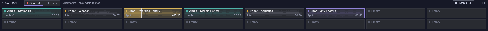

# Cartwall

De cartwall is het paneel met knoppen onder de spelers, of ernaast (zie
[Indeling](layout.md#move-and-resize-the-cartwall)). Elke knop, een
**cart**, speelt direct één geluid af: jingles, effecten, spots. Carts spelen
op hun eigen uitgangen, onafhankelijk van de spelers.

## Gebruik {#using-it}

- **Klik op een cart** om hem te starten. **Klik er nogmaals op** om hem te
  stoppen.
- **Sleep nummers uit het [bibliotheekvenster](library.md)** naar een cart om
  het eerste erin te zetten (het vervangt het bestand van de cart wanneer die
  gestopt is). Een cart die speelt of op CUE staat weigert de drop.
- **Alles stoppen** (rechts op de balk) stopt elke cart die speelt, op elke
  pagina. Het label toont hoeveel er spelen, zoals in **Alles stoppen (2)**;
  als er geen speelt, is de knop gedimd en staat er geen aantal.
- Terwijl een cart speelt, nemen zijn rand en een balk die tijdens het
  afspelen van links aangroeit de [kleur](#setting-up-carts) van de cart aan
  (rood voor een cart zonder kleur), markeert een dunne lijn over de golfvorm
  de afgespeelde rand en telt zijn tijd af. De lijn beweegt vloeiend, ook bij
  een korte cart.
- Zodra het bestand van een cart is geanalyseerd, verschijnt zijn golfvorm
  zwak achter zijn naam, zodat je een geluid dat meteen inzet kunt
  onderscheiden van een dat langzaam inzet. Ze beslaat wat de cart afspeelt,
  van zijn cue-in tot zijn cue-out.
- Carts **overlappen** standaard: een tweede starten stopt de eerste niet. Een
  cart met **Andere carts stoppen bij starten** stopt eerst elke andere cart
  die on air is, op welke pagina ook.
- Een cart met **Herhalen (loop)** begint zonder onderbreking opnieuw bij zijn
  cue-in wanneer hij het einde bereikt, totdat je hem stopt.
- **Klik met de rechtermuisknop** op een cart voor meer opties:

| Item | Actie |
|---|---|
| Voorbeluisteren op CUE | Afspelen op de CUE-uitgang van de cartwall (gedimd als de cartwall geen Cue-uitgang heeft). Op de on-air uitgang vraagt het eerst om bevestiging terwijl daar iets speelt (zie [CUE](players.md#cue-pre-listen)) |
| Stoppen | Stoppen |
| Bewerken… | In Instellingen openen |

Het menu van een lege cart heeft alleen **Bewerken…**, om zijn bestand te
kiezen.

- **Pagina’s:** de tabbladen naast **CARTWALL** wisselen van pagina. Een rode
  stip laat zien dat een cart op die pagina speelt.
- Klik op **CARTWALL** om de cartwall in te klappen of weer uit te klappen.
  Ingeklapt naast de spelers is het een smalle strook met een pijl om hem uit
  te klappen en, terwijl een cart speelt, een rode stip.
- Onder de spelers, zo hoog als zijn rijen nodig hebben, worden de knoppen
  kleiner als het venster laag is (tot een minimale hoogte) zodat alle
  ingestelde rijen passen. Zodra je de cartwall van grootte verandert, of
  naast de spelers, groeien de knoppen mee om hem te vullen, en de namen en
  tijden behouden hun grootte in het midden van elke knop. In beide gevallen
  scrolt de cartwall pas als zelfs de kleinste knoppen niet passen.

| Uiterlijk van de knop | Betekenis |
|---|---|
| Violette stip | Jingle |
| Amberkleurige stip | Effect |
| Grijze stip | Spot (reclame) |
| Gekleurde rand, tint en stip | De kleur van de cart, gekozen in Instellingen: de stip neemt de kleur aan in plaats van die van het type |
| ↻ na het type | Herhaalt |
| ✋ na het type | Stopt de andere carts bij starten |
| Bestand met een kruis / waarschuwingsteken | Het bestand ontbreekt / kan niet worden gedecodeerd; beweeg de muisaanwijzer over de cart voor de reden en het pad. Een ontbrekend bestand wordt elke 30 s opnieuw gezocht (`tuning.missing_recheck_ms`). |
| “Leeg”, gedimd | Geen bestand toegewezen |

Carts gebruiken dezelfde markers als nummers. Ze beginnen bij hun cue-in en
eindigen bij hun cue-out, die je kunt bewerken op de golfvorm van een speler
wanneer het bestand daar geladen is.

## Toetsenbord {#keyboard}

Standaard starten **F1**…**F12** cart 1–12 van de getoonde pagina, en stopt
**Ctrl+Space** alle carts (hetzelfde als **Alles stoppen**; het stopt ook een
cart die je op CUE voorbeluistert, zelfs als er geen cart speelt). Zie
[Toetsenbord](keyboard.md) om ze te wijzigen.

De sneltoets die de cartwall in- of uitklapt, doet niets zolang de cartwall in
de bovenbalk is verborgen (zie
[Indeling](layout.md#show-and-hide-panels)).

## Carts instellen {#setting-up-carts}

Ga naar **Instellingen → Cartwall**:

- **Pagina’s:** aanmaken, hernoemen, verwijderen (de laatste pagina kan niet
  worden verwijderd) en de rastergrootte instellen (rijen × kolommen). Een
  kleiner raster wordt geweigerd als het carts met een bestand zou laten
  vallen. Een grootte die je typt in het vak naast een schuifregelaar wordt
  toegepast wanneer je op Enter drukt of het vak verlaat; Escape annuleert.
- **Importeren… / Exporteren…** slaan een pagina op in een
  `.cartpage.json`-bestand en laden die weer in, bijvoorbeeld om hem tussen
  studio’s te delen. Relatieve bestandspaden worden opgelost vanaf de map van
  het bestand. Kleuren reizen mee met de pagina; een bestand van een oudere
  versie wordt zonder kleuren geïmporteerd.
- **Carts:** klik in het raster op een cart en stel dan zijn naam, bestand
  (**Kiezen…** of **Wissen**), type, **Kleur**, **Herhalen (loop)** en
  **Andere carts stoppen bij starten** in. **Kleur** biedt geen kleur en acht
  kleuren (rood, oranje, amber, groen, turquoise, blauw, violet, roze): geef
  alle spots één kleur en de zender-ID's een andere om ze in één oogopslag
  te vinden. Een lege cart behoudt zijn kleur, en het bestand van een cart
  wissen verwijdert die niet. Een cart met een bestand heeft ook
  **Uitsluiten van normalisatie** en **Trim**, de instellingen voor
  [loudness-normalisatie](loudness.md#per-track-exclude-and-trim) van zijn
  nummer, met de meting onder het label.

De eigen Main- en Cue-uitgangen van de cartwall staan in **Instellingen →
Audio-uitgangen** (de rij **Cartwall**).
