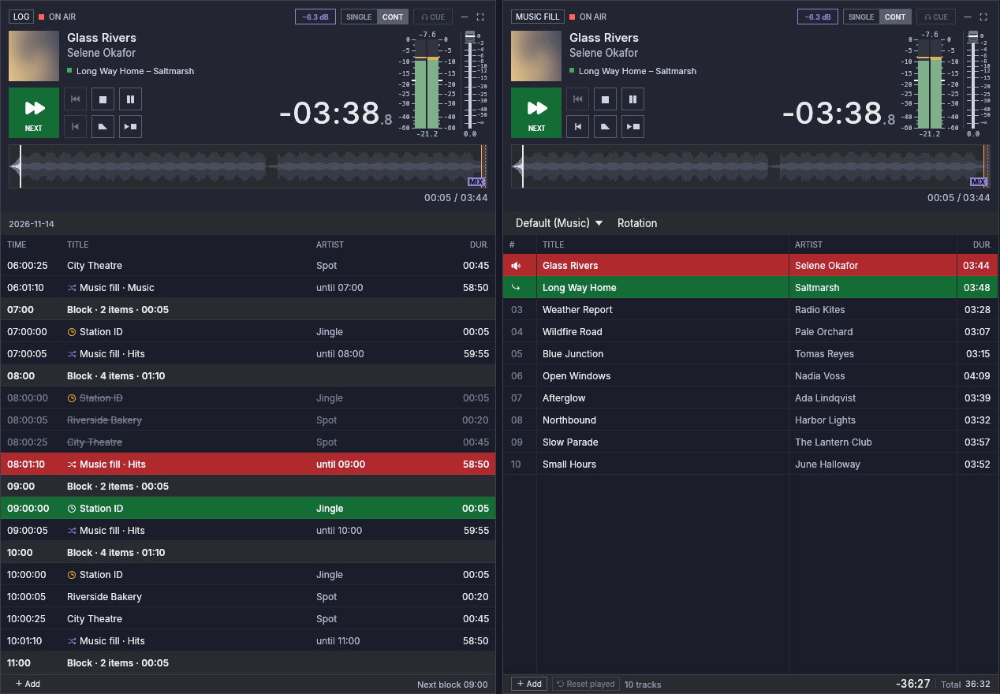
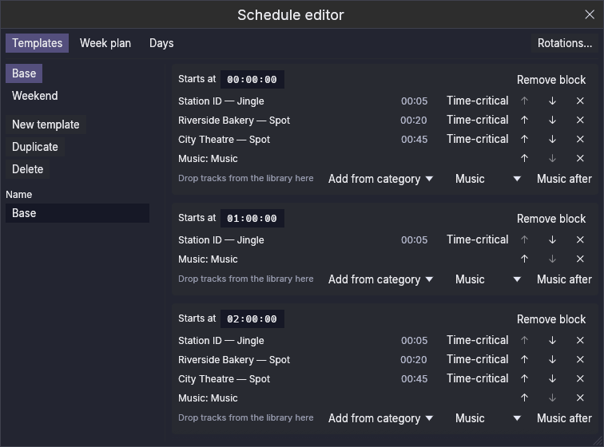
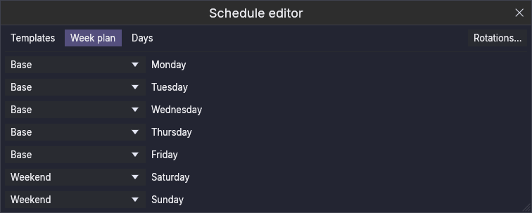
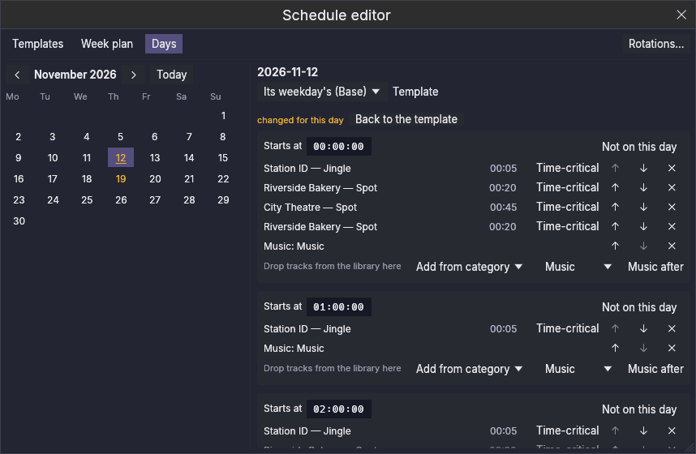
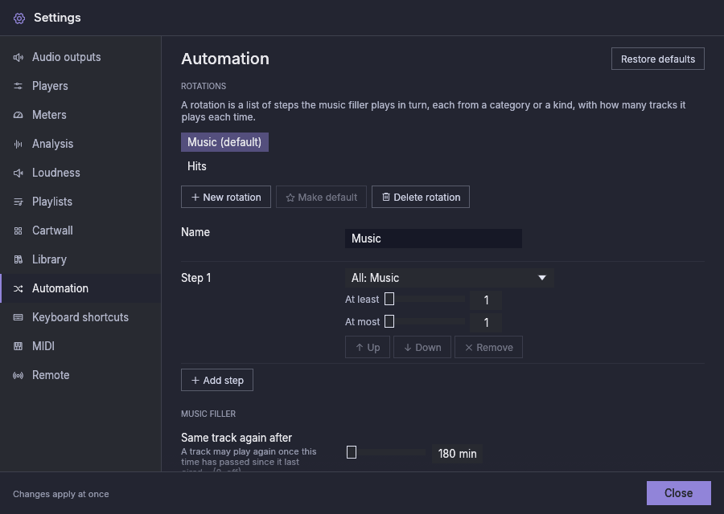

# Automatyzacja

Automatyzacja utrzymuje stację na antenie, gdy nikogo nie ma w studiu. Ta
wersja ma **wypełniacz muzyczny**, odtwarzacz, który sam wybiera muzykę
według ustawionych przez Ciebie reguł i nigdy nie staje z braku listy, oraz
kolumnę **Ramówka**, która odtwarza bloki dnia o ustalonych godzinach, wraz z
edytorem, w którym je tworzysz.
Odtwarzacze, których już używasz (P1 … Pn), pozostają nietknięte: nadal są
Twoje, do audycji, które przygotowujesz i grasz na żywo.

## Kolumna Ramówka {#the-schedule-column}

Kolumna **Ramówka** odtwarza **bloki** dnia: grupy elementów z godziną
rozpoczęcia (sygnał godzinowy, spoty, audycja). Pokaż ją kafelkiem
**Ramówka** na górnym pasku, tak jak odtwarzacz.

Jej lista to ramówka, pogrupowana według bloków: godzina rozpoczęcia każdego
bloku, potem jego elementy. Pokazuje dzisiaj, ostatni blok z wczoraj i
pierwszy z jutra. Blok zmieniony na jeden dzień mówi o tym. Element na antenie
i następny są oznaczone jak w odtwarzaczu; elementy, które już poszły na
antenę, są przyciemnione, a element, który nie poszedł (**nienadany**), jest
przekreślony. Zegar oznacza element **punktualny**, który gra tylko o swojej
porze.

Nad listą:

- **Uruchom** uruchamia ramówkę: każdy blok gra o swojej porze, a wypełniacz
  muzyczny gra między blokami. Nic nie rusza samo: po każdym uruchomieniu
  aplikacji automatyka jest zatrzymana, dopóki nie naciśniesz Uruchom.
- **Zatrzymaj po bieżącym** pozwala skończyć się temu, co jest na antenie, a
  potem nic więcej nie gra samo.
- **Działa** lub **Zatrzymana** mówi, który to stan.

Aby zmienić to, co zagra dalej, kliknij element dwukrotnie albo kliknij go
prawym przyciskiem i wybierz **Zagraj jako następne**; wchodzi po utworze na
antenie. **Wróć do zegara**, w tym samym menu, pozwala ramówce znów wybierać
według godziny.

## Edycja ramówki {#editing-the-schedule}

**Edytuj ramówkę**, w kolumnie Ramówka, otwiera edytor. Ma trzy karty, a
**Rotacje…** prowadzi do Ustawienia → Automatyzacja, gdzie tworzy się
rotacje.

- **Szablony.** Szablon to dzień bloków; nowa instalacja ma jeden, „Base”, na
  każdy dzień. Szablony tworzysz, powielasz, zmieniasz im nazwy lub usuwasz po
  lewej; bloki wybranego są po prawej. Początek bloku wpisz jako `HH:MM:SS`
  (godzina, która nie istnieje, zostaje w polu z uwagą i nic się nie zmienia).
  Przeciągnij utwory z biblioteki na blok, aby je dodać; **Dodaj z
  kategorii** dodaje element, który gra jeden utwór z tej kategorii, za każdym
  razem inny; **Muzyka potem** wybiera rotację, którą wypełniacz muzyczny gra
  po bloku (rotację domyślną, gdy żadnej nie wybrano). Każdy element można
  oznaczyć jako **Punktualny**, przesunąć lub usunąć. Gdy elementy bloku są
  dłuższe niż czas do następnego bloku, blok mówi o ile, na bursztynowo; nadal
  możesz go tak zostawić.
- **Tydzień wzorcowy.** Którego szablonu używa każdy dzień tygodnia.

  

- **Dni.** Wybierz datę w kalendarzu (daty ze zmianami są bursztynowe). Data
  może używać innego szablonu niż jej dzień tygodnia (święto w czwartek może
  używać weekendowego). Jej bloki można zmienić tylko dla tej daty: zmiana
  jest oznaczona, a **Wróć do szablonu** ją cofa. **Nie tego dnia** usuwa
  blok tylko z tej daty, a **Dodaj blok tego dnia** dodaje jeden. Późniejsze
  zmiany szablonu nadal docierają do bloków, których w tej dacie nie
  zmieniłeś.

  

## Wypełniacz muzyczny {#the-music-filler}

Wypełniacz muzyczny to kolumna **Muzyka**. Jest ukryta, dopóki jej nie
pokażesz: kliknij kafelek **Muzyka** po lewej stronie górnego paska. Leży na
lewo od P1.

Wygląda i działa jak odtwarzacz: duży zegar, przebieg, przyciski transportu,
suwak i lista utworów. Różnica to lista:

- **wypełnia się sama** z **rotacji** (niżej), zawsze mniej więcej pół godziny
  do przodu (*wyprzedzenie*, w Ustawienia → Automatyzacja);
- **przycina się sama**: zachowuje ostatnie 50 odtworzonych utworów i usuwa
  starsze, więc może działać tygodniami;
- przed blokiem ramówki może **zamienić utwory, które sam wybrał**, na inne,
  których długość pasuje do pozostałego czasu (zob. niżej); utwory, które
  dodałeś, nigdy nie są ruszane;
- nadal możesz go **zmieniać ręcznie**: przeciągaj utwory z biblioteki,
  zmieniaj kolejność wierszy, usuwaj utwór, którego nie chcesz. Wiersz, który
  dodasz, jest oznaczony dłonią i nigdy nie jest zastępowany; wiersz, który
  usuniesz, nie liczy się jako odtworzony.

Jego wyjścia ustawia się w Ustawienia → Wyjścia audio, w wierszu **Muzyka**,
jak dla każdego odtwarzacza. Nie ma numeru, skrótów klawiszowych ani
przypisań MIDI, a zdalne sterowanie go nie widzi.

Naciśnij **Play**, aby go uruchomić, i **Zatrzymaj po bieżącym**, aby
utwór na antenie się skończył i kolumna się zatrzymała. Jak każdy odtwarzacz,
nigdy nie startuje sam, nawet po ponownym uruchomieniu.

Nad jego listą, tam gdzie odtwarzacz ma karty playlist, kolumna Muzyka
pokazuje **rotację**, którą gra. Wybierz tam inną: utwory, które miała w
kolejce, są zastępowane, te dodane przez Ciebie zostają. Gdy rotacja nie
znajduje nic do odtworzenia (jej kategorie są puste albo każdy plik jest
brakujący), pasek o tym mówi.

## Rotacje {#rotations}

**Rotacja** to krótka lista **kroków**, które wypełniacz gra po kolei, a potem
znów od pierwszego. Każdy krok wskazuje, skąd pochodzą jego utwory (kategoria
biblioteki z jej podkategoriami albo każdy utwór danego rodzaju) i ile ich
gra za każdym razem, jako zakres:

| Krok | Gra |
|---|---|
| Aktualne hity | 2–3 |
| Sygnały stacji | 1 |
| Złote przeboje | 0–1 |

Przy zakresie sygnał stacji raz następuje po dwóch piosenkach, a następnym
razem po trzech. Zakres od **0** pozwala krokowi pominąć niektóre kolejki:
przy złotych przebojach 0–1 złoty przebój raz gra po sygnale stacji, a raz nie.
Maksimum to zawsze co najmniej 1. Jedna rotacja jest **domyślna**: nowa
instalacja ma jedną, **Music**, która gra całą Twoją muzykę.

Rotacje tworzy się w Ustawienia → Automatyzacja:

## Jak wybiera {#how-it-chooses}

W obrębie kroku wypełniacz preferuje utwory, które najdłużej nie szły na
antenę, z niewielką losowością między nimi, aby kolejność nigdy nie stała się
stałym cyklem. Pilnuje też odstępu:

- **ten sam utwór:** może zagrać ponownie, gdy minęły 3 godziny albo od tego
  czasu zagrała połowa pozostałych utworów jego kroku, zależnie od tego, co
  nastąpi pierwsze;
- **ten sam wykonawca:** nie w ciągu 30 minut.

Liczy się wszystko, co poszło na antenę: z wypełniacza, odtwarzacza lub
cartwalla; odsłuch wstępny się nie liczy. Gdy mała kategoria nie może
dotrzymać reguł, wypełniacz ustępuje, zamiast zamilknąć: najpierw co do
wykonawcy, potem co do utworu. Ustawienia → Automatyzacja zawiera każdą
wartość i tam tworzy się, zmienia nazwy i zmienia rotacje (zob.
[Ustawienia](settings.md#automation)).

Przed blokiem ramówki wypełniacz wybiera też swoje ostatnie utwory według ich
długości, aby muzyka kończyła się czysto: utwór, który wycisza się, gdy
zaczyna się blok, traci najwyżej 30 sekund, a nie startuje żaden utwór, który
grałby krócej niż 45 sekund. Gdy żaden utwór rotacji nie spełnia obu
warunków, gra ten, który traci najmniej. Obie wartości można na razie zmienić
tylko w pliku konfiguracji (`automation.max_fade_cut_secs` i
`automation.min_song_play_secs`).

**Sygnał godzinowy** to osobny rodzaj utworu (Biblioteka → Rodzaj ▸ Sygnał
godzinowy), przeznaczony na identyfikację stacji na początku godziny.
