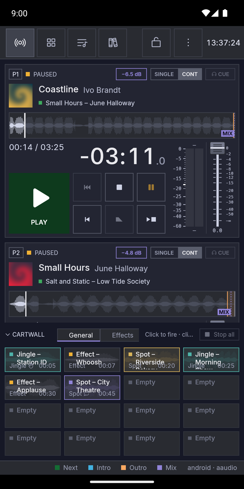
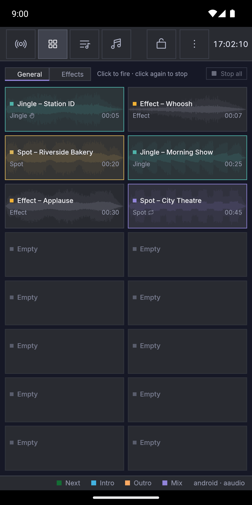
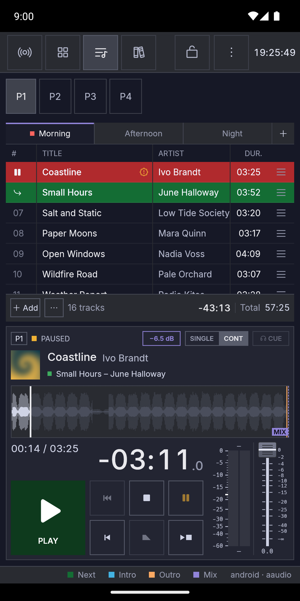
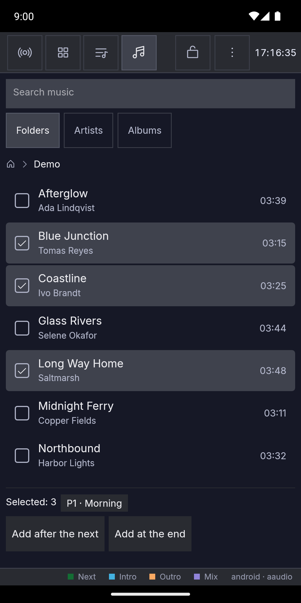
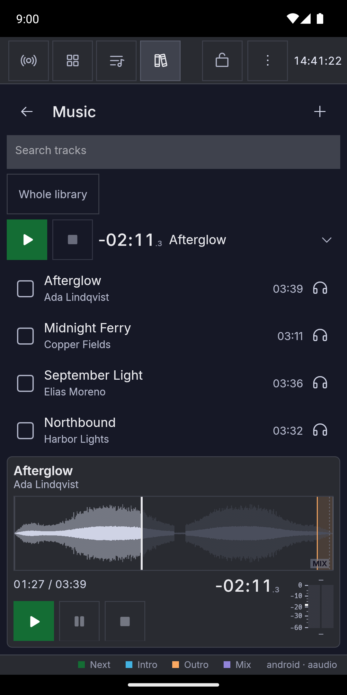

# Android

Fauste Player also runs on Android phones and tablets (Android 10 or
newer), on the same playout core as the desktop: the players, playlists,
the cartwall, markers, loudness normalization and every play rule work
the same way.

## Install

A release that carries the app has `fauste-player-<version>-android.apk`
on its **Releases** page (with its `.sha256`). Open it on the phone and
allow your browser or file manager to install apps when Android asks.
To update, install the newer APK the same way: your playlists and
settings stay. The app is not in Google Play yet.

## First start

- **Music access.** Allow access to music (and notifications, on Android
  13 and newer). Without it the music browser stays empty.
- **Playout keeps going.** While a player or a cart plays, a notification
  stays up and the audio goes on with the screen off or the app in the
  background. As on the desktop, nothing goes on air by itself after a
  start or a crash.
- **Back and closing.** Back first closes what is open (the music
  browser, Settings, About, an open player, a page of the Library tab).
  With nothing left to close, Back puts the app away while something
  sounds (a player, a cart or a CUE pre-listen) and keeps
  playing; when nothing sounds, it saves and closes the app. Swiping the app away in the app switcher does the same:
  a swipe never stops what is playing, and the app closes once it falls
  silent.
- **Other apps' sound.** When another app takes the audio, Fauste Player
  goes on playing and says so in the status bar at the bottom.

## The screen

On a **phone** the top bar has four tabs, **Live**, **Carts**,
**Playlists** and **Library**, shown as icons (the chosen one also with its
name when there is room), then the **padlock** and **⋮** (More: Settings
and About). The clock shows when there is room for it. Turned sideways,
the Playlists screen puts its player chips (P1, P2…) in the top bar, and
the status bar at the bottom shows only when it has something to say.

- *Live:* every player as a card, and the cartwall. Each card has, top
  to bottom, the player's name, status, Single/Cont and CUE; the cover,
  the title and artist and the next track; the waveform (a tap seeks);
  then the elapsed time and the track's length with the time left in
  large digits over the
  transport (Play/Next, Previous, Pause, Stop, Restart, Fade stop, Stop
  after current) with buttons a finger's size, and a slim meter with the
  volume fader (the fader's level shows under it). The time left ends
  where the buttons end, smaller for a long track. On most phones the
  meter shows its scale on its left, and on a wider one (about 406 dp
  and up) the fader shows its levels too; on a narrow phone (under about
  384 dp) neither does, and the buttons get a little smaller so they
  fit. The
  buttons work while another finger holds the fader, and a tap counts
  though the finger rolls a little or stays down a moment. Held
  upright the cards are on top, one whole card and the start of the next
  (scroll for more), and the cartwall below. Turned sideways each player
  is one row on the left (its name and status, the title, the time left,
  Play/Next, Pause and Stop; tap the row elsewhere to open the player on
  Playlists) and the cartwall is on the right. Tap **CARTWALL** in its
  header to fold it: only the header stays, at the bottom (page tabs and
  *Stop all* still work), and the players get the room; tap it again to
  unfold. The Carts tab always shows the whole cartwall. A cart page too
  wide for the space shows in fewer columns, in the same order.
- *Carts:* the shown cart page, filling the screen. Swipe sideways to
  show the next or the previous page. Held upright, a page wider than
  tall is turned (8 × 2 shows as 2 × 8), in the same order.
- *Playlists:* the chips at the top (P1, P2…) choose the player; under
  them are its playlist tabs (+ makes a new one), the track list and,
  at the bottom (on the right when the phone is on its side), the
  player's card with a larger waveform for preparing a track (it gets
  shorter when room is short, so the buttons always show). A long
  press on a row opens its menu, which also has **Move up**, **Move
  down** and **Move to another player** (the track goes right after that
  player's next track, in the playlist it shows; the track on air
  stays). Drag a row by its ≡ handle to move it. The footer has **Add**
  and, behind **⋯**, **Reset played**. A long press on the waveform sets
  a marker at that point (cue in, intro end, outro start, MIX, cue out)
  or removes one you set; markers are edited here only, not on Live.
- *Library:* the track library and the device's music (see
  [Library](#library)).

Back from another screen goes to Live; on Library it first goes back to
the list of categories (on Device music, up a folder first).

When nothing moves on the screen, the app draws it once a second (for
the clock) to spare the battery; a meter still falling after a pause or
a stop keeps it drawing until the meter is down.

**The padlock** guards against stray touches during a show. Locked (the
padlock closed and lit), the volume faders only show the level and the
waveforms neither seek nor edit markers; they look dimmed. A pinch and a
drag still zoom and move a waveform, and Play, the transport, the carts
and the playlists always work. The lock stays on after a restart and is
saved with the session, so loading another session takes that session's
lock; the remote API and MIDI are not locked.

A drag that starts on a volume fader moves it; one that starts anywhere
else scrolls, so scrolling never changes a level on air. A tap on a
waveform seeks there, a two-finger pinch on it zooms around your fingers,
a one-finger drag moves a zoomed view and **Full view** shows the whole
track again. In a playlist a finger scrolls; to move a track, use its ≡
handle or the row menu.

On a **tablet** the layout is the desktop's (see [Layout](layout.md)),
with targets made easier to hit.

A long press opens what a right click opens on the desktop: the row menu,
the header menus, a cart's menu (**Edit…** chooses an empty cart's
file). On a phone, Settings fills the screen and lists its sections; tap
one to open it, with each setting's name above its control. The arrow or
Back returns to the list, and Back again (or **Close**) closes Settings.
Editing a cart opens its section directly.

About → **Third-party licences** opens the notices of the libraries the
app is built with in a browser or HTML viewer.

## Library

On a **phone** the **Library** tab opens on a list of categories:
**All tracks**, your categories (each subcategory under its parent, with
its colour and how many tracks it holds), **Uncategorised** and **Device
music**. The library is the same one the desktop's [library
window](library.md) shows: every file added to a playlist, a cart or the
library is in it. Categories are created, renamed, recoloured and deleted
in **Settings → Library**.

**A category's tracks.** Tap a category to open its tracks (with those of
its subcategories). The arrow in its header, or Back, returns to the
categories. Another tab and back finds the list as you left it. Opening
a category from the categories starts with an empty search. Search
filters the list by title, artist, album and the other tags the library
window searches; **Whole library** searches every
category. Each row shows the title (or the file name), the artist, the
duration and the window's marks for a missing, unreadable or not yet
analysed file.

Tap rows to tick them. While something is ticked, the bar of Device music
appears at the bottom: how many, the player and playlist they go to (tap
it to choose another), **Add at the end** and **Add after the next**, as
on Device music. The tracks go in the order you ticked them, and adding
clears the ticks.
Going back to the categories clears them too.

**The row menu.** A long press on a row opens its menu: **Add to ▸** (a
player's playlist, at the end), **Pre-listen**, **Move to category ▸**,
**Re-analyse** and **Remove from library**, which asks as on the desktop
(see [Removing tracks](library.md#removing-tracks)). While rows are
ticked, a long press on another row ticks it too and the menu acts on
every ticked row, in the order you ticked them; **Pre-listen** is then
not offered. The ticks stay after the menu's action.

**Pre-listen.** The 🎧 at a row's right plays its track from its cue-in
on the library's pre-listen output; the 🎧 of another row switches to
that track. A slim strip over the list shows the title, the time left,
**Pause**/**Play** and **Stop** while it plays (or is paused), and a
hint otherwise: it always keeps its place, so the rows do not move when a
pre-listen starts or stops. The 🎧
is dimmed when the file is missing or cannot be played.

**The pre-listen card.** Tap the strip (away from its buttons) to open
the card under the list, with the track's waveform as on a player's card
in Playlists; the arrow at the strip's right shows whether it is open.
Tap the strip again, or press Back, to close it; the pre-listen goes on.
The arrow in the list's header goes back to the categories at once and
leaves the card open for the next list.
On the card:

- a tap on the waveform jumps there, or, while stopped, sets where
  **Play** starts;
- a long press sets a marker at that point (cue in, intro end, outro
  start, MIX, cue out) or removes one you set. Markers belong to the
  track, so the change shows in every playlist and on the desktop;
- a pinch zooms, a drag moves a zoomed view and **Full view** shows the
  whole track again;
- under the waveform are the times, **Play**, **Pause**, **Stop** and the
  meter.

The list stays above the card (on the left with the phone on its side),
so the 🎧 of another row still switches the card to that track. The
padlock stops the waveform's jumps and marker changes, as on the
players.
The preview stops when its track leaves the library and when you leave
the Library tab (for another tab, or by Back); on the categories or on
Device music it goes on, but its strip shows only on the track list.

Unlike the desktop, Android (a phone or a tablet) plays the library's
pre-listen on the default output when no output is chosen for it: in
**Settings → Audio outputs → Library** the empty choice reads *System default*, and its
**Test Cue** plays there. Choose another output there (wired headphones,
for example) to pre-listen away from the air. The default output is
usually also the players' and the cartwall's, so the pre-listen may be
heard on air: while something plays on that output, the 🎧 asks first
(**Pre-listen anyway** or **Cancel**), and a pre-listen you did not
confirm stops when something starts there, as a player's CUE does (see
[CUE (pre-listen)](players.md#cue-pre-listen)).

**Adding device music to a category.** The **＋** in a track list's
header opens Device music for that category. Its bar then has only **Add
to &lt;category&gt;** (**Add to Uncategorised** from *All tracks* or
*Uncategorised*), which adds the ticked files to the library in that
category and returns to the list; a file already in the library joins it
if it has no category and keeps the one it has otherwise, as on the
desktop. Device music keeps its ticks between visits,
so files ticked on an earlier visit are added too: check the count on the
bar first. **Back to the list**, at the top, or Back returns to the list
without adding. Device music opened from the categories has **Back to the
categories** at the top instead.

**A category's device folder.** A category can take its files from a
folder of the device's music. In its menu (a long press on it in
**Settings → Library**, or in the library window on a tablet), **Use a
device folder…** opens Device music to choose the folder (**Use this
folder**); the category's menu then names it, above its folder items. Nothing watches the folder: when
you have copied new music there, tap the **↻** in the category's track
list header (or **Re-read device folder** in its menu). Every file Device
music lists in the folder and its subfolders is added to the category,
with the rules above (a file already in another category keeps it), and a
notice says how many files were read. Files that left the folder stay in
the library, marked missing, and come back to normal when they return to
it (when Device music lists nothing, for example without permission,
nothing is marked). **Change device folder…** and **Forget
device folder** are in the same menu; one folder belongs to one category.

### Device music

**Device music** shows the device's audio files by **Folders** (with the
path above the list; tap a part of it to go back up), **Artists** or
**Albums**, and a search over title, artist, album and file name. Each
row shows the title, the artist and the duration; tap rows to tick them.
While something is ticked, a bar at the bottom shows how many, the player
and playlist they go to (tap it to choose another), **Add at the end**
and, when that player's next track is in that playlist, **Add after the
next**. The tracks go in the order you ticked them. A device file has no
pre-listen.

**Add** in a playlist footer, a cart's file and Settings → Playlists →
Music folder open Device music on a phone (on a tablet, the **music
browser** window, by folder). Tick files and tap **Add**, tap one file for
a cart, or **Use this folder**; **Cancel** or Back goes back to where you
were. Copy music to the device (for example to its *Music* folder) to see it
there. Fauste Player only reads your music: tags and covers are not
written, and playlists and cart pages are not imported or exported on
Android yet.

On a **tablet** the library is the desktop's [library
window](library.md), opened from the top bar.

## Outputs

Settings → Audio outputs lists the phone's outputs by kind: the speaker,
wired headphones, a USB interface, a Bluetooth speaker ("JBL Flip
(Bluetooth)"). Each player, the cartwall and their CUE pick one, as on the
desktop, and so does the library's pre-listen (see [Library](#library)).
A Bluetooth speaker that is turned off and on again is found
again by its route; while it is away its players behave as with a missing
device on the desktop. Whether two outputs can sound at the same time
depends on the phone.

## Not on Android

MIDI control surfaces, remote control, tag and cover editing, and
playlist and cart page files are desktop features for now. A keyboard
plugged into a tablet works as on the desktop (see [Keyboard](keyboard.md)).
