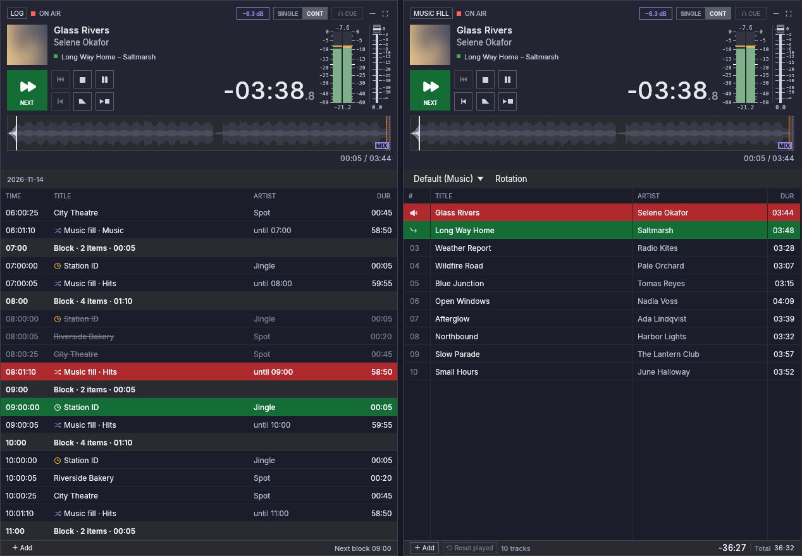

# Automation

Automation keeps the station on air when nobody is in the studio. This
version has the **music fill**, a player that chooses music by itself,
from rules you set, and never stops for lack of a list, and the
**Log** column, which runs the day's timed blocks, with the editor
where you make them.
The players you already use (P1 … Pn) are untouched: they stay yours for
shows you prepare and play live.

## The Log column

The **Log** column plays the day's **blocks**: groups of items with a
start time (an hourly ID, spots, a programme). Show it from the
**Log** tile on the top bar, as you show a player.

Its list is the schedule, grouped by block: each block's start time, then
its items. It shows today, the last block of yesterday and the first of
tomorrow. A block changed for one day says so. The item on air and the
next one are marked as on a player; items that already aired are dimmed,
and an item that did not air (**missed**) is struck through. A clock
marks a **hard start** item, which plays only at its time.

The Log column has a player's header and buttons, and they work as on a
player:

- **Play** plays the item marked next and runs automation: each block
  then plays at its time, and the music fill plays between blocks. When
  next was chosen by the clock and its block starts later, the music
  plays until then. Nothing runs by itself: after every start of the
  application, automation is stopped until you press Play.
- **Pause**, **Stop** and **Fade stop** act on what is on air for the Log
  (its item, or the music fill's song between blocks) and stop
  automation. Play after Pause goes on from where it was.
- **Stop at end** lets what is on air end, and then automation stops. If
  the music is playing and a block's time comes first, the block starts
  on time and automation stops after its first item.
- **SINGLE** makes the Log manual: Play plays the next item, and it stops
  after it; no block starts by itself.

While the music fill plays between blocks, the Log's header shows its
song.

When automation stops, next stays on the item below the one that played,
and Play plays it, whatever the time: you choose. To change what plays
next, double-click an item, or right-click it and choose **Play next**.
**Back to the clock**, in the same menu, sets next to what the time says.

## Editing the schedule

**Edit log**, on the Log column, opens the editor. It has three
tabs, and **Rotations…** takes you to Settings → Automation, where
rotations are made.

- **Templates.** A template is a day of blocks; a new installation has
  one, "Base", for every day. Make, duplicate, rename or delete templates
  on the left; the chosen one's blocks are on the right. Type a block's
  start as `HH:MM:SS` (a time that does not exist is kept in the field
  with a note, and nothing changes). Drag tracks from the library onto a
  block to add them; **Add category track** adds an item that plays one
  track of that category, a different one each time; **Then music fill**
  chooses the rotation the music fill plays after the block (the
  default rotation when none is chosen). Each item can be marked
  **Hard start**, moved or removed. When a block's items are longer
  than the time to the next block, the block says by how much, in amber;
  you can still keep it so.
- **Week plan.** Which template each weekday uses.

  

- **Days.** Pick a date on the calendar (dates with changes are amber).
  A date can use another template than its weekday's (a holiday on a
  Thursday can use the weekend's). Its blocks can be changed for that date
  only: the change is marked, and **Back to the template** undoes it.
  **Not on this day** removes a block from that date alone, and **Add
  block on this day** adds one. Later changes to the template still reach
  the blocks you did not change on that date.

  

## The music fill

The music fill is the **Music fill** column. It is hidden until you show it:
click the **Music fill** tile on the left of the top bar. It sits left of P1.

It looks and works like a player: the big clock, the waveform, the
transport buttons, the fader and the track list. The difference is the
list:

- it **fills itself** from a **rotation** (below), always about half an
  hour ahead (*look-ahead*, in Settings → Automation);
- it **trims itself**: it keeps the last 50 tracks it played and removes
  older ones, so it can run for weeks;
- before a block of the schedule it may **swap songs it chose itself**
  for others whose length fits the time left (see below); the songs you
  added are never touched;
- you can still **change it by hand**: drag tracks from the library,
  reorder rows, remove a song you do not want. A row you add is marked
  with a hand and is never replaced; a row you remove does not count as
  played.

Its outputs are set in Settings → Audio outputs, on the **Music fill** row, as
for any player. It has no number, no keyboard shortcuts or MIDI bindings,
and remote control does not see it.

Press **Play** to start it and **Stop at end** to let the song on air
end and stop. Like every player, it never starts by itself, not even after
a restart. While it plays for the Log between blocks, stopping or pausing
it stops automation too, and its Stop at end stops automation when the
song ends; if a block's time comes first, the block plays and the mark is
cleared.

Above its list, where a player has its playlist tabs, the Music fill column
shows the **rotation** it plays. Choose another one there: the songs it had
queued are replaced, the ones you added stay. When the rotation can find
nothing to play (its categories are empty, or every file is missing), the
bar says so.

## Rotations

A **rotation** is a short list of **steps** the music fill plays in turn, then
again from the first. Each step names where its tracks come from (a
category of the library with its subcategories, or every track of a kind)
and how many it plays each time, as a range:

| Step | Plays |
|---|---|
| Current hits | 2–3 |
| Station IDs | 1 |
| Gold | 0–1 |

With a range, a station ID comes after two songs one time and after three
the next. A range from **0** lets a step sit out some turns: with Gold at
0–1, a gold song plays after the station ID some times and not others.
The most is always at least 1. One rotation is the **default**: a new
installation has one, **Music**, which plays all your music.

Rotations are made in Settings → Automation:

## How it chooses

Within a step, the music fill prefers the tracks that have gone longest
without airing, with a little chance among them so the order never becomes
a fixed cycle. It also keeps apart:

- **the same track:** it may play again once 3 hours have passed or half
  of the other tracks of its step have aired since, whichever comes first;
- **the same artist:** not within 30 minutes.

Everything that went on air counts, from the music fill, a player or the
cartwall; pre-listening does not. When a small category cannot keep the
rules, the music fill gives way rather than fall silent: first on the artist,
then on the track. Settings → Automation has every value, and is where
you make, rename and change rotations (see
[Settings](settings.md#automation)).

Before a block of the schedule, the music fill also chooses its last songs by
their length, so the music ends cleanly: the song that fades out when the
block starts loses at most 30 seconds, and no song starts that would play
for less than 45 seconds. When no song in the rotation can do both, the
one that loses least plays. Both values can be changed for now only in the
configuration file (`automation.max_fade_cut_secs` and
`automation.min_song_play_secs`).

An **Hourly ID** is a track kind of its own (Library → Kind ▸ Hourly ID),
for the station's identification at the top of the hour.
