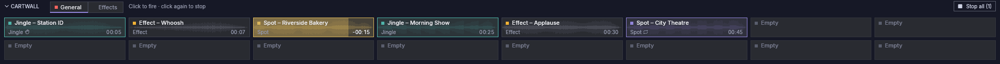

# Cartwall

The cartwall is the panel of buttons under the players, or beside them (see
[Layout](layout.md#move-and-resize-the-cartwall)). Each button, a
**cart**, plays one sound instantly: jingles, effects, spots. Carts play on
their own outputs, independently of the players.

## Using it

- **Click a cart** to fire it. **Click it again** to stop it.
- **Stop all** (right end of the bar) stops every cart that is playing, on
  every page. Its label shows how many are playing, as in **Stop all (2)**;
  with none playing it is dimmed and shows no count.
- While a cart plays, its border and a bar that shrinks as it plays take
  the cart's [colour](#setting-up-carts) (red for a cart without one), and
  its time counts down.
- Once a cart's file has been analysed, its waveform shows faintly behind
  its name, so you can tell a sound that hits at once from one that fades
  in. It covers what the cart plays, from its cue-in to its cue-out.
- Carts **overlap** by default: firing a second one does not stop the first.
  A cart set to **Stop other carts when fired** stops every other cart on air
  first, on any page.
- A cart set to **Loop** starts again from its cue-in when it reaches its end,
  without a gap, until you stop it.
- **Right-click** a cart for more options:

| Item | Action |
|---|---|
| Pre-listen on CUE | Play it on the cartwall's CUE output (dimmed when the cartwall has no Cue output). On the on-air output it asks first while something plays there (see [CUE](players.md#cue-pre-listen)) |
| Stop | Stop it |
| Edit… | Open it in Settings |

An empty cart's menu has **Edit…** only, to choose its file.

- **Pages:** the tabs next to **CARTWALL** switch pages. A red dot shows
  that a cart on that page is playing.
- Click **CARTWALL** to collapse the cartwall or expand it again. Collapsed
  beside the players it is a narrow strip with an arrow to expand it and,
  while a cart plays, a red dot.
- Under the players, as tall as its rows need, the buttons shrink when the
  window is short (down to a minimum height) so that all the configured
  rows fit. Once you resize the cartwall, or beside the players, the
  buttons grow to fill it, and the names and times keep their size in the
  middle of each button. Either way the cartwall scrolls only when even the
  smallest buttons do not fit.

| Button look | Meaning |
|---|---|
| Violet dot | Jingle |
| Amber dot | Effect |
| Grey dot | Spot (commercial) |
| Coloured border, tint and dot | The cart's colour, chosen in Settings: the dot takes the colour instead of the type's |
| ↻ after the type | Loops |
| ✋ after the type | Stops the other carts when fired |
| File with a cross / warning sign | The file is missing / cannot be decoded; hover the cart for the reason and the path. A missing file is looked for again every 30 s (`tuning.missing_recheck_ms`). |
| "Empty", dimmed | No file assigned |

Carts use the same markers as tracks. They start at their cue-in and end at
their cue-out, which you can edit on a player's waveform when the file is
loaded there.

## Keyboard

By default **F1**…**F12** fire carts 1–12 of the page shown, and
**Ctrl+Space** stops every cart (the same as **Stop all**; it also stops a
cart you are pre-listening on CUE, even when no cart is playing). See
[Keyboard](keyboard.md) to change them.

The shortcut that collapses or expands the cartwall does nothing while the
cartwall is hidden from the top bar (see
[Layout](layout.md#show-and-hide-panels)).

## Setting up carts

Go to **Settings → Cartwall**:

- **Pages:** create, rename, delete (the last page cannot be deleted), and set
  the grid size (rows × columns). A smaller grid is refused if it would drop
  carts that have a file. A size typed into the box next to a slider applies
  when you press Enter or leave the box; Escape cancels it.
- **Import… / Export…** save a page to a `.cartpage.json` file and load it
  back, for example to share it between studios. Relative file paths are
  resolved against the file's folder. Colours travel with the page; a file
  from an older version imports without them.
- **Carts:** click a cart in the grid, then set its name, file (**Choose…**
  or **Clear**), type, **Colour**, **Loop** and **Stop other carts when
  fired**. **Colour** offers no colour and eight colours (red, orange,
  amber, green, teal, blue, violet, pink): give all the spots one colour
  and the station IDs another to find them at a glance. An empty cart
  keeps its colour, and clearing a cart's file does not remove it. A cart
  with a file also has **Exclude from normalization** and **Trim**, its
  track's [loudness normalization](loudness.md#per-track-exclude-and-trim)
  settings, with the measurement under the label.

The cartwall's own Main and Cue outputs are in **Settings → Audio outputs**
(the **Cartwall** row).
