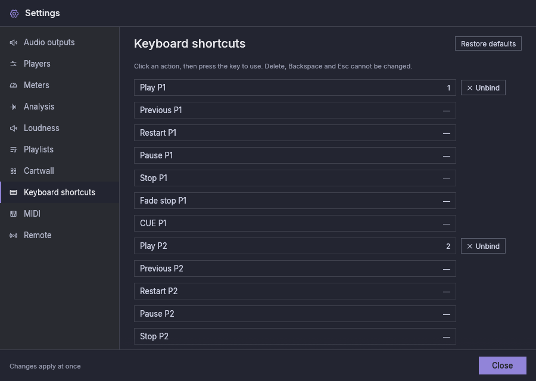

# Keyboard

| Default key | Action |
|---|---|
| `1` … `9` | Play on players 1–9 (same as their Play button) |
| `F1` … `F12` | Fire carts 1–12 of the cart page shown |
| `Ctrl+Space` | Stop every cart, and the cart CUE (the cartwall's **Stop all** button) |
| `Up` / `Down` | Move the selection through the playlist shown by the player you used last (the first shown player at start), scrolling the row into view. With nothing selected, the first press selects the player's next track, or the first track |
| `Enter` | Set the selected track as the player's next track. Press `Enter` a second time on the same track within a double click's time (the system's double-click delay) to play it, as the player's Play shortcut does. Another key, a click or a change of selection in between, or a longer wait, makes it a first `Enter` again |
| `Delete` / `Backspace` | Remove the selected track from the playlist shown (not while it is on air). Hiding a player clears its selection |
| `Esc` | Close menus and Settings; cancel the "Audio is on air" dialog; clear the selection |

- Holding a key does not repeat it: a held `1` presses Play once.
- A shortcut key does only its shortcut: if a button has the keyboard focus,
  `Space` or `Enter` bound to a shortcut does not also press that button, and
  a shortcut on `Tab` or an arrow does not move the focus.
- Shortcuts are ignored while you type in a text field, such as a playlist
  name.
- A shortcut whose button is dimmed does nothing (for example Stop on a
  stopped player). The one exception is the stop-all-carts shortcut, which
  also stops the cart CUE.

## Changing shortcuts

In **Settings → Keyboard shortcuts**, click an action and press the key (with
Ctrl, Alt, Shift or Cmd if you like). If another action already uses that
key, its name is shown. Choose **Assign** to move the key, or **Cancel**.
**Unbind** removes a shortcut and **Restore defaults** (top right of the
section) restores the table above. Available actions, for every player and cart:

- play, previous, restart, pause, stop, fade stop and CUE on a player
  (previous and restart have no default key);
- fire a cart of the page shown;
- stop every cart (the cartwall's **Stop all**);
- show or hide the cartwall;
- next or previous cart page.

`Delete`, `Backspace` and `Esc` cannot be changed. `Up`, `Down` and `Enter` on the playlist work only when no shortcut uses them and no button or slider has the keyboard focus.
