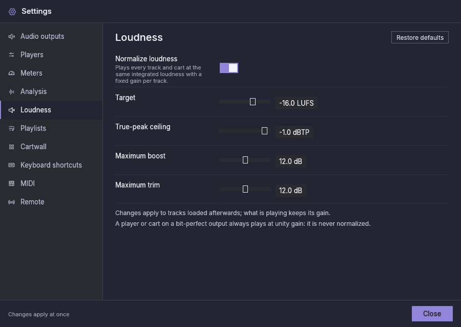

# Loudness normalization

Tracks come from many sources and are mastered at very different levels: a
recent pop single can sound twice as loud as a 1970s recording or a spoken
promo. **Loudness normalization** plays every track and cart at the same
perceived loudness, so the operator does not ride the fader from one track
to the next.

It is **on for new installations**; an existing configuration keeps its
current setting (every saved configuration already stores it). Change it in
[Settings → Loudness](settings.md#loudness).

## How it works

**A fixed gain per track.** Each track gets one gain, in dB, decided when
the track is loaded and kept until it stops. Nothing is compressed or
limited: the whole track is made louder or quieter by the same amount, so
its own dynamics stay as they were mastered. The player's fader works on
top of it, as before.

**The measurement.** The background analysis measures each file once:

- its **integrated loudness**, in LUFS: how loud the whole file sounds, as
  ITU-R BS.1770 and EBU R128 define it (quiet passages and silence are
  gated out, so a long fade-out or a pause does not lower it);
- its **true peak**, in dBTP: the highest level the signal reaches between
  samples once it is converted to analogue.

New files are measured with their first analysis. Files added before
loudness was measured are measured by a **background pass** that runs while
the normal analysis has nothing to do, without touching their markers. It
runs whether normalization is on or off, so the measurements are ready when
you turn it on. **Re-analyse** (in the playlist menu) measures a file again,
reading it even if its size and date did not change.
A file shorter than
0.4 s is never measured, and a silent file has no loudness: both play
unchanged.

**The gain.** The gain brings the measured loudness to the **Target**, plus
the track's own **Manual trim** (see [Per track](#per-track-exclude-and-trim)):

> gain = target − measured loudness + trim

A track louder than the target is turned down by as much as it needs. A
quieter track is turned up, but never by more than the **Maximum boost**,
and never so much that its true peak would go above the **True-peak
ceiling**: there is no limiter, so the ceiling is what keeps a boosted
track from clipping. A track whose true peak is already above the ceiling
is not boosted at all.

Examples, with the defaults (target −16 LUFS, ceiling −1 dBTP, maximum
boost 12 dB):

| Track | Measured | True peak | Gain |
|---|---|---|---|
| A loud modern master | −9.0 LUFS | +0.5 dBTP | −7.0 dB |
| A quieter older master | −20.0 LUFS | −10.0 dBTP | +4.0 dB |
| A quiet track with high peaks | −22.0 LUFS | −3.0 dBTP | +2.0 dB (limited by the ceiling) |
| A very quiet recording | −35.0 LUFS | −20.0 dBTP | +12.0 dB (limited by the maximum boost) |

**When the gain is decided.** When a track is loaded: prepared as a
player's next, started, loaded paused, pre-listened on CUE, or fired as a
cart. A track that is playing or paused **keeps its gain** until it stops,
through seeks and pauses. Changing the settings, a track's measurement or
its trim applies the next time the track is loaded; the next track already
waiting on a player is prepared again with the new gain, so it starts with
it.

**Pre-listen.** CUE and cart pre-listen play a track with the same gain it
gets on air, so what you hear in the headphones matches the programme.

**Meters.** The meters and their loudness readout measure after the gain,
so they show the normalized level. The meters' own **Loudness target**
(Settings → Meters) only colours the readout; it does not change any gain.

## Bit-perfect outputs

A player or cart whose output is [bit-perfect](bit-perfect.md) is **never
normalized**: it always plays at unity gain (0 dB), whatever the settings,
because any gain would change the samples the device receives. With
normalization on, its header shows an amber **0.0 dB** badge whose
tooltip says "Bit-perfect output: tracks play unaltered." The same holds
for pre-listen on a bit-perfect Cue device, while the player's Main output,
if it is not bit-perfect, still gets the gain.

A track that is already playing (or paused) when its device is turned
bit-perfect keeps the gain it started with, and the **BP** badge stays off
for it. The next track plays at 0 dB and bit-perfect. A DSD track in that
situation plays converted to PCM with its gain, never as an unchanged DSD
stream.

## The gain in the player header

While a player is playing or paused, a badge left of **BP** shows the gain
of the track on air. The badge has a border in its colour and always the same width. Hover it for the reason.

| Badge | Meaning |
|---|---|
| **+4.0 dB**, **−7.0 dB** (blue) | The track is normalized with this gain. The tooltip is the gain breakdown described below. When the settings, the measurement or the trim changed after the track was loaded, it says only that the track keeps the gain set when it was loaded, and shows that gain. |
| **0.0 dB** (amber) | The track plays unchanged. The tooltip is the same breakdown, and its **Automatic gain** line says why: it has no measurement yet (or is too short to measure), the output is bit-perfect, or the track is excluded from normalization. |
| No badge | Normalization was off when the track started, the track is silent, or the player is stopped. A bit-perfect player shows none either while normalization is off. |

The badge shows the gain the player asked for when the track started.

### The gain breakdown

Everywhere the program explains a track's gain it shows the same block of
lines, label on the left and value on the right: the gain badge's tooltip,
the loudness popup (under its controls), the cart editor and the track
tooltip of the playlist table.

| Line | Meaning |
|---|---|
| **Integrated loudness** | The measured loudness of the track, in LUFS (or "not measured"). |
| **True peak** | Its highest true peak, in dBTP (only when measured). |
| **Target** | The loudness every track is brought to (Settings → Loudness). |
| **Automatic gain** | Target minus measured loudness, before the trim and any limit, or "none" and why: excluded, bit-perfect output, normalization off, not measured yet, or silent. |
| **Manual trim** | The track's manual trim in use, when it is not 0 (with the saved value and the maximum when a lowered **Maximum manual trim** limits it). |
| **Gain wanted** and **Limited by** | Only when the true-peak ceiling or the maximum boost held the gain back: the automatic gain plus the trim (shown when there is a trim) and the limit that stopped it. |
| **Resulting gain** | Always last, under a rule and in bold: the gain the track plays with. 0.0 dB when it is not normalized. |

With normalization off, a note above the resulting gain says that nothing
changes on air and that the trim applies once it is turned on.

## Per track: exclude and trim

Some tracks should not follow the target: a station ID mastered loud on
purpose, a test tone, a track whose measurement does not match how it
sounds (speech often sounds louder than music at the same LUFS). Each track
has two settings for that:

- **Exclude from normalization:** the track always plays unchanged.
- **Manual trim:** dB added to the track's gain, from − to + the **Maximum manual trim**
  (Settings → Loudness), in 0.5 dB steps. Double-click the slider to put it
  back to 0. The trim is dimmed while the track is excluded.

The slider is a **trim**: an offset on top of the automatic gain, so it
reads 0 dB for every track you have not edited. The popup and the cart
editor therefore show the [gain breakdown](#the-gain-breakdown) with their
controls: the **Resulting gain** line follows the slider as you move it. In
the popup the controls come first and the breakdown under them, so the
slider stays where it is while the breakdown grows or shrinks.
While the track is sounding, the popup adds that a change applies from its
next load.

Where to change them:

- **On a waveform:** right-click a player's waveform (or its CUE window's)
  and choose **Loudness…**. The popup names the track and shows its
  measurement. It keeps editing that track even when the player moves on to
  another one; close it with its **×** button. It closes by itself if the
  track is removed.
- **On a playlist row:** right-click the row and choose **Loudness…**: the
  same popup, for that row's track.
- **In the cart editor:** Settings → Cartwall, click a cart: the same two
  controls are under **Stop other carts when fired**, with the measurement
  under the label.
- **Remotely:** `PUT /api/v1/tracks/<id>/loudness` (see
  [Remote control](remote-control.md)).

The settings belong to the track and are saved with it. A change applies
the next time the track is loaded, like any other change.

**The track tooltip** of the playlist table shows the track's tags and, under
a rule, the same [gain breakdown](#the-gain-breakdown), computed for the
player that list belongs to (a bit-perfect player plays it unaltered).

## Choosing the settings

- **Target.** −16 LUFS suits most music programmes on air and online.
  −23 LUFS (EBU R128) or −24 LUFS (ATSC A/85) leave more headroom, but quiet
  tracks then need larger boosts, which the ceiling and the maximum boost
  may hold back. Choose a target close to how loud your material already is.
- **True-peak ceiling.** −1 dBTP leaves room for the conversion and for
  lossy encoders downstream. Lower it when a stream encoder clips.
- **Maximum boost.** Keeps a very quiet recording (or a mostly silent one)
  from being raised into noise. 0 dB only turns loud tracks down.
- **Maximum manual trim.** How far the per-track trim may go. Lowering it limits
  trims already set without changing them, until you next edit that
  track's loudness: the edit then saves the limited trim.

## Standards behind the defaults

- **Measurement.** Integrated loudness and true peak as defined by
  ITU-R BS.1770 (K-weighting, gated).
- **Target −16 LUFS.** It follows the AES recommendations for streaming and
  online distribution. AES TD1008 (2021) supersedes the earlier AES
  TD1004.1.15-10, which recommended −16 to −20 LUFS for streaming. It is
  not a broadcast value: EBU R128 uses −23 LUFS and ATSC A/85 uses
  −24 LKFS. Use one of those when a delivery specification requires it
  (EBU R128 for European broadcast programme exchange, ATSC A/85 for US
  digital television), and −16 for a stream or online programme.
- **True-peak ceiling −1 dBTP.** The maximum true peak of EBU R128, also
  used by the AES recommendations. Lossy encoders can overshoot on decoding,
  so a stream sent through a low bit rate encoder may want a lower ceiling
  such as −2 dBTP (a common practice, not part of those standards).
- **Maximum boost and maximum trim, 12 dB.** Product choices with no
  standard behind them: enough to bring a quiet recording up and to correct
  a track by ear, not so much that noise is raised or the trim defeats the
  target.
- **Normalization is off by default,** so updating the application changes
  nothing on air until you turn it on.
- **The meter's loudness target** (Settings → Meters) is a separate setting,
  by default the R128 value of −23 LUFS. Normalization does not use it.
